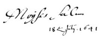
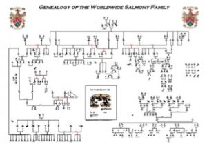
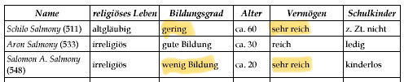
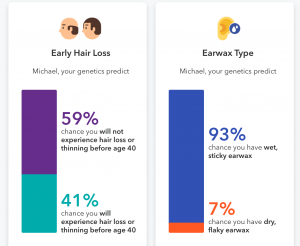
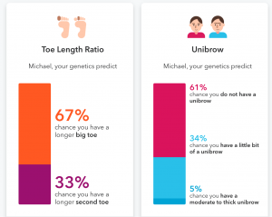
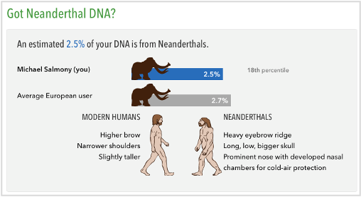
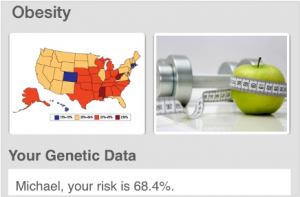
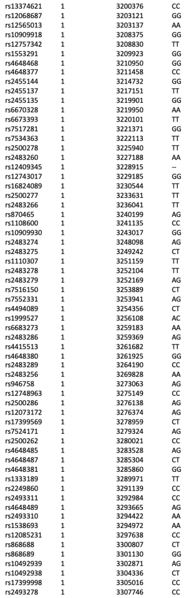

Where the name [SALMONY](/genealogy/suggestions-for-the-origin-of-the-name-salmony/) comes from

The oldest known reference to a Salmony ancestor is Moses = Moyses Salomon of Camberg 1641:

He is at the top of our worldwide Salmony family tree:

First record of ancestors adopting the name Sal(o)mony (when the Jews were not allowed to keep their old Hebrew names):

Then they had to learn to sign with their new names in 18th century:

In 1849 it is documented that the less educated and less religious they were – the richer they were:

Salmony castle in Languedoc in 1766:

Our family crest:

[See details of the family crest](/genealogy/the-coat-of-arms-of-the-salmony-family/)

How to pronounce Salmony:

<audio controls preload="none" src="/assets/uploads/2019/01/emphasis.wav">
</audio>

(and how not to)

What [rhymes](http://www.encyclopedia.com/doc/1O233-salmony.html) with Salmony

Other [namesakes](/genealogy/salmony-namesakes/) and full family tree on request

**Complete genetic code/genome** (courtesy of 23andme.com) containing traits such as:

  
  
  

Extract of my 30,000 genomes:

… full data on these are available to blood relatives only
