## My parents

<figure>

<figcaption>at Fasching</figcaption>
</figure>

my parents now sadly at [Ostfriedhof **Munich**](https://www.muenchen.de/leben/staedtische-friedhoefe/ostfriedhof), [HD – OB III – 0116](http://maps.google.com/maps?saddr=48.121306,11.594385&hl=en&ll=48.119293,11.592969&spn=0.006661,0.016512&sll=48.118735,11.593494&sspn=0.006661,0.016512&t=h&doflg=ptk&mra=mift&mrsp=0&sz=17&z=17)

<figure>
<a href="/assets/uploads/2020/10/the-journalist-georg-salmony-and-the-actress-mara-lane-in-conversation-with-the-rich-industrialist-nuss-in-the-background-the-boxer-max-schmeling-can-be-seen.jpg">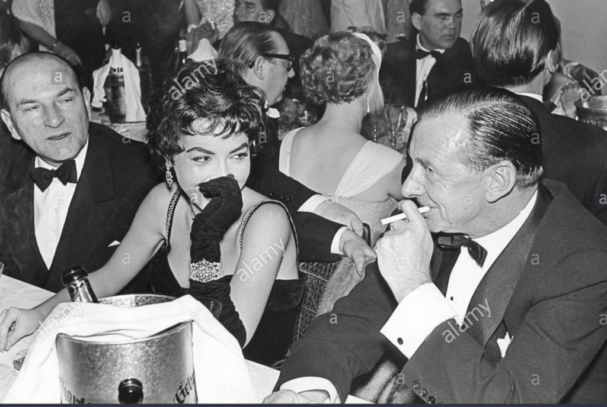</a>
<figcaption>My father (left) with actress Mara Lane, the rich industrialist Nuss and boxer Max Schmeling (at back)</figcaption>
</figure>

## My father's father

<figure>

<figcaption>My father’s father Friedrich (Fritz) Salmony at age 52 (born 1866)</figcaption>
</figure>

<figure>

<figcaption>from his permit to cross France (Nase “krumm”)</figcaption>
</figure>

<figure>

<figcaption>Naturalised as an Alien (i.e. got British citizenship) in 1893 (at age 26) and swore his oath of allegiance to Queen Victoria.</figcaption>
</figure>

<figure>
<a href="/assets/uploads/2026/01/Gravestone.jpg">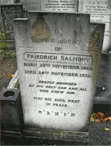</a>
<figcaption>Died just before his 66th birthday - his grave LX-19-76 at Willesden Jewish Cemetry, London</figcaption>
</figure>

Lived in 28 Landsdowne Terrace, Hemstall Rd, West Hampstead, Middlesex.

## Namesakes around the world

<figure>
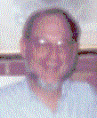
<figcaption>Steve Salmony from North Carolina, <strong>US</strong></figcaption>
</figure>

<figure>
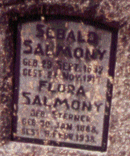
<figcaption>Steve’s Grandparents (Address: EI.1c.5/6 <strong>Mannheim</strong> Jewish Cemetry)</figcaption>
</figure>

<figure>
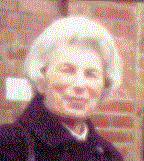
<figcaption>Doritt Froomberg (née Salmony) <strong>UK</strong></figcaption>
</figure>

<figure>

<figcaption>Finn Garð (DK) who works at IBM (as I did)</figcaption>
</figure>

<figure>
<a href="/assets/uploads/2020/10/2B8175E9-2493-47C1-9C57-D9E57F9E0720.jpeg">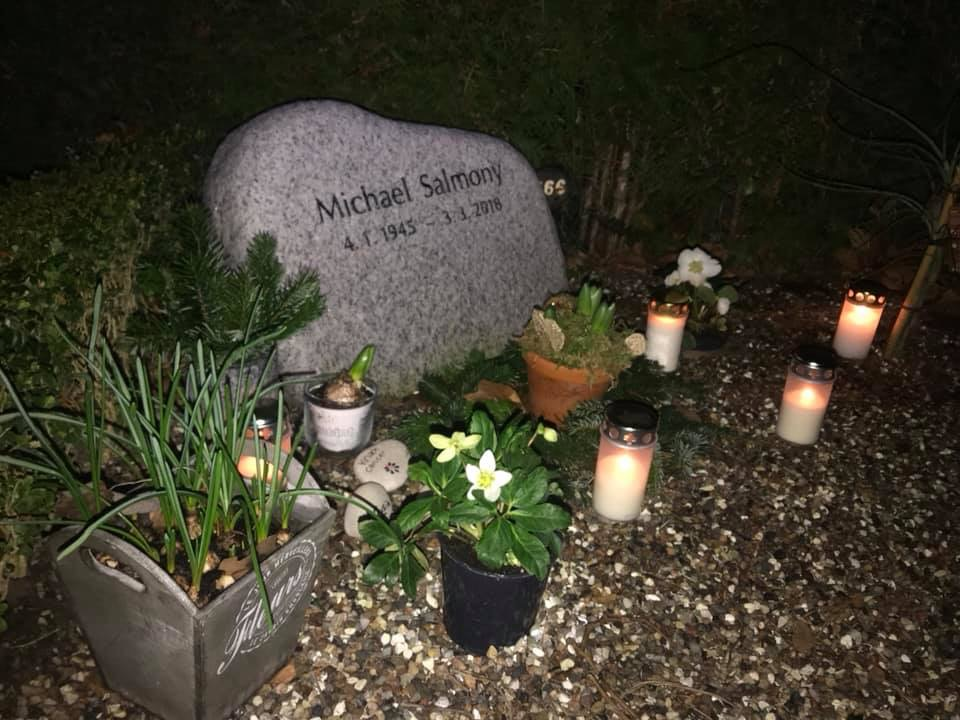</a>
</figure>

**Danish** Michael Salmony – sadly deceased, rather disconcerting to see a grave with one’s own name on it.  
Michael was a lovely man who traced [all the Salmonys in Denmark](/assets/uploads/2026/09/dktree.xls) back to the **Faroe islands**

## Switzerland

<figure>
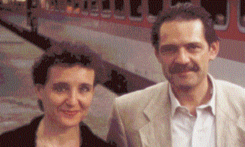
<figcaption>Michèle (who married Giovanni) and Claude Salmony (<strong>Switzerland</strong>)</figcaption>
</figure>

<figure>
<a href="/assets/uploads/2020/10/hjsalmony.jpg">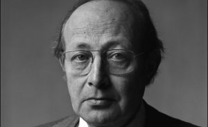</a>
<figcaption>Professor Hansjörg A. Salmony</figcaption>
</figure>

These are the offspring of [Professor Hansjörg A. Salmony](https://www.hjsalmony.com/in-celebration-of-the-100th-anniversary.html) who [published](https://www.hjsalmony.com/) about Kant, Kierkegaard and [more](https://www.google.de/search?tbo=p&tbm=bks&q=inauthor:%22Hannsj%C3%B6rg+Alfred+Salmony%22) and was colleague of Jaspers

## Rosa Salmony

<figure>
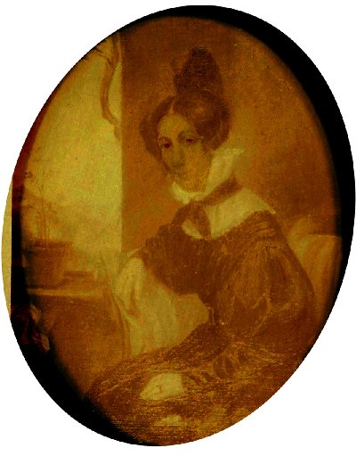
</figure>

**Rosa Salmony** (née Lichtenau) in a dress that was fashionable in 1836. Image restored from a faded Daguerrotype. The nose was never fashionable.

## Prof. Alfred Salmony

<figure>

<figcaption>Alfred Salmony in 1937</figcaption>
</figure>

<figure>

<figcaption>Alfred Salmony as young man</figcaption>
</figure>

<figure>
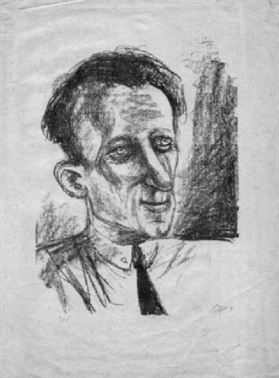
<figcaption>Alfred Salmony by OTTO DIX</figcaption>
</figure>

<figure>

<figcaption>Alfred Salmony at age 68 by Imogen Cunningham</figcaption>
</figure>

<figure>

</figure>

The famous [**Prof. Alfred Salmony**](https://de.wikipedia.org/wiki/Alfred_Salmony#)  
(**Germany, US, Austria, Soviet Union, Caucasus, China, Far East, India, Near & Middle East, Korea, Japan**)  
during the war: New York University, Institute of Fine Arts  
before the war: Head of Ostasiatische Museum, Cologne  
Author of “Carved Jade of Ancient China” and much [more](https://www.amazon.com/s?i=stripbooks&rh=p_27%3AAlfred+Salmony&_encoding=UTF8&search-type=ss&ref=ntt_athr_dp_sr_1)

## Further afield

Dr. Hani Al-Salmony, Professor of Computer Science at King Saud University, **Saudi Arabia**, aka د. هاني السلامو منسق

There is a connection to the Sal Oppenheim bankers (also a Salomon) founded in Cologne

<figure>
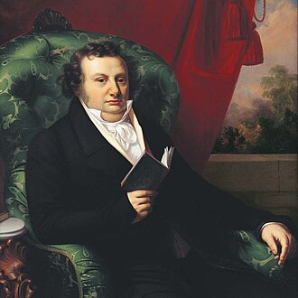
<figcaption>Salomon Oppenheim jr.</figcaption>
</figure>

## The global meeting

**Global meeting** of all known, non-dead Salmony’s of the world (Denmark, Germany, USA, Switzerland) in Geneva 1998:

<figure>

</figure>

## The Count of Salmony

“Isabel de Mayrand y el Conde de Salmony” (Isabel de Mayrand and the Count of Salmony, next to their castle in **Languedoc**), documented ca 1791 by Vicente López, painter of kings and queens and of Goya, first sketch of drawing in the [Prado](https://www.museodelprado.es/coleccion/obra-de-arte/isabel-de-mayrand-y-el-conde-de-salmony-junto-a/f5c31639-7108-4aec-9097-6c0ecfb6a356):

<figure>

</figure>

<figure>

</figure>

“*The proximity of the Castles is the reason why Ysabel and Salmony have loved each other since their early childhood and their parents resolve to look at each other*” – translated from the original castellano antiguo

and [written about](https://babel.hathitrust.org/cgi/pt/search?q1=salmony;id=njp.32101068989811;view=plaintext;seq=1;start=1;sz=10;page=search;orient=0) in “Jornadas divertidas, politicas sentencias y hechos memorables de los reyes y heroes de la antiguedad.  
Escritas por la Seneca del siglo XVII, Madama de Gomez.  
Traducidas fielmente del frances al castellano por Don Baltasar Driguet” to be found in Madrid national library

## J. Salmony's postcards

Kitsch-postcards with lurid stones painted by J. Salmony in **France**:

<figure>

</figure>

## Paul Nipkow

Not a namesake but an ancestor: Paul Nipkow who invented the Nipkow disc used to make television possible

<figure>

</figure>

<figure>

</figure>

<figure>
<a href="/assets/uploads/2020/10/Baird-with-his-invention-showing-a-large-Nipkow-disk.jpg">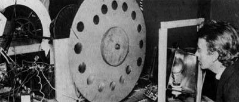</a>
<figcaption>Baird with his invention, showing a large Nipkow disk</figcaption>
</figure>

<figure>

<figcaption>early webcam</figcaption>
</figure>

## There may be more Salmony’s in the world …

<figure>

</figure>

<figure>

<figcaption>Mendoz the strangler Salmony</figcaption>
</figure>

<figure>

<figcaption>Kanzia Scarface Salmony</figcaption>
</figure>

<figure>
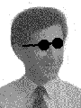
<figcaption>Michael Bitface Salmony</figcaption>
</figure>

