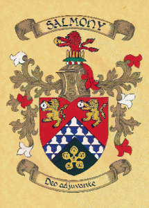
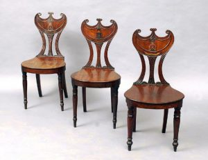
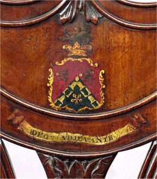

#### Arms:

Per chevron gules and sable a chevron vaire between in chief two lions rampant double-queued or each holding between the paws a plate charged with an ermine spot and in base a cinquefoil erminois.

#### Crest:

A mount vert thereon issuant out of six park pales or a demi lion double-queued gules holding between the paws a bezant charged with an ermine spot.

If you don’t undertand any of this consult a [heraldry glossary](https://web.archive.org/web/20220703212704/http://www.heraldica.org/cgi-bin/translat.pl) (clue: or doesn’t mean or, it means gold – obviously …)

#### Motto:

Deo adjuvante – With God’s assistance (courtesy of  [Linstead Heraldry](mailto:richard@linstead.fsnet.co.uk))

There is another Salmony Coat of Arms that has come down through the Swiss Salmonys.  
Needless to say it looks totally different to the above …

------------------------------------------------------------------------

Curiously some chairs with above motto (probably nothing to do with the Salmony crest) have appeared:See “Deo Adjuvante” motto and similar lower part of crest:
