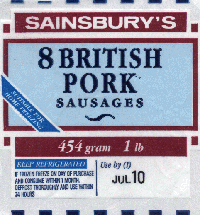
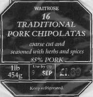

**General principle:** To prolong adolescence beyond all previously know limits.

**Serious Interests: **[Cooking](http://www.microshop.de/salshop/), Games, Douglas Adams, [Monty Python](/personal/fun-and-curious-bookmarks/), [Aardman](http://www.aardman.com/), [Muppets](https://en.wikipedia.org/wiki/Beaker_(Muppet)#/media/File:Beaker_(Muppet).jpg) (esp. Animal, Danish cook), Sleeping, [Lockpicking](http://www.lockpickguide.com/lockpicktypes.html), …

<figure>

</figure>

**Frivolous Interests: **[Art](/personal/the-culture-vulture-page/), Literature (see my [top 10 books](/personal/top-10-books/)), Food, [Travel](/personal/travels/), Computing, Bridge, [Horrifying deep sea creatures](http://www.blueworldaquariums.com/blog/2010/10/horrifying-deep-sea-creatures/), [Beautiful deep sea creatures](http://www.press.uchicago.edu/books/nouvian/nouvian_gallery.html), [Classical music](/personal/the-culture-vulture-page/#classmus), [Theatre](/my-theatre-likes/), [Film](/personal/top-10-films/), modern Dance (Pina Bausch, [Sidi Larbi Cherkaoui](https://www.youtube.com/watch?v=JNHMrSh4XB4), [Hussein Chalayan](https://www.youtube.com/watch?v=srm1ojaHQsU), etc),  [Technology & Money](/personal/why-i-like-working-with-technology/) …

**Favourite Animals:** [Octopus](https://www.nhm.ac.uk/discover/octopuses-keep-surprising-us-here-are-eight-examples-how.html) (nine brains, camouflage, walking to jet propulsion, blue blodd, colour change …), Chameleon (because of the feet, the long sticky tongue, the independently revolving eyes, and OK, because it can change colour). Also like hippos (because the ears spin when they surface), how a lizard eats, tucans, spiders and scorpions …

**Favourite Designers: **Montblanc, Porsche Design (for cars, more the 280SL from Mercedes, sorry Markus), Polo Ralph Lauren, Apple, Ferragamo ties, Interlübke

**Food:**

<figure>

<figcaption>Favourite Number 1</figcaption>
</figure>

<figure>

<figcaption>Favourite number 2</figcaption>
</figure>

You might also want to see … [What I lust for](/personal/what-i-lust-for/)

------------------------------------------------------------------------

## My Dislikes

- **Hectic behaviour:**

<figure>

</figure>

- **Food:** peppers, olives, coconuts, meat with fruit, aniseed, celery, raw carrots, fennel, radishes, cardamon (hear how I feel about these below)

<audio controls preload="none" src="/assets/uploads/2019/01/bucket.wav">
</audio>

- **Heat: **hot food (see above) and hot weather (anything beyond 25°C/80°F)
- **Worst Products/Services: **Hardware TELES, Software Intuit/Quicken, Service Compuserve
- **Sport:** all, except maybe some light walking …

## My political interests (and what I think is important):

1.  climate (& nature loss, …)
2.  inequality (& rich not paying taxes)  
    (both of the above caused by turbo-capitalism)
3.  social media (puréeing all minds, teen suicides, uprisings)  
    (which lead to rise of autocrats/populists)
4.  future of europe (leading in more than handbags, regulation)
5.  factory farming
6.  plastics
7.  online identity – the new battleground
8.  low birth rates (S Korea, Italy, Germany, US, ….)

## Fake Problems (which the media focus on):

- trans toilets
- immigration
- dangers of nuclear (compare that to the dangers of coal!), dangers of AI, …
