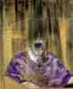
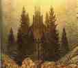
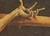
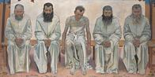
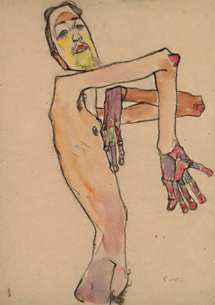
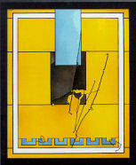
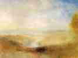

### My likes in art

<figure>

<figcaption>Melting Carpets</figcaption>
</figure>

<figure>

<figcaption>Beardsley</figcaption>
</figure>

<figure>

<figcaption>Popes (Bacon)</figcaption>
</figure>

<figure>

<figcaption>Bacon</figcaption>
</figure>

<figure>

<figcaption>Jessica Harrison</figcaption>
</figure>

<figure>

<figcaption>Breugel</figcaption>
</figure>

<figure>

<figcaption>Caravaggio</figcaption>
</figure>

<figure>

<figcaption>Dali</figcaption>
</figure>

<figure>

<figcaption>Fabergé</figcaption>
</figure>

<figure>

<figcaption>Friedrich</figcaption>
</figure>

<figure>

<figcaption>Giacometti</figcaption>
</figure>

<figure>

<figcaption>Grünewald</figcaption>
</figure>

<figure>

<figcaption>Hiorns</figcaption>
</figure>

<figure>

<figcaption>Ukiyo-e Bonkei &amp; Saikei (where Bonsai is embedded)</figcaption>
</figure>

<figure>

<figcaption>Ukiyo-e Bonkei &amp; Saikei (where Bonsai is embedded)</figcaption>
</figure>

<figure>

<figcaption>Hodler</figcaption>
</figure>

<figure>

<figcaption>Rodin</figcaption>
</figure>

<figure>

<figcaption>Mueck</figcaption>
</figure>

<figure>

<figcaption>Netsuke</figcaption>
</figure>

<figure>

<figcaption>Philine</figcaption>
</figure>

<figure>

<figcaption>Rousseau</figcaption>
</figure>

<figure>

<figcaption>Goya</figcaption>
</figure>

<figure>

<figcaption>Schiele</figcaption>
</figure>

<figure>

<figcaption>Schreiter</figcaption>
</figure>

<figure>

<figcaption>Tinquely</figcaption>
</figure>

<figure>

<figcaption>Slinkachu</figcaption>
</figure>

<figure>

<figcaption>Turner</figcaption>
</figure>

<figure>

<figcaption>Turner</figcaption>
</figure>

<figure>

<figcaption>Helmut Netwon</figcaption>
</figure>

<figure>

<figcaption>Helmut Netwon</figcaption>
</figure>

<figure>

<figcaption>Velazquez</figcaption>
</figure>

<figure>

<figcaption>John Cooper Clarke: promote the Beaudelarian principle of idleness – do nothing but still contribute to the general wellbeing of mankind</figcaption>
</figure>

<figure>

<figcaption>Yarnbombing</figcaption>
</figure>

<figure>

<figcaption>All things Japanese (Kirie, Netsuke, etc etc)</figcaption>
</figure>

For more of these see [WebMuseum: Famous Paintings exhibition](http://sunsite.unc.edu/wm/paint/) or [Art “Artchive”](https://www.artchive.com/).

## My dislikes in art

“con art” where people who sell themselves more than a new concept (with the help of an [instruction manual](/personal/the-instruction-manual-to-modern-art/)). E.g.,

<figure>

<figcaption>Beuys</figcaption>
</figure>

<figure>

<figcaption>Pollock</figcaption>
</figure>

<figure>

<figcaption>Rothko</figcaption>
</figure>

## My likes in music

“The angels play Beethoven for the greater glory of God  
– for their own enjoyment they play Mozart”

Other classical classic: Brahms, Vivaldi, Tchaikovsky, Wagner  …  
Opera really only Wagner (esp Tannhäuser), Mozart (esp Don Giovanni), Verdi (Rigoletto only) … not keen on Muscials (except 1920’s) …

To listen to these go to [Classical MIDI Archives](http://www.prs.net/midi.html)

Other classical pop: Rolling Stones, Pink Floyd, Blues (not Jazz) …

## My hates in music

The “music” played in aeroplanes and hotel lifts (e.g. Nat King Cole)

The “music” played by throwing forks into a grand piano (e.g. Stockhausen)

## Dance?

Modern Dance (Pina Bausch, Sidi Larbi Cherkaoui etc) yes ! – classical ballet – no!
