### My likes in art

<figure>
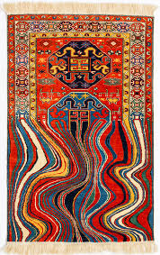
<figcaption>Melting Carpets</figcaption>
</figure>

<figure>
<a href="/assets/uploads/2020/05/beardsley.jpg">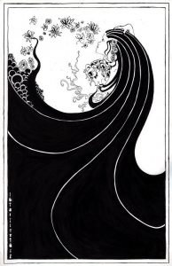</a>
</figure>

<figure>

</figure>

<figure>
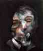
</figure>

<figure>
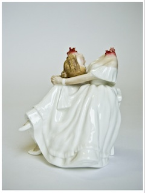
</figure>

<figure>
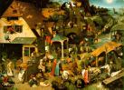
</figure>

<figure>

</figure>

<figure>
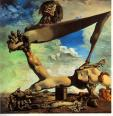
</figure>

<figure>

</figure>

<figure>

</figure>

<figure>
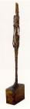
</figure>

<figure>

</figure>

<figure>

</figure>

<figure>

</figure>

<figure>
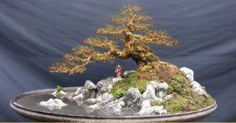
</figure>

<figure>

</figure>

<figure>

</figure>

<figure>

</figure>

<figure>

</figure>

<figure>

</figure>

<figure>
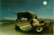
</figure>

<figure>

</figure>

<figure>

</figure>

<figure>

</figure>

<figure>
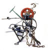
</figure>

<figure>
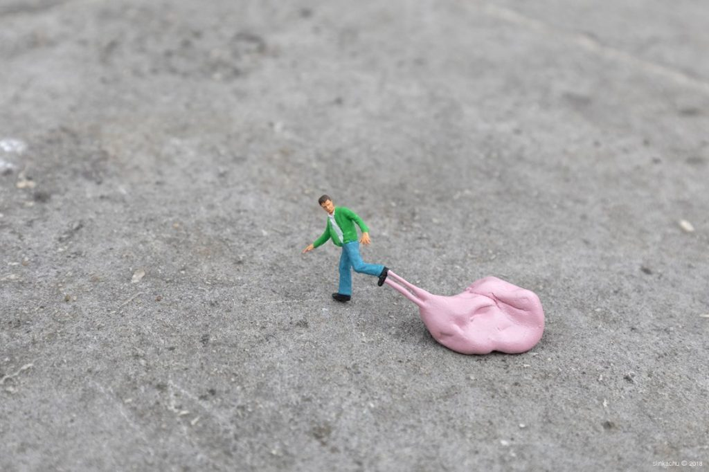
</figure>

<figure>

</figure>

<figure>

</figure>

<figure>

</figure>

<figure>

</figure>

<figure>

</figure>

<figure>

<figcaption>Yarnbombing</figcaption>
</figure>

<figure>
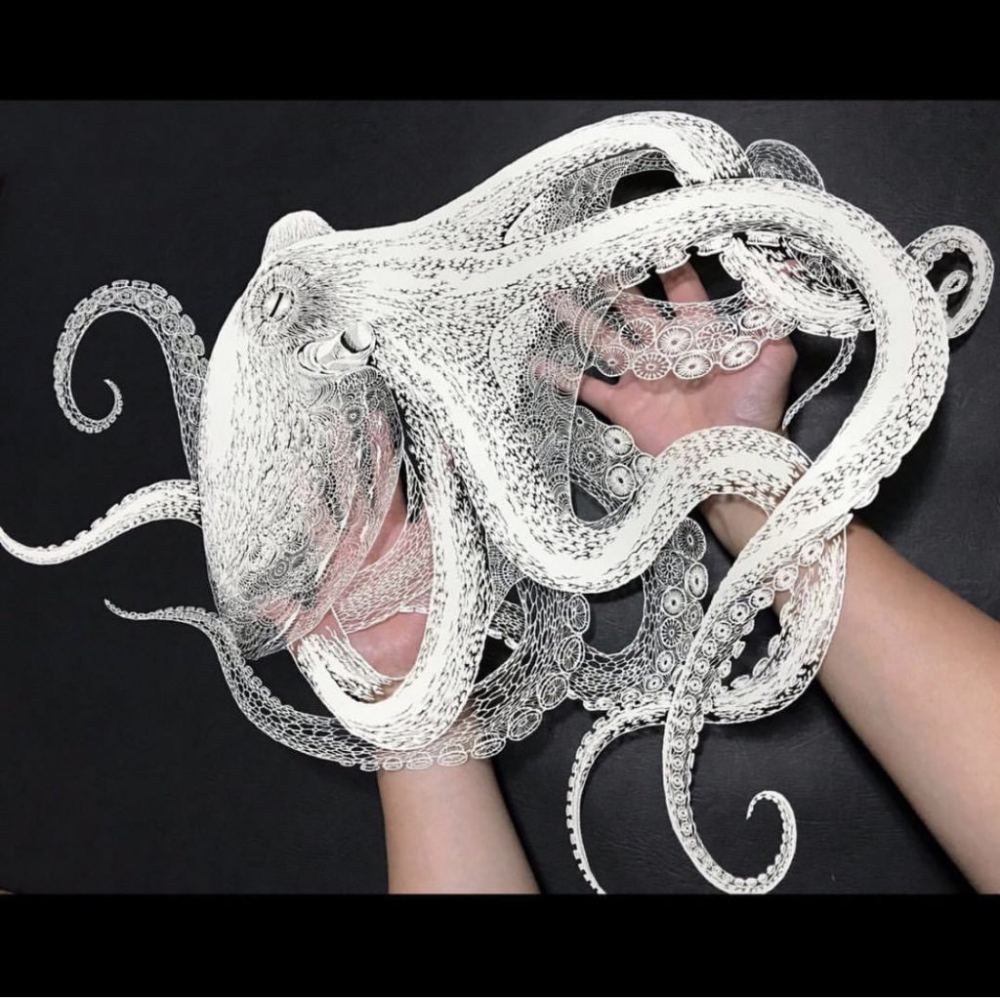
<figcaption>All things Japanese (Kirie, Netsuke, etc etc)</figcaption>
</figure>

For more of these see [WebMuseum: Famous Paintings exhibition](http://sunsite.unc.edu/wm/paint/) or [Art “Artchive”](https://www.artchive.com/).

## My dislikes in art

“con art” where people who sell themselves more than a new concept (with the help of an [instruction manual](/personal/the-instruction-manual-to-modern-art/)). E.g.,

<figure>
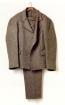
<figcaption>Beuys</figcaption>
</figure>

<figure>
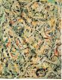
<figcaption>Pollock</figcaption>
</figure>

<figure>
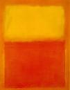
<figcaption>Rothko</figcaption>
</figure>

## My likes in music

“The angels play Beethoven for the greater glory of God  
– for their own enjoyment they play Mozart”

Other classical classic: Brahms, Vivaldi, Tchaikovsky, Wagner  …  
Opera really only Wagner (esp Tannhäuser), Mozart (esp Don Giovanni), Verdi (Rigoletto only) … not keen on Muscials (except 1920’s) …

To listen to these go to [Classical MIDI Archives](http://www.prs.net/midi.html)

Other classical pop: Rolling Stones, Pink Floyd, Blues (not Jazz) …

## My hates in music

The “music” played in aeroplanes and hotel lifts (e.g. Nat King Cole)

The “music” played by throwing forks into a grand piano (e.g. Stockhausen)

## Dance?

Modern Dance (Pina Bausch, Sidi Larbi Cherkaoui etc) yes ! – classical ballet – no!
