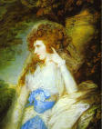
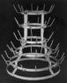

Using the Example of Marcel Duchamp (1887-1968)

Described as iconoclast, the most destructive of all artists in history … and thus maybe the prototype of the “modern” artist.

<figure>

</figure>

### Process Analysis (Classical Art)

The way artists have always worked until Duchamp’s revolution was:

|              |                                                                |                            |                              |                                                             |             |                        |                                              |                                     |                               |
|--------------|----------------------------------------------------------------|----------------------------|------------------------------|-------------------------------------------------------------|-------------|------------------------|----------------------------------------------|-------------------------------------|-------------------------------|
| Process Step | Have an **idea** or be **commis- sion**ed to produce something | **Select** materials       | **Combine** materials        | Give the work a **title** (which explains what it is about) | **Sign** it | **Promote** it         | **Exhibit** it as soon as possible           | Get the public to **appreciate** it | **Reproduce** it              |
| **Example**  | Paint Lady Marlborough                                         | Choose oils, canvas, frame | Mix colours, paint on canvas | “Lady M. in pensive mood”                                   | Sal fecit   | Publicise in newspaper | Hang in Royal Academy, Lord M.’s living room | public/critics like/dislike it      | print posters of oil painting |

<figure>

</figure>

### Process Analysis (Modern Art)

Duchamp has simply removed and changed part of the artist’s value chain:  
(Source: Duchamp’s interview with Philippe Collin about “Ready Mades” 21.6.1967)

<table style="width:100%;">
<colgroup>
<col style="width: 10%" />
<col style="width: 10%" />
<col style="width: 10%" />
<col style="width: 10%" />
<col style="width: 10%" />
<col style="width: 10%" />
<col style="width: 10%" />
<col style="width: 10%" />
<col style="width: 10%" />
<col style="width: 10%" />
</colgroup>
<tbody>
<tr class="odd">
<td><strong>Step</strong></td>
<td><strong>Idea</strong></td>
<td><strong>Select</strong></td>
<td><strong>Combine</strong></td>
<td><strong>Title</strong></td>
<td><strong>Sign</strong></td>
<td><strong>Promote</strong></td>
<td><strong>Exhibit</strong></td>
<td><strong>Appreciate</strong></td>
<td><strong>Reproduce</strong></td>
</tr>
<tr class="even">
<td></td>
<td>Random selection</td>
<td></td>
<td>Give a title that “adds another dimension”</td>
<td>Certainly – Don’t forget who to issue the cheque to !</td>
<td>YES ! 
talk about it in long woolly phrases at great length everywhere</td>
<td>Leave it (but hope that people will buy it at great price eventually)</td>
<td></td>
<td>It is already a repro- duction</td>
<td></td>
</tr>
<tr class="odd">
<td><strong>Quote</strong></td>
<td>No idea (at least none, that any 10-year-old can’t also come up with)</td>
<td>“A ready-made is a manufactured object, which – simply through the <em>choice</em> of the artist – is promoted to the level of art” (Breton)</td>
<td>There is no art: it is always choice. You don’t <em>make</em> the paints, the canvas, the frame, you just <em>choose</em> them. So why should you make the work instead of just choosing it? That is art taken to its logical conclusion.</td>
<td>Call a landscape a pharmacy to “change its axis”. The title adds verbal colour.</td>
<td>By signing it, you turn a mundane object into art.</td>
<td></td>
<td>There is a danger that something – however insignificant now – may become beautiful in 40 years</td>
<td>Indifference. Instead of choosing something you like or dislike, you choose something which has no visual interest. When you it becomes a ready-made. Renounce retinal seduction. No need to look at it – it is just “there”.</td>
<td>“A ready-made does not require reproduction since it can always be replaced with a new original”</td>
</tr>
<tr class="even">
<td><strong>Cleverness</strong></td>
<td>—</td>
<td>++</td>
<td>++</td>
<td>–</td>
<td>+++</td>
<td>–</td>
<td>+</td>
<td></td>
<td></td>
</tr>
</tbody>
</table>

Once this principle is understood, it can be applied to poetry (Dada), music (random/atonal music by Cage et al.) and other forms of “Art”.

Easy, isn’t it ?

The only thing you must never forget is the promotion. That is the only essential part of modern art. And to wear a hat, show you are different, wear a waistcoat with lots of pockets, be an “artist” – then you even get millions for some butter in a museum.

However, without such iconoclasm we would never have departed from classical art (i.e. still be painting like photography). No impressionism, no surrealism … none of the other wonderful variants of painting. So I think by examining the rules, changing and re-ordering them, they are doing something useful. This might well lead to something new, entertaining, useful and surprising – in the future.
