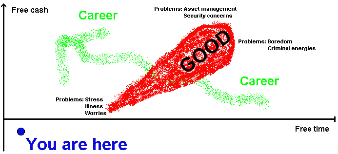

**The Strategy**

This highly complicated chart aims to show a simple concept. There is a “good” area where the amount of free time is adequate as is the amount of spare cash. This, however, is only a small area of the total possible spectrum.

Indeed most people find themselves in an area where the amount of free time is sorely inadquate – as is the amount of spending money. Other bad areas are when there is lots of spare time but maybe even less than zero free cash (unemployed and in debt), or too much money or spare time (yes, these are, I assume, problem areas too).

The thing to note is that career pressures from your boss, your wife†, society etc. tend to push you through the good zone (into stress etc.) but many people either disqualify themselves before they enter it, or – after entering it – forget about the meaning of life at work and continue into an area of heart attacks, worries and excessive stress.

But having seen this chart you will now surely never lose your peace of mind…  
† not yours or mine, of course

**The Tactic**

If you can keep your head when all about you  
Are losing theirs and blaming it on you;  
If you can trust yourself when all men doubt you,  
But make allowance for their doubting too;  
If you can wait and not be tired by waiting,  
Or, being lied about, don’t deal in lies,  
Or, being hated, don’t give way to hating,  
And yet don’t look too good, nor talk too wise;

If you can dream – and not make dreams your master;  
If you can think – and not make thoughts your aim;  
If you can meet with triumph and disaster  
And treat those two impostors just the same;  
If you can bear to hear the truth you’ve spoken  
Twisted by knaves to make a trap for fools,  
Or watch the things you gave your life to broken,  
And stoop and build ’em up with worn-out tools;

If you can make one heap of all your winnings  
And risk it on one turn of pitch-and-toss,  
And lose, and start again at your beginnings  
And never breath a word about your loss;  
If you can force your heart and nerve and sinew  
To serve your turn long after they are gone,  
And so hold on when there is nothing in you  
Except the Will which says to them: “Hold on”;

If you can talk with crowds and keep your virtue,  
Or walk with kings – nor lose the common touch;  
If neither foes nor loving friends can hurt you;  
If all men count with you, but none too much;  
If you can fill the unforgiving minute  
With sixty seconds’ worth of distance run –  
Yours is the Earth and everything that’s in it,  
And – which is more – you’ll be a Man my son!

Rudyard Kipling (1865-1936), “If”
