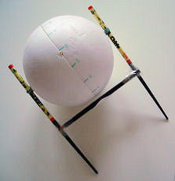
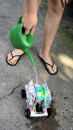
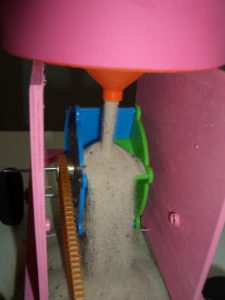
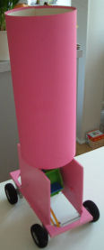

This was part of the [Explore Science](http://www.explore-science.de/) competition.

**The goal**: To make a non-electrical device that moves over 1 meter in *exactly* 15 seconds.

<figure>

<figcaption>First we tried a <strong>rubber band</strong> powered device</figcaption>
</figure>

<figure>

<figcaption>Then we tried water</figcaption>
</figure>

<figure>

<figcaption>Finally, we used sand</figcaption>
</figure>

<figure>

<figcaption>and painted the result pink!</figcaption>
</figure>

But did it work?
