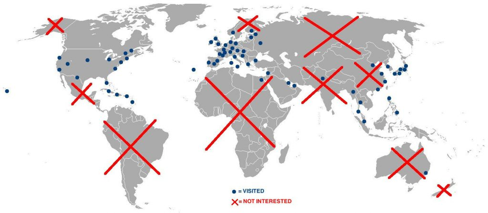
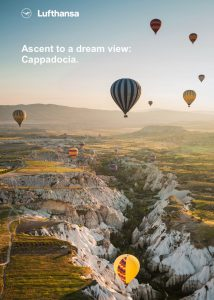
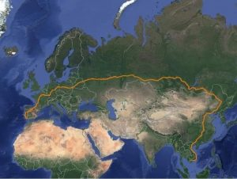
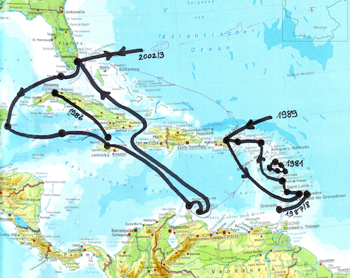
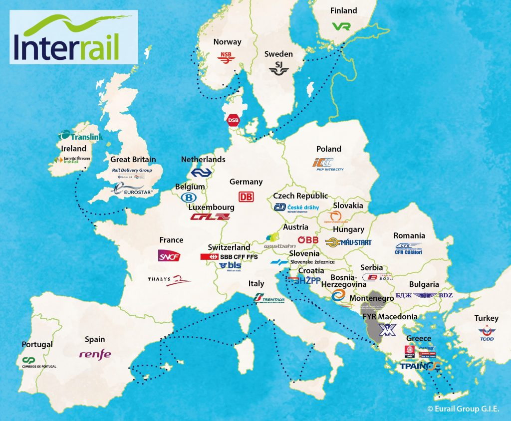
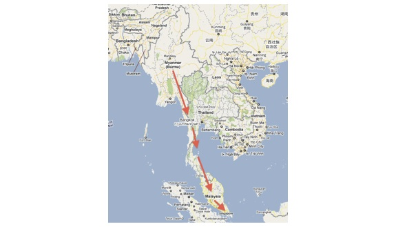
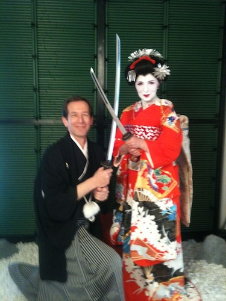
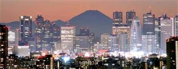
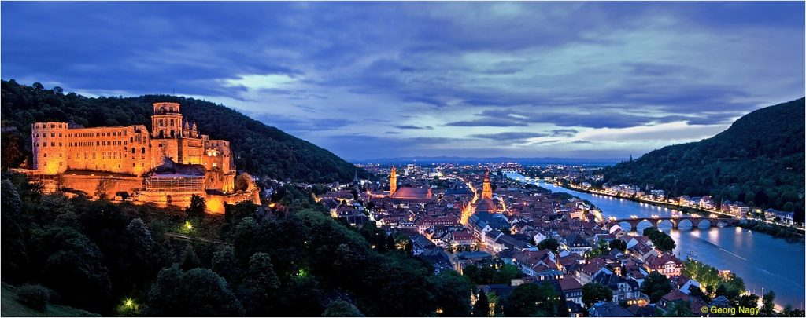

Where I’ve been and where I don’t want to go:

I still want to see:

- Arctic with blue icebergs and aurora borealis (without waiting 11 years for sunspots and weeks in the cold for clouds to disperse)
- Easter Island with Noa
- Floating in a turquoise Siwa Oasis in the Egyptian Desert
- Christmas Island when covered in red crabs
- Eat Caviar on the Caspian sea (Astrachan)
- Madagascar (150 chameleons, birds & vanilla), visit bays with katamaran
- See Bahamas & Bermudas (and wear the pink shorts)
- Canoeing through Bear glacier Resurrection bay Alaska
- Faroes?
- Dubai/Abu Dhabi (depite muggy heat but to [see](http://youtu.be/WLJc-dHnkuw) tallest building (for the moment), do 4WD/quad bike desert race, indoor ice & snow park, artificial palm and world islands, 1446 mud and new marble grand mosques, Ferrari world, tunnel under acquarium, 500m water jets, play Camel-Polo and other craziness)
- See Oman – the “best” country in the world (run by benevolent dictator)
- Revisit sea-food buffet at Mandarin Oriental in Manila
- Cap Verde islands (Caribbean without time zone), Fogo island (hotel in live volcano, turtles of boa vista, lobsters)
- Iceland (find namesakes, see northern lights, ice hotel Blue Lagoon and/or glass igloos and/or bubble hotel, live volcano, snowmobiling, geothermal swimming, dog sledding, snorkelling in fissure, phallology museum, glacier tunnel)
- Baku (the rich city in Azerbaidshan with [melting carpets](https://www.theguardian.com/artanddesign/2016/nov/13/magic-carpet-art-faig-ahmed-rugs-azerbaijan))
- Snorkel with 400 whale sharks in Mexico mid June-mid Sept
- Take a hot air balloon over the amazing rocks in Cappadocia 
- See the [underground](https://en.m.wikipedia.org/wiki/Derinkuyu_underground_city) [tunnels](https://en.m.wikipedia.org/wiki/Kaymakli_Underground_City), underground cities, fly over irocks in Goreme  in balloon
- See Vietnam and its underground Cu Chi tunnels
- Afuera aggregation near Cancun – snorkel with whales in July/August, stay at hotel where flower petals are sprinkled on your private pool every day
- Cambodia Angkor Wat temple
- Hiking in Scotland (see “Edie” film)
- [Samarkand](https://en.wikipedia.org/wiki/Samarkand) in Usbekistan & [Isfahan](https://en.wikipedia.org/wiki/Isfahan) in Iran, the capital of Persia i.e. “half of the world” under Shah Abbas the Great. Even today the city retains much of its past glory. It is famous for its Perso–Islamic architecture, grand boulevards, covered bridges, palaces, tiled mosques, and minarets
- The longest train journey in the world: 17.000km from Portugal to Mekong, only [1.428,30€](https://www.linkedin.com/posts/maxime-blondeau-%F0%9F%8C%B1-%E2%99%BE-a71b6521_train-voyage-maps-activity-6956895836903481344-T0zM/?utm_source=linkedin_share&utm_medium=ios_app) and 13 days
- Many more extensive retirement trips (in private dropbox only) such as: 4x 3-month trip (aka “one year in Japan” but with breaks) through Japan exploring all areas in all seasons

### Past major trips

#### Caribbean

<figure>

<figcaption>1981, 1987, 1989, 2002, 2014</figcaption>
</figure>

#### Rucksack

<figure>

<figcaption>1977 Interrail – UK, France, Belgium, Luxemburg, Germany, Austria, Slovenia, Yugoslavia, Greece, Italy, Switzerland</figcaption>
</figure>

------------------------------------------------------------------------

<figure>

<figcaption>1983 S. E. Asia – Russia, Burma, Thailand, Koh Samui, Malaysia, Singapore</figcaption>
</figure>

2013 – [Singapore and Hong Kong](http://salsinghong.tumblr.com/)  
2017 – [Australia (45mins) & Shanghai](https://45minaustralia.tumblr.com/)  
COVID stops all travel  
2023 – [Cruise around Britain](https://www.journiapp.com/app/j/cruising-around-britain)  
2023 – [UAE/Dubai & Saudi/Riyadh](https://www.journiapp.com/app/j/michael-saudi-arabia)  
2023 – [No-cheese tour M&P in UK](https://www.journiapp.com/app/j/cheese-tour-around-uk)  
2023 – [South Africa](https://www.journiapp.com/app/j/africa-2754305) (Cape Town & Zimbabwe)

------------------------------------------------------------------------

### Japan

See special page on my favourite: [Japan](/personal/travels/michael-salmony-on-japan/)

### Favourite places

<figure>

<figcaption>London</figcaption>
</figure>

<figure>

<figcaption>Tokyo</figcaption>
</figure>

<figure>

<figcaption>Heidelberg</figcaption>
</figure>
