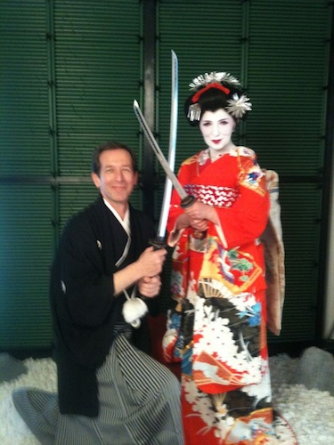
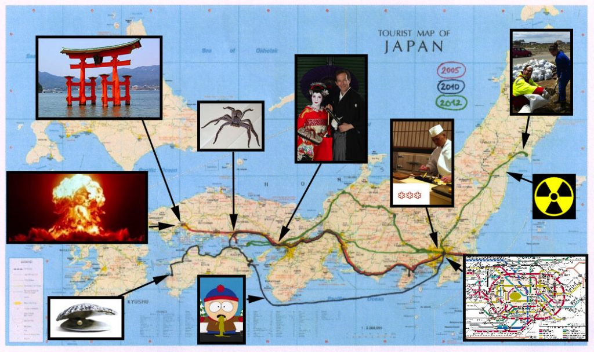
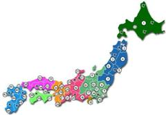
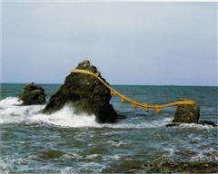
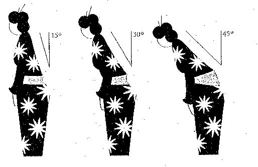

#### [Past trips to JaPan](#japtrips) [Why to Japan](#whyjap) [The Language](#japlang) [The Identity](#japidentity) [Curious facts](#japcurio) [First impressions](#japimpress) [Traditional Culture](#japcult) [Comparison Japan vs UK](#japvsuk) [Japanese books](#japbooks)

## Past trips to Japan:

[2005 Photo blog](/personal/travels/michael-salmony-on-japan/first-japan-trip-also-to-philippines-and-china/) – 1st time in Japan, also Philippines, China  
[2010 Photo blog](http://salmony.tumblr.com/) – Japan Pearl Farm, another Ryokan, …  
[2012 Photo blog](http://salmonyjapan.tumblr.com/) – 5 weeks with daughter across Japan  
[2015 Photo blog](http://sal4japan.tumblr.com/) – Japan: Kyoto, public swimming, …  
[2017 Photo blog](https://salkorjap5.tumblr.com/) – Korea (Seoul only – [why](https://www.insidejapantours.com/blog/2021/11/09/japan-and-south-korea-what-makes-them-unique/?utm_source=RedEye&utm_medium=Email&utm_campaign=IJT_News_Nov-21&utm_content=IJT_News_Nov-21_UK_B2C) Japan is better than Korea) & Japan (Tokyo only)  
[2017 (again) Photo Blog](https://tokyoonbusiness.tumblr.com/) – Tokyo on business  
[2019 Photo blog](http://japhiking.tumblr.com/) – [Kumano Kodo](https://www.komoot.com/tour/63599287) pilgrimage & southernmost [Yaeyama Islands](https://www.komoot.com/tour/64300899)  
2019 short business trip (Robot hotel) – three trips to Japan in 12 months  
2020 [Two months](https://2monthsjapan.tumblr.com/) (April,May) incl Noto, Kyushu (active volcanoes to pottery) – postponed due to Covid – as was second short business trip (Nov) for conference I organised  
2022 at last!: [Cruise](https://www.princess.com/cruise-search/details?voyageCode=M214A) around Japan in Spring (cancelled)  
Autumn 2023: long planned 2-month [two month trip](https://www.journiapp.com/app/j/two-months-in-japan) in  with my [conference](http://www.transactioninnovationforum.com/)  
August/September 2024 (the hottest on record) in Tokyo  
Oct/Nov 2025 1 month [Kyushu](https://www.journiapp.com/app/j/kyushu-japan-octnov-2025)  
[Tokyo, Kuala Lumpur, Baku](https://www.journiapp.com/app/j/tokyo-kl-baku-2026) Spring 2026  
[Singapore SFF, Tokyo](https://invite.journiapp.com/S2ew?pid=invite&c=trip_follower&deep_link_value=ul&deep_link_sub1=https%3A%2F%2Fwww.journiapp.com%2Finvite%2FFojCgfzaCAYfIYDN&af_web_dp=https%3A%2F%2Fwww.journiapp.com%2Finvite%2FFojCgfzaCAYfIYDN) Autumn 2026  
Hokkaido Winter 2026/2027

map of our further [**todos**](https://www.google.com/maps/d/edit?mid=1ygp5QDdOd7J55gt1ua7Gwo36bwU&ll=36.66186647564257%2C134.45540492500004&z=5) in Japan  

## Why to Japan ?

Q: Why go to this strange, expensive, strenuous country ?

A: Because it is both so different and so cultured  
or to put it another way It’s the most alien place with good plumbing  
– Where else can you get this combination …  
(and yes it is expensive but it will cost less than the average banker will lose you in a year – but instead leave positive memories for life)  
and because we like sushi

Because we **like**: the culture, wood prints, bamboo forests, ikebana, stone walls with moss on them, gleaming swords, striving for perfection in all things, ryokan, harakiri, gardens, lacquerware, no tipping, bonsai, [bonkei](https://fr.pinterest.com/pin/569635052875747095/) (where bonsai aer embedded in a landscape), netsuke, courtesy, respect for privacy, veneration of old age, pride in work, sense of beauty (also in everyday things), calligraphy, politeness, shinkansen, kimonos, origami, ceramics, white-gloved escalator attendants, mix of natural and artificial, kintsugi (west: when you repair something you try to make it as good as new, here you make it better! … related to wonderful concept of wabi-sabi “beauty in imperfection”), anti-americanism (understandable after Hiroshima, I suppose), gift wrapping and, of course, the food (kobe beef, sushi prepared using the principles of “ichi motsu zen shoku”- “one item, consumed entirely” i.e. use fish/veg etc. totally, and without waste and “washoku” – harmonious combination of colours, textures, flavours, cooking methods, Tokyo has 191 Michelin Stars – more than any other city etc.)

Also like the **corporate values** (refreshingly different to American):

– competition doesn’t mean earning more but serving better

– company has greater loyalty to its employees than its shareholders

– the objective is to keep the greatest number of people equally happy

Even though we **don’t like**:

Summer humid weather, 1000 earthquakes per year (= 3 per day ! but you don’t notice them – what a pity), 20 typhoons per summer, No/Kabuki theatre, tea ceremony, violence in sex, not sure about selling schoolgirls’ underwear in vending machines, denying war crimes, lack of fruit (although that’s got a lot better now), whale burgers (for research only, of course), noise/warnings, sweets/deserts/bean paste in pastry and the standard tourist fare (Disneyland, Mount Fuji, Beppu, Expo, Geisha)

## The Language

<table>
<colgroup>
<col style="width: 50%" />
<col style="width: 50%" />
</colgroup>
<tbody>
<tr class="odd">
<td>Yes/No</td>
<td>Hai/Iie</td>
</tr>
<tr class="even">
<td>Please</td>
<td>Onegai shimass</td>
</tr>
<tr class="odd">
<td>The honourable function of making tea</td>
<td>chakumi</td>
</tr>
<tr class="even">
<td>Do you speak English ?</td>
<td>Eigo o hanasemass-ka ?</td>
</tr>
<tr class="odd">
<td>O-sho-jin-gu</td>
<td>honourable uncooked food</td>
</tr>
<tr class="even">
<td>O-rio-gu</td>
<td>honourable boiled food</td>
</tr>
<tr class="odd">
<td>Ikizurasa</td>
<td>pain of living</td>
</tr>
<tr class="even">
<td>Excuse me/sorry</td>
<td>Sumimasen (*1)</td>
</tr>
<tr class="odd">
<td>Yoko meshi</td>
<td>literally: “a meal eaten sideways” 
referring to the stress induced by speaking a foreign language</td>
</tr>
<tr class="even">
<td>My name is X</td>
<td>Watashi no namae wa X desu (*2)</td>
</tr>
<tr class="odd">
<td>Tsundoku</td>
<td>Acquiring books and journals but letting them pile up in one’s home without reading them</td>
</tr>
<tr class="even">
<td>Hikikomori</td>
<td>The uber-otaku … someone who never leaves his room but lives online</td>
</tr>
<tr class="odd">
<td>Hara Hachi Bu</td>
<td>Eating until only 80% full</td>
</tr>
<tr class="even">
<td>Betsubara</td>
<td>The second stomach your body has, just for desserts</td>
</tr>
<tr class="odd">
<td>Inkyo Sekkatsu</td>
<td>Living like a retired monk 
(in=hidden, kyo=home, sekkatsu=art of living)</td>
</tr>
<tr class="even">
<td>Kuidaore</td>
<td>The civilised practice of bankrupting oneself through sheer gluttony</td>
</tr>
<tr class="odd">
<td>Kuchisabishii</td>
<td>When you’re not hungry but you eat because your mouth is lonely</td>
</tr>
<tr class="even">
<td>Hello/Goodbye</td>
<td>Konnichiwa/Sayonara</td>
</tr>
<tr class="odd">
<td>Ikigai</td>
<td>What an individual defines to be the meaning of their life 
https://www.de.emb-japan.go.jp/NaJ/NaJ2206/post_two.html</td>
</tr>
<tr class="even">
<td>Kodawari</td>
<td>The relentless pursuit of precision, quality, attention to detail and craftsmanship in all one’s work. Doing things the best possible, 
pride in perfection up to the detail</td>
</tr>
<tr class="odd">
<td>Mental state of people living on an island (e.g. UK)</td>
<td>Shima-guni konjo</td>
</tr>
<tr class="even">
<td>Don’t give up</td>
<td>Gambatte kudassai</td>
</tr>
<tr class="odd">
<td>Arigata meiwaku</td>
<td>The Japanese word describing what it means when someone offers to do you a favour and you say “Oh no, please don’t, it will be fine if you didn’t” and they insist on doing it … even though you would very much rather they didn’t do it. And then they do it and somehow it goes wrong and it would have been very much better for you if they hadn’t done it in the first place, as you had asked them, but because of social convention you have to behave as though you are in some way grateful.</td>
</tr>
<tr class="even">
<td>Master/Beginner</td>
<td>Sempai/Kohai</td>
</tr>
<tr class="odd">
<td>Death through overwork</td>
<td>Karooshi</td>
</tr>
<tr class="even">
<td>To look worse after a haircut than before</td>
<td>Age-otori</td>
</tr>
<tr class="odd">
<td>Thank you</td>
<td>(Domo) Arigato (gozaimass) (*3)</td>
</tr>
<tr class="even">
<td>Johatsu</td>
<td>People who disappear due to pressures like failed marriages, debt, and job loss. They abandon their lives and live anonymously off the grid. Specialized companies, called “night movers,” assist them in vanishing completely.</td>
</tr>
<tr class="odd">
<td>Enough</td>
<td>Jubun desu</td>
</tr>
<tr class="even">
<td>Beru-ai</td>
<td>the “typically Japanese” blue colour in okyo-e – actually “Preussisch Blau/Prussian Blue” (Beruin for Berlin, ai for Blue)</td>
</tr>
<tr class="odd">
<td>Facade</td>
<td>Tatemae – the public display (vs Honne – what you really feel/desire)</td>
</tr>
<tr class="even">
<td>How do you do ?</td>
<td>Hajimemashite</td>
</tr>
<tr class="odd">
<td>ABCC11</td>
<td>Genetic mutation to not produce any chemical precursors to armpit odour (as often found in Japanese)</td>
</tr>
<tr class="even">
<td>You choose</td>
<td>Omakase (to chef)</td>
</tr>
<tr class="odd">
<td>Mahlzeit</td>
<td>Itadakimasu</td>
</tr>
<tr class="even">
<td>Where is X</td>
<td>X wa doko desuka ?</td>
</tr>
<tr class="odd">
<td>Toilet</td>
<td>Otearai/Keshoshitsu</td>
</tr>
<tr class="even">
<td>Mottainai</td>
<td>a sense of regret over waste</td>
</tr>
<tr class="odd">
<td>Taxi</td>
<td>Takushi</td>
</tr>
<tr class="even">
<td>Ikigai</td>
<td>“a reason for being” … something that gives one a sense of purpose</td>
</tr>
<tr class="odd">
<td>Kuuki Wo Yomu</td>
<td>“Luftlesen”. To read the atmosphere, to sense the mood, to behave appropriately. Kids learn this in Kindergarten to read between the lines, show respect, be polite … The opposite is Kuki Yomenai</td>
</tr>
<tr class="even">
<td>Left/Right/Straight on</td>
<td>Migi/Hidari/Massugu</td>
</tr>
<tr class="odd">
<td>Kodokushi</td>
<td>“lonely death” – person who dies alone, whose body goes undiscovered for an extended period, sometimes weeks or months, until decomposition or other signs (like unpaid bills or strong smells) reveal the death … an increasing social problem in Japan. A “death cleanup industry” is booming and the insurance industry sells special policies for this case. 20% of crimes are by senior citizens – a refuge from poverty and lonely death.</td>
</tr>
<tr class="even">
<td>Arnold Schwarzenegger</td>
<td>Arnodu Schwa</td>
</tr>
</tbody>
</table>

\*1 note that the “u” is sometimes pronounced  
\*2 and sometimes it isn’t

\*3 three of dozens of levels of politeness. In an otherwise wonderfully simple language (no genders, no declinations, not even plurals !) they have added enormous complexity by distinguishing linguistically whether a man or a woman is speaking, whether the person spoken to is a man or a woman, a superiour to an inferiour, an old person to a young one etc.. That and the amazing writing (3 alphabets in parallel !) make sure any simplicity is entirely removed.  

## The Identity

Two facts explain a lot:

- Until recently (1835) Japan had isolated itself entirely from the rest of the world!  
  No harbours, foreigners entering Japan were beheaded,…  
  – until this day only 2 of 127 million inhabitants are foreigners
- In Western cultures we see initiative, individualism, having a strong personal opinion etc. as showing a strong character – in Japan that is considered a sign of weakness !  
  Instead the social goal is to subordinate oneself to the group, hence  
  – little crime (group sticks together – some say this comes from rice growing where the community needs to share the water together and hence breeds cooperative culture)  
  – Hence Tokyo has the lowest violent crime stistiscs, lowest homicide in the world  
  – Hence children under 10 routinely travel alone across Tokyo to school  
  – better at science than arts subjects (e.g. philosophy – where you need an opinion …)  
  – you never discover your bosses name (he remains *tencho*)  
  – the buddhist monk will get out of his mercedes to go to a red-light district bar (no consistent individual in the western sense – but “one man in his life plays many parts”)

## Curious facts

– shoes must be changed between street, home, toilet etc. all day  
– signs are everywhere: like in a socialist country: “let us avoid rubbish !” but also as the ultimate nanny state “please do not kill yourself during the rush hour”  
– do not look people in the eye (provocative), do not shake hands (avoid contact)  
– it is better to be a foreigner than a local in Japan (we are indulged, are not expected to conform – but benefit from the advantages of everything working, politeness, cleanliness etc.)  
– religion is eclectic/pick&mix: e.g. celebrate birth with shinto ceremony, have christian wedding and then buddhist funeral. When government did a poll, adding up the adherents to religious groups gave 2x the population  
– 13 million people live in Tokyo, 21 million in greater Tokyo, 4.4 million people go through Shinjuku station a day  
– due to paucity of space, lack of cellars/attics due to earthquakes/tornadoes/torrential rain – spare stuff is spread around the houses’ environs  
– suitcases are *rented* so as not to fill house  
– Japan consists of 6852 Islands, from arctic circle (latitude above Omsk) down to tropics (latitude Bangladesh), most is south of the latitude of the alps, 90% is mountainous and unpopulated  
– Tokyo is at the Latitude of Tunis – hence the heat in August !  
– phone is often used for a few seconds only to talk (as they don’t want to disturb others). But mostly a phone is used only for sending mails – not phoning  
– when invited, it is rude to come after the appointed time (no ct !) and best to come earlier. I.e. exact opposite of Europe  
– Japanese will not help or talk to a person lying in the gutter (unless he’s ill). They want to stay away from trouble and avoid any obligations. Unusual in such a helpful, service-oriented society.  
– pointing with flat of hand – see here for other [Japanese hand gestures](/personal/travels/michael-salmony-on-japan/japanese-hand-gestures/)  
– impolite to blow your nose in public  
– “heavy burden” husbands (who flop drunk on wife’s doorstep at night)  
– “christmas cake” women (who wants one after 24th?)  
– sararymen  
– “inemuri” spontaneous sleeps  
– adults reading manga/watching anime- love and capsule hotels  
– “giri (obligation)-choco (chocolate)” as opposed to “honmei (prospective winner)-choco” given from women to men on Valentine’s day  
– Yakuza (Ya=8 Ku=9 Za=3 the worst combination in Oicho-Kabu (a blackjack-like card game), a hand that always loses)  
– Mobile phone variants: throw away, in-store with customer-to-customer telephone directory, local city only …

Understand more by reading these recommended [books](/personal/travels/michael-salmony-on-japan/#japbooks)

And now enough theory …

Here follow the *Crudities*, those hastily consumed and as yet undigested morsels of events, for the nourishment of the reader – live from our first trip …

\[Thomas Coryate, 1611\]  

## First Impressions (updated [here](https://japhiking.tumblr.com/post/184612003908/japan-what-is-greatcould-be-improved) in 2019)

**Japan is the ideal holiday destination**

|                            |                                                                                                                                                       |
|----------------------------|-------------------------------------------------------------------------------------------------------------------------------------------------------|
| fascinating                | more than can possibly be described here                                                                                                              |
| well organised             | can set clocks by trains, great signs, all 400.000 vending machines work                                                                              |
| passion for excellent food | especially seafood                                                                                                                                    |
| squeaky clean              | and orderly people, streets, transport, bank notes, …                                                                                                 |
| polite                     | 90 degree bowing and handing things with two hands                                                                                                    |
| safe                       | even for women at midnight in parks, for tiny children unaccompanied across town, or for the tourist who leaves anything behind (he will get it back) |
| no tourists                | not even Germans or Americans (but increasingly more are discovering this wonderful country and Rugby2019 and Oympics2020 may really change this)     |
| slim beautiful people      | especially while young                                                                                                                                |
| great air-con              | not too cold, totally pervasive                                                                                                                       |

**However there are some disadvantages  
**

|                  |                                                      |
|------------------|------------------------------------------------------|
| heat (in summer) | and humidity (but see air-con above)                 |
| distance         | from Europe, within Tokyo                            |
| expensive        | but no worse than London                             |
| no fruit         | only as 10.000yen gifts (update: that has changed …) |

those who quibble might like to add (racism, sexism, xenophobia, … but not me)

see [update](https://japhiking.tumblr.com/post/184612003908/japan-what-is-greatcould-be-improved) to this from 2019

**The following rumours are not true  
**

<table>
<colgroup>
<col style="width: 50%" />
<col style="width: 50%" />
</colgroup>
<tbody>
<tr class="odd">
<td>you will never be invited to a japanese home</td>
<td>they even have an official home visit programme !</td>
</tr>
<tr class="even">
<td>earthquakes</td>
<td>pathetic. haven’t felt a thing. “big” typhoon was rubbish too</td>
</tr>
<tr class="odd">
<td>language difficulty</td>
<td>everything very clearly signed in english and people very friendly and helpful – much less problems travelling than in Munich’s MVV</td>
</tr>
<tr class="even">
<td>technophilia</td>
<td>hard to find internet access anywhere (update: take portable wifi router). mobile phones just used for talking and texting as in Europe (that’s definitely changed). but very high-tech toilets (that’s not changed).</td>
</tr>
<tr class="odd">
<td>manga</td>
<td>you can read these in internet cafes</td>
</tr>
<tr class="even">
<td>have to take shoes off everywhere</td>
<td>no – only in temples, homes and ryokans</td>
</tr>
<tr class="odd">
<td>hold old traditions high</td>
<td>most Japanese think No theatre is boring and don’t know what netsuke is. 
Tea Ceremony is popular as a hobby, however</td>
</tr>
<tr class="even">
<td>Mount Fuji</td>
<td>never seen – always in clouds</td>
</tr>
<tr class="odd">
<td>Godzilla</td>
<td>doesn’t seem to exist either</td>
</tr>
</tbody>
</table>

**Puzzles:**

– why does a nation so devoted to aesthetics have all their towns so incredibly ugly?  
(Answer: Japan grew from 75 to 175 million in 100 years, Japanese are better at details than the grand schemes)

– where do the English habits of driving on the left, tucking sheets in,scones, .co.jp, admiration of transitory values, non-explictit communication, self-deprecation, complex social conventions and cucumber sandwiches come from?  
(Speculation: from William Adams, the last foreign samurai in 17th century – originally from Cornwall – a Shogun adviser)

**Every trip will be  an ichi-go ichi-e (“once in a lifetime”) holiday  
**  

## Traditional Culture

Lafcadio Hearn (1850-1904) described Japan in “Glimpses of Unfamiliar Japan” just as it was before opening up and had been influenced by the West.

(What an interesting life: He was born in Greece, illegally married a black woman in US, influenced creole cooking, translated Maupassant, quoted in James Bond film, became Japanese citizen.)

> Admiration  
> “Everything Japanese is delicate, exquisite, admirable – even a pair of common wooden chopsticks in a paper bag with a little drawing up it; even a package of toothpicks of cherry-wood, bound with a paper wrapper wonderfully lettered in three different colours; even the little sky-blue towel, with designs of flying sparrows upon it, which the jinrikisha man uses to wipe his face. The bank bills, the commonest copper coins are a thing of beauty. Even the piece of plaited coloured string used by the shopkeeper in tying up your last purchase is a pretty curiosity”
>
> Fear of Westernisation  
> xxx
>
> Customs  
> xxx

## Comparison Japan vs UK

Superficially there are many similarities between Japan and UK:

Usually we focus on how different Japan is (Geisha, Onsen, Manga, Shinkansen, atomic bomb history etc) – this is much publicised.

However both countries are actually remarkably similar in many ways (maybe more than between other countries, certainly more than one can expect from two countries at opposite ends of the world)

Both are  
– an island nation,  
– somewhat connected but at odds with its neighbouring continent,  
– partially successful efforts in separating from dominant cultural neighbour (UK vs US, J vs China),  
– long history in same borders (since islands),  
– dominant central city,  
– democratic,  
– punching much above its weight in industry (eg technology) and culture (eg film),  
– highly ritualised society (parodied by G&S in The Mikado),  
– royal family,  
– culture of heavy drinking males (esp after work),  
– best underground transport,  
– schools have uniforms, inculcate how nation is/was superiour, elite universities (leading to best government jobs)  
– love of nature and gardens,  
– politeness/fear of social awkwardness/panic of embarrassment,  
– drive on left,  
– tea  
– .co.jp/co.uk etc Internet domains  
– fish & chips (or rice) 😉  
– both have an ethos of staying power in the face of adversity:  
\* UK: stiff upper lip, stay calm and carry on, mustn’t grumble, Blitz spirit, do your duty (more in Victorian times than now …)  
\* Japan: gambatte kudasai  
– A British woman (who never went to Japan) saved Nori (and hence Suschi) https://www.mub.eps.manchester.ac.uk/science-engineering/2019/03/04/mother-of-the-sea-how-kathleen-drew-baker-saved-sushi/  
– A British man who saved Cherry Treees (by sending seeds in potatoes) and hence Sakura https://www.theguardian.com/books/2019/mar/14/cherry-ingram-naoko-abe-review-englishman-saved-japans-blossoms

Some of these similarities differ in extent (e.g. in UK the women also drink a lot, in Japan the tea is green) and some differences are being eroded over time (e.g. UK has now become a foodie nation after a grim past)

Some differences will never heal (Yoko Ono broke up the Beatles 😉

But by and large an amazing amount of overlap and similarity !

### Top 113 books on Japan I have studied:

### Useful and useless Japanese books

The Land of the Rising Yen, George Mikes  
– lovingly pointing our the foibles of this nation too

An Artist of the Floating World, Kazuo Ishiguro  
– boring. Other Ishiguro books much better

Geschichte Japans, Prof Hans Martin Krämer  
– fab book on how Japan developed from Jomon to now

Reiseführer Japan: Geheimtipp Hokkaido  
– rather German (worthy topics, no food) but useful for next trip

Sterben lernen auf Japanisch, Milena Flašar  
– if you lose your lust for Sushi, you are on your way to death, Happiness = Reality – Desires, Hokusai “nothing I produced before the age of 70 is worthy of note … when I am 90 I will get closer to the essence” and more thoughts on mortality

Lost Japan, Alex Kerr  
– fab book on abandonend houses, art, Japan vs China, etc by American (but v cultured) living in Japan

Zeit für Japan, Gert Anhalt  
– the non-standard guide to Japan

Love, Fight, Feast – Japanese Narrative Art  
– Melanie Trede et al coffee table book on the Rietberg Exhibition

The book of tea – Kabuzo Okakura  
The authority for the West when Japan openend up

Noma in Kyoto  
– how best of food between continents meet

Tokyo Crush, Vanessa Montalbano  
– the love, dating, marriage life in Japan seen from French girl

Stupeur et Tremblements, Amélie Nothomb  
– on working in a Japanese company as a European (even if you speak fluent Japanese)

Tant que le café est encore chaud, Toshikazu Kawaguchi  
– novel on a café where you can time-travel

A History of Japan: From Stone Age to Superpower, Kenneth Henshall  
– the standard text on Japan’s history – some boring bits (it’s history) but many fascinating insights

Le Voleur d’Estampes – Camille Moulin-Dupré  
weird manga-like book which you don’t know from which direction to read

Japan by Rail, ISBN 978-1-905864-75-1 (or almost free when you by JR Pass)  
super useful booklet of what to see, eat, quirky hints – even if not going by public transport (which you should)

Eine Heldin Reist – Dorris Dörrie  
charming account of a lover and insider on meeting Japan

200 Proverbes Japnonais  
Schmalspurpsychologie for Japan and French fans (like me)

Kana Pict-O-Graphix  
ho to remember Katagana and Hiragana signs with cartoon associations

Things Japanese, Basil Hall Chamberlain  
– “Dictionary” explaining customs in Japan just after opening up. Also revealing on what Victorians thought about women (“silly”)

Elemental Haiku, Mary Soon Lee  
– for every chemical element its own three-line Haiku … charming

The Memory Police, Yoko Ogawa  
– much hyped author (which is rather boring)

L’élégance du hérisson, Muriel Barbery  
super elegant Japanese man changes the lives of a crypto-intellectual concierge and an upper class kid who wants to commit suicide

Die Kieferninseln, Marion Poschmann  
charming tale of a professor for beards who discovers Bashô and meets a student in Japan who tries to kill himself

Ghost in the shell, Masamune Shirow  
Original cyberpunk Manga which led to Anime film and great Hollywood movie with Scarlett Johansson in mad futuristic Tokyo

The Roads to Sata – a 2000-mile walk through Japan, Alan Booth  
– an extreme version of our hike … but although he speaks Japanese he did not like it. But many great hints (although from 1985)

Looking for the Lost – Journeys through a vanishing Japan, Alan Booth  
– this book is not nearly as good as his first: he mainly talks of his aching feet and how much beer he drinks. But his thoughts about Nô (which brought him to Japan) are great

Complete manual of suicide  
– which forest to hang yourself, statistics, … what it says on the outside … sadly only available in Japanese

Kumano Kodo – Official Guide  
– very helpful booklet on the pilgrims trail

Netsuke – Japanese Life and Legend in Miniature, Edwin Symmes  
– from the wonderful Prince’s Collection in Tokyo National Museum up to modern pieces by Bishu etc

KIE – Kateigaho International  
– lovely mag for Japan’s arts & culture

Samurai oder von der Würde des Scheiterns – Ivan Morris  
– 600 dense pages for smart-alecs to teach me what Japanese culture is really about (but failing nobly is indeed a core Japanese value, of course, unlike Hollywood’s eternal happy ends)

Ich nannte ihn Krawatte, Milena Michiko Flasar  
– a hikikomori (isolated teem at home) meets salaryman who lost his job (and can’t tell his wife) – nice idea of two isolated dysfuntionals meeting in park bench, but not that good

Haiku – Gedichte aus fünf Jahrhunderten, Reclam  
– lovely collection of poems from Basho to modern

Ikigai – the essential japanese way to finding your purpose in life, Ken Mogi  
Not always accurate/believable but many interesting insights in the culture

Tokyo, Monocle Travel Guide  
– great hints on areas, food, shopping – really different to the standard guides

Tokyo Now & Then – an explorer’s guide, Paul Waley  
– history of all districts – not only bordellos are fascinating

Noh adaptation of Shakespeare – Kuniyoshi Ueda  
– really wacky: Hamlet as Noh (two or five scene version, or as one man play), Othello as English&Japanese Haiku – with instructions where to dance and stomp foot on traditional stage, what Noh mask Desdemona wears and how she holds her fan, at what syllable to beat the taiko drum in “to be or not to be is \*not\* the question” and much more.  
“Hamlet exits via the the hashigakari, doing komawari and ashibyoshi movement as a final display of his decisiveness”

Unuseless Japanese Inventions, Kenji Kawakami  
– Cindogu – elaborate or unconventional solutions to non-pressing problems

Die 101 wichtigsten Fragen – Japan, Coulmas/Stalpers  
– amazingly informative – even if you think you know a bit about Japan

Japan – zwischen Tradition und Moderne, National Geographic  
– wonderful pictures, als always from NG

Secrets of the Samurai, Toby Slade, V&A Magazine Winter 2019  
– beautifully illustrated, interesting, funny description of the rise and fall of the Samurai class and their increasingly decorative ornamentation as the were required to fight less and as bullets appeared

Design of NOH, Seigensha Art  
– lovely handbook of costumes, masks etc

Mokusei! Eine Liebesgeschichte, Cees Nooteboom  
– lovely short sad love story and description of foreigners who think they know (or want to see) the real Japan

Rashomon and seventeen other stories, Ryunosuke Akutagawa  
– some nice, but mostly overrated (and a bit boring …). Life of the author in appendix is the best bit

Der Dieb, Fuminori Nakamura  
– quite nice story about pickpocket in what I thought was crime free Japan

Kanji Pictographix, Michael Rowley  
– mnemonics for jap. characters – which are harder to remember than the character

70 Japanese Gestures  
– how to say “your underwear is showing” without speaking japanese

Mokusei !, Cees Nooteboom  
– love story showing insider knowledge of jap. society – but slow

Weltgeschichte – Das Japanische Kaisserreich  
– history of Japan from Jomo to the 1960s. All the facts and history the boring way

Forms of Japan, Michael Kenna, Prestel  
– beautiful black and white (not even grey) photos of Japan with Haiku

Fear and Trembling, Amélie Nothomb  
– beautifully written inside view of jap. corporations and role of women

Glimpses of Unfamiliar Japan, Lafcadio Hearn (1850-1904)  
– born in Greece, illegally married a black woman in US, influenced creole cooking, translated Maupassant, quoted in James Bond film, became Japanese citizen. Delights in all things Japanese and does not want them Westernised. Enchanted by traditional houses, customs etc. as seen just after Japan opened up. Many of his findings can still be observed today – but how much longer …

Hiroshige: 100 Famous Views of Edo, Melanie Trede and Lorenz Bichler  
– beautiful pictures with helpful academic text by our friends Melanie and Lorenz

Oishinbo, Tetsu Kariya, Akira Hansaki  
– manga about quest for perfect meal – translated but still turn pages right to left

Empire of Signs, Roland Barthes  
– famous book by Frenchman who never went to Japan – pretentious twaddle

The Makioka Sisters, J. Tanizaki  
– very famous but quite turgid novel about Japanese tradition

World Food – Japan, lonely planet  
– especially good on local variations and practical tips

Haiku, Reclam e.g. On a withered branch/a crow has settled…/autumn nightfall  
– interesting introduction to provenance and understanding and translation of 17 syllables

Japanische Jahreszeiten, Tanka und Haiku aus 13 Jahrhunderten, Coudenhove, Manesse  
– alternative translation for poems on the 5 (including New Year!) Japanese seasons

Japan, lonely planet  
– ditto, well researched and masses on every area

The Man in the High Castle, Philip K. Dick  
– brilliant social/political utopia of world if Japan and Germany had won the war

Japan, Dorling-Kindersley Eyewitness Travel Guide  
– the standard, but beautifully illustrated, guide to Japan

Dashi and Umami – the heart of Japanese cuisine, foreword by Heston Blumenthal et al  
– 150 pages on how to make the perfect broth, brilliant

Japan, Bucher Verlag  
– beautiful pictures of ancient and modern Japan

Ando by Masao Furuyama, Taschen  
– the only architect who really knows how to do concrete

Architecture in Japan by Philip Jodidio, Taschen  
– Spooky, square buildings in Omotesando, Roppongi etc. and why Japanese cities are the way they are

Araki, Stern Fotografie  
– beautiful Kaori, with ropes and without

TimeOut: Tokyo  
– excellent guide by insiders

Kunst aus Japan, Museum für Ostasiatische Kunst, Berlin/New York  
– dig those Kimonos with Mickey Mouse

Japanische Farbholzschnitte, Taschen Verlag  
– poor quality pictures and long boring texts on fascinating subject

Darum Nerven Japaner, Christoph Neumann  
– thing you wish you didn’t know about the Japanese

Mobile Suit Gundam, Kazuhisa Kondo  
– classic Manga comic

At Home with Japanese Cooking, Elizabeth Andoh  
– excellent manual for all Japanese staples

Japans 99 irdische Paradise  
– boring: grey texts, maps and pics – no paradise

Haruki Murakami e.g. A Wild Sheep Chase  
– weird stories by the Japanese master

The last hour of the Bengal Tiger, Yoko Ogawa  
– brings up weird moods like Murakami, but these are short stories and more in-your-face/brutal

Ryokan, Gabriele Fahr-Becker  
– the concepts behind the traditional inns

The Hotel Book – Great Escapes Asia, Christiane Reiter  
– these look so good it makes you want to go there

Sex and the Floating World, Timon Screech  
– academic treatise on woodcuts used, ahem, “in conditions of solitary pleasure”

Pons, Japanisch Powerkurs fuer Anfänger  
– you’re not going to learn Japanese in a hurry

Gateway to Japan, Kinoshita & Palevsky  
– encyclopaedic guide to Japan

Japanese Cooking A Simple Art, Tsuji  
– don’t be put-off by the fact that this book is over 25 years old, has few photographs, more than 500 pages and that it “takes 20 years to acquire enough experience to make truly perfect rice”!

Tsukiji, Ted Bestor  
– the world’s biggest fish market (described by boring academic)

Merian Japan 2010  
– more useful hints for the traveller

Merian Tokyo und Japan Dezember 1992  
– “enorme Schulden … größte Spekualtion der Wirtschaftsgeschichte … mittels Buchwertexplosion reicher gerechnet … nun geplatzt … Verzerrung der Einkommensverteilung dort Gesellschaft zu destabilisieren …gewaltiges Kunstkapital … Geld beliebig vermehrbar … Finanazapparat über Nach zu einer Krisenbranche … “Casino-Kapitalismus” … der Steuerzahler wird die Zeche zahlen”  
– sounds familiar ? The above is based on events “in der zweiten Hälfte der achtziger Jahre” – so 1987, not 2008 – but twenty years before: toujours la même chose with the bankers …

Mondtränen, Bürohelden und Küchengerüchte, Schmitt  
– less useful, longwinded articles

Wrong about Japan, Peter Carey  
– a father discovers Japan through travels with his son

The Xenophobe’s Guide to the Japanese, Sahoko Kaji  
– what is likeable and less likeable

Taishita koto nai jinsei, Helga Sentivany  
– talks with aged Japanese ladies

Railway Timetable, JR Group  
– indespensable for the Rail Pass user

Inemuri – wie die Japaner schlafen, Brigitte Steger  
– academic treatise on the instant nap/meditation at work

Zehn, Franka Potente  
– nice, but not special (surprising author, though), short stories on everyday life in Japan

In Praise of Shadows, Junichiro Tanizaki  
– 1886 author gently reminding that one should not emulate Westerns, that laquer should be seen in the dusk and that the Japanese toilet truly is a place of spiritual repose

The Thousand Autumns of Jacob de Zoet, David Mitchell  
– delightful story of Dejima (the Dutch trading colony outside Japan before the country’s opening)

Tokyo Tango, Uwe Schmitt  
– German journalist gives perceptive insights into East/Western assimilation, role of state in society etc

The Chrysanthemum and the Sword, Ruth Benedict  
– Classic on Japanese obligations/debts/favours owed/reciprocated etc (on, chu, ko, giri, jin – see table in p. 116)

The Hare with the Amber Eyes, Edmund de Waal  
– Delightful book about the inheritance of a Nestuke collection through a Jewish/Viennese family. Observes the “obsessive search for perfection” that lies behind everything the Japanese do, including spending months on making a single Netsuke.

Shogun, James Clavell  
– Classic so-so novel on how a Westerner became a Japanese warrior

Japan, David Michaud  
– Beautiful pictures of Japan

Netsuke, in Japanology series, Komada  
– Text in Japanese, but nice pictures of production process and some lovely pieces

Masatoshi Netsuke, Sagemonoya  
– Beautiful images of Netsuke by Masatoshi (1915-2001)

Tokyo Vice, Jake Adelstein  
– American reporter who worked with Japanese police so-so on Yakuza

Memoirs of a Geisha, Arthur Golden  
– Fascinating insights into traditional world of Gion distric/Geisha and Japanese views (Japanese men feel about a woman’s neck and throat the same way that Westeners feel about womens’ legs – hence low kimono collars, neck paint “sanbon-ashi”), customs (e.g. obi tied in front = prostitute, because too much bother taking it off all night if tied at back. A proper Geisha instead has a Danna – a rich keeper), “en” is a lifetime karmic bond between two people etc

Netsuke – The Prince Takamado Collection, Tokyo National Museum  
– Beautiful largely modern Netsuke

In the Miso Soup, Ryu Murakami  
– An American gets taken on guided tour of Tokyo nightlife. Not much good

Manga Kochbuch, Angelina Paustian  
– Sounds fun but the “Japanese” food looks pretty unpleasant and unhealthy – not like the real thing

The Buddha in the Attic, Julie Otsuka  
– Delightful story of how Japanese women were lured across the Pacific to America – not their advantage. “Picture brides” clutching photos of their husbands-to-be are disappointed when they see the real thing and are lost in a strange land. Very sad but beautifully written.

When China Rules the World, Martin Jacques  
– More on China than Japan, obviously. But very knowledgeable about Asian culture with many fascinating facts about the culture. Also on Japan: attitudes towards rules (should be followed – but not as much as in Germany, Fig. 9), every junction has traffic lights (where people wait), uniforms, swimming hats’ timed appearance in supermarkets. And why China will – unlike Japan, as once was expected – conquer the world.

Japan, JPM Guides  
– Nice compact guide book

Japan Style, Taschen  
– Beautiful pictures of Japanese houses and ornaments, furnishings etc.
