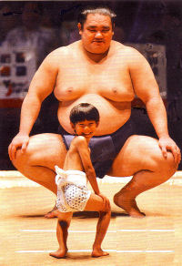
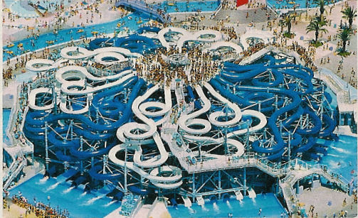
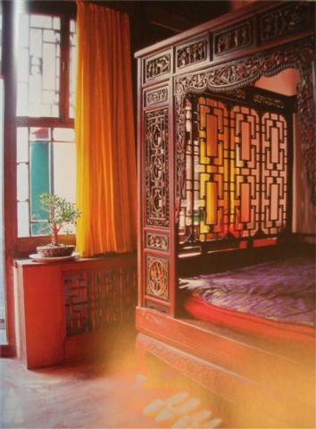
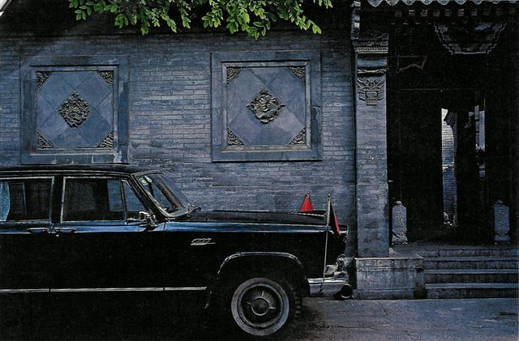
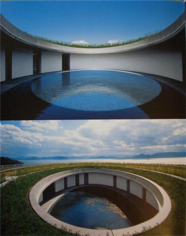
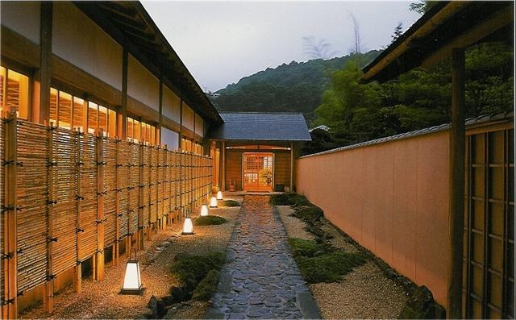
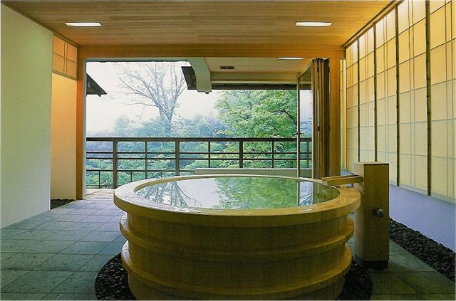
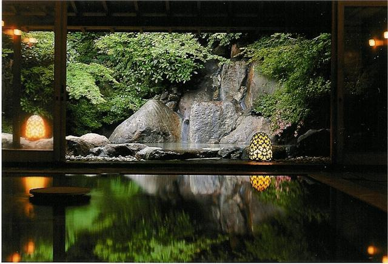

## The Plan

We fly to Japan, see some people already made friends with via e-mail, do a course on japanese cookery, cooking utensils and foodmarkets, take the bullet train, stay in a traditional Ryokan, watch the Kobe famers massaging their beef with sake (which they don’t), see the architecture in Naoshima and then take the trip back visiting some of the greatest hotels in Asia (Architect’s Benesse House, Manila Pearl Farm, Peking Capitalists’ Club)

## The Itinerary

11/8   Leave Frankfurt, GERMANY – Japan Airlines Business Class

  
12/8   Arrival in Tokyo, JAPAN  
Keio Plaza Intercontinental Hotel  
16/8   Tokyo-Hakone  
Relais & Chateau Ryokan Gora Kadan de Luxe (\*)  
17/8   Hakone-Kyoto  
New Miyako Hotel  
20/8   Kyoto-Hiroshima  
Granvia Hotel  
21/8   Hiroshima-Okayama  
Minshuku (\*)  
22/8   Okayama-Naoshima  
Benesse House (\*)  
24/8   Naoshima-Kobe  
Green Hill Hotel & 6km Water Slide (see below)  
26/8   Kobe-Toyko  
Grand Palace Hotel

Although some of these can get [very full](https://www.youtube.com/watch?v=inA-36YRV0Y) …

28/8   Tokyo-Manila-Davao, PHILIPPINES  
Barcelo Pearl Farm Island Resort (\*)  
1/9      Davao-Manila  
Mandarin Oriental Hotel

2/9      Manila-Peking, CHINA  
Red Capital Club & Residence (\*) – Chairman Mao’s Suite & East Concubine Suite

6/9   Peking-Frankfurt, GERMANY

(\*) see below under “Great Hotels Asia” and <http://community.webshots.com/user/msalmony>

## Great Hotels Asia

**The Barcelo Pearl Farm Island Resort, Samal Island, Philippines**

*A Living Room by the Sea*

The houses were built based upon the traditional stilt houses of the Samal seafarers.

Homes and nature linked by wooden footbridges and even by rope ladders – a more beautiful way of getting from the living room to the beach does not exist.

Situated south of Manila at the Gulf of Davao, 1.5. hours by air and then 45 mins by boat.  
Typical Filipino food, the seafood is particularly good.

<http://www.philippine-travel.co.uk/~pthotels/hotels/davao/pearl_farm/index.htm>

**Red Capital Club & Residence, Beijing, China**

*On Mao’s Trail*

Private residence by leading politicians as their pieds-a-terre of choice.  
The concubines’ rooms are next to the Chairman’s Suite – they consist almost entirely of beds and are furnished with with antiques from the Qing Dynasty.  
The Restaurant’s “Zhongnanhai cuisine” includes Mao’s favourite dishes.  
The stretch limousine that once used to chauffeur Madame Mao is available for the exclusive use of hotel guests – all seven meters of it including red flags, champagne and Russian caviar.

<http://www.redcapitalclub.com/>

**Benesse House, Naoshima, Japan**

*On Form*

Designed by Tadao Ando in 1992 – the hotel itself is a work of art.  
More than half is underground.  
From the air it looks like a giant Fisher-Price toy and is linked to the the galleries of the Naoshime Contempory Art Museum and a Seaside Park with landscape art.  
Huge concrete cylinder with a transom window.  
The restaurants “Sound of the Ocean” and “Wind between the Pine Trees” serve elaborate Kaiseki cuisine.

<http://www.naoshima-is.co.jp/english/first.html>

Source: “Great Hotels Asia” ISBN 3-8228-1913-1

Ryokan

**Gora Kadan Ryokan & Yamasa Honjin Minshuku**

A Ryokan is a traditional japanese inn built with traditional materials

sleeping on tatami mats,  
sitting at 1-foot high tables,  
using japanese steam baths

  
(and japanese toilets),  
eating traditional japanese food  
and having a special etiquette on [how to use a Ryokan](http://www.ryokan.or.jp/how_en.html).

They come from simple [Minshuku](http://www.minshuku.jp/english/what.html) (like a home visit, where you get to see how a family lives)

to a super luxury [Relais & Chateaux Ryokan](http://www.gorakadan.com/)  both of which we will be visiting

## Conclusion

**All in all an ichi-go ichi-e (“once in a lifetime”) holiday  
**[… and here is the next trip …](http://salmony.tumblr.com/)

We ate a scorpion, dried fishes’ heads, survived typhoons and earthquakes, were refused entry into china (and thus to our way home) and had an emergency root canal operation – but otherwise we had the most exciting holiday of our lives in Japan. Also outside Japan we had the nicest hotel (Mandarin Oriental Manila), nicest beach resort (Pearl Farm) and the best discount shopping (Peking) of our lives.

See here for [first impressions](/personal/travels/michael-salmony-on-japan/) in 2005 (with an [update](https://japhiking.tumblr.com/post/184612003908/japan-what-is-greatcould-be-improved) 15 years later)
