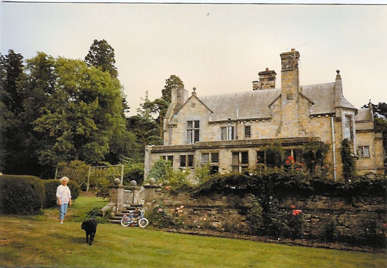
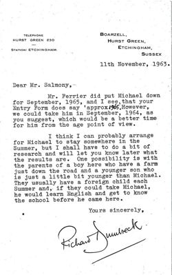
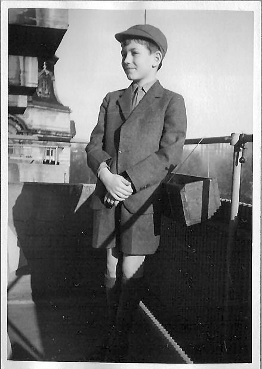
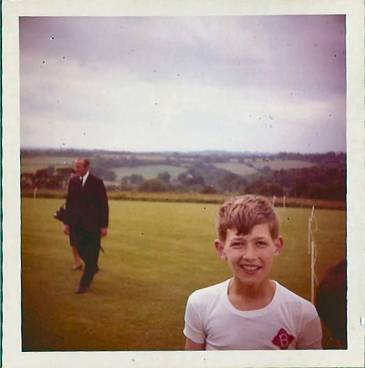
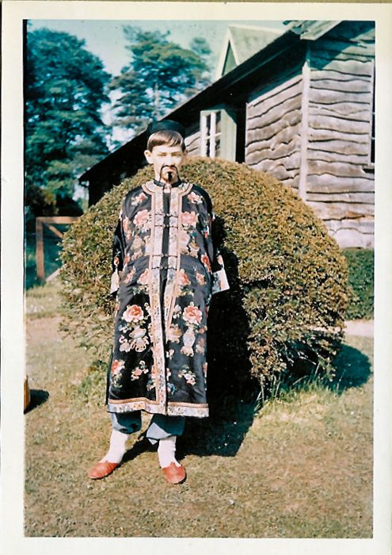
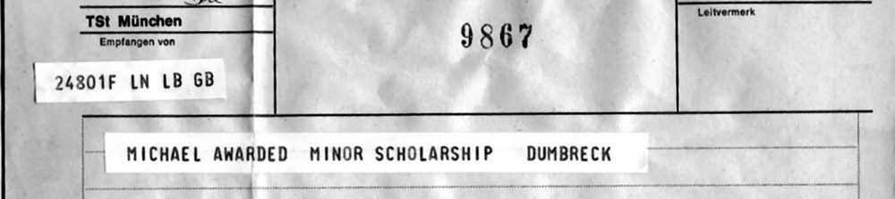

## Born

Munich, Germany (just after the last woman was executed in the UK, just around the time the first high-level computer language FORTRAN was invented)

## Education (Age 8-21)

<table>
<colgroup>
<col style="width: 50%" />
<col style="width: 50%" />
</colgroup>
<tbody>
<tr class="odd">
<td>Volksschule, München</td>
<td>see my <a href="/assets/uploads/2026/09/zeugnis-1.jpeg">first school report</a></td>
</tr>
<tr class="even">
<td><a href="https://www.facebook.com/groups/202377877091151/about/">Boarzell School</a>, Sussex, England</td>
<td>my <a href="/assets/uploads/2026/09/boarzell-report.jpeg">prep school report</a></td>
</tr>
<tr class="odd">
<td><a href="https://kings-association.co.uk/events">King’s School</a>, Canterbury, England 
A/S-Level (Abitur/Baccalaureat) Grade AAAA1.</td>
<td>(then £166/13/4 per term, now charging £9725 per term – for my son …) 
This is what the school and we looked like</td>
</tr>
<tr class="even">
<td>Trainee at <a href="https://web.archive.org/web/20231206110629/http://www.liedl-lana.de">Liedl</a>, Munich</td>
<td>(destroyed a few weaving machines there)</td>
</tr>
<tr class="odd">
<td>Working student at <a href="http://www.iabg.de/">Industrieanlagenbetriebsgesellschaft mbH</a></td>
<td>(didn’t understand satellite pics there)</td>
</tr>
<tr class="even">
<td><a href="http://www.cam.ac.uk/">Cambridge University</a>, <a href="http://www.pet.cam.ac.uk/">Peterhouse</a>, England 
Matriculated, graduated to B.A., later M.A.</td>
<td>(where a formal hall dinner cost 51p. Now admitting girls. Has produced some <a href="https://web.archive.org/web/20120301035742/http://www.petreans.net/petreans/eminent-petreans">famous</a> people). My daughter is sadly only going to Oxford …</td>
</tr>
<tr class="odd">
<td>Management Course, Downing College Cambridge</td>
<td></td>
</tr>
<tr class="even">
<td><a href="http://www.tuwien.ac.at/">Technical University of Vienna</a>, Austria</td>
<td>(went there but did nothing)</td>
</tr>
<tr class="odd">
<td><a href="http://www.lancs.ac.uk/">Lancaster University</a>, England</td>
<td>(never been there)</td>
</tr>
</tbody>
</table>

Completed education with Ph.D. in Computer Science/Telecommunications  
Thesis Title: “On OSI-based Transport Systems for Future Applications over High-speed Networks”

Doctor of Philosophy

Doktor der Naturwissenschaften Dr. rer. nat.

## Boarzell

<figure>

<figcaption>Mr Dumbreck's letter</figcaption>
</figure>

<figure>

<figcaption>Correctly dressed</figcaption>
</figure>

<figure>

<figcaption>Sports dress</figcaption>
</figure>

<figure>

<figcaption>As Wun Tun in the school play</figcaption>
</figure>

How it ended, five years later - by telegram:

(a scholarship was celebrated with a strawberry tea for the whole school and your name engraved on the board. Mine was only worth £50 a year - probably less than the tea and strawberries for the whole school cost)

### The Boarzell QI-Quiz

How well do you know Boarzell? Click a question for the answer.

"For my next trick - which is also impossible". Says who?
The Colonel

How many screws to take out to get into the tuck cupboard?
3 - best done with a screwdriver with integrated torch

What was the original planned use for the Dining Room?
Billiard Room

What was served for Sunday breakfast?
One banger on fried bread

"Lapis, lapidis, ______, ______"
"masculine, a stone" - said in suitably forceful way (The Major)

List the spanking tools by order of severity
Mr D: brown slipper, black slipper (when not flying out of window), cane. In classroom: 12-inch wooden rules arranged as a fan and applied to head of boy, chalk dusters, etc.

"Dogs and children on the left". Which lesson?
The Major's Latin lesson

What was the highest numeral in a boy's name (e.g. Taylor ii)?
iii

What colour were the "PVC mattress protectors"?
Orange

Which house was Tony Banks (Genesis) in?
Drake - see Boarzell Magazine

During an epidemic, what did one vomit into?
Giant cans for jam

What do these have in common: nice, 3, Xmas, any word hyphenated over two lines?
All "outlawed" by Mr D

Name some "crazes"
Potty putty, crocheting using cotton reels and four hooks, conkers, cotton reel attached to pencil with rubber band - runs up ramp to lower forms

What were the only legal comics?
The Eagle (merged into The Lion in 1969), Look &amp; Learn, Fix und Foxi

Scores: 0-5 did you really go to Boarzell? 5-10 red star, 10-14 gold star.

## King's School, Canterbury

Not everyone enjoyed King's. [Somerset Maugham](https://en.wikipedia.org/wiki/W._Somerset_Maugham) was so unhappy there that at 16 he refused to go back, and put it all into *Of Human Bondage*. [John Lloyd](https://en.wikipedia.org/wiki/John_Lloyd_(producer)) (Not the Nine O'Clock News, Blackadder, QI) [called](https://shots.net/news/view/63312-john-lloyd) winning his scholarship there the worst thing that ever happened to him.

I loved it - except for Goddard, our housemaster, who later became Lord Mayor of Oxford.

## Work (Age 21-?)

|   |   |
|---|---|
| [IBM Germany](http://www.ibm.de/), Stuttgart, Germany | (seen the bad times, seen the good times, …) |
| IBM Science Center, Heidelberg, Germany | (got [blown up by RAF](http://books.google.de/books/about/The_IBM_Heidelberg_Science_Center.html?id=YfqnAgAACAAJ&redir_esc=y)) |
| [IBM Research](http://www.research.ibm.com/), Zurich/Rüschlikon, Switzerland | (this is where the action is) |
| Director Innovation Management & Digital Transformation, DG BANK AG, Frankfurt | (later to be [merged](/assets/uploads/2026/09/newmgmt.mp3) into the DZ Bank) |
| [Deutsche Zentral-Genossenschaftsbank](http://www.dzbank.de/), Frankfurt, Germany | (what [I know](/assets/uploads/2026/09/lehrer.wav) about banking) |
| TAI AG with the truly international name of “TAI Transaktionsinstitut für Zahlungsverkehrsdienstleistungen AG” | (e/m Payments – at last something I know about !) |
| Equens SE (merger of TAI and Interpay) | (a merger of equals, yes, really) |
| [Worldline](https://worldline.com/) (merger of Equens and Worldline Financial Processing) | (the biggest in Europe - until it collapsed) |
| Far too much time in Brussels: ERPB, EACB, EPC, the [European Parliament hearing](https://youtu.be/AE0BXH5KdOM) and other gremia beginning with E |  |
| [Payments Innovation Consulting](https://payments-innovation.com/) |  |
| Host of [The Payments Trilogue](https://thepaymentstrilogue.com/) |  |
| My book: [Tokenisation of Money - from Fiat to Stablecoins](https://tokenisationofmoney.com/) |  |
