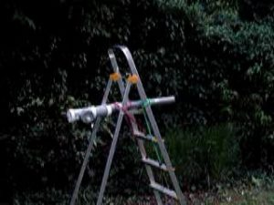
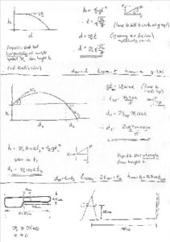
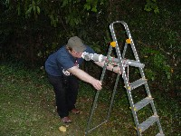
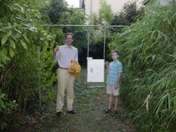
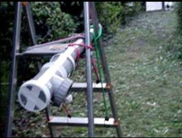
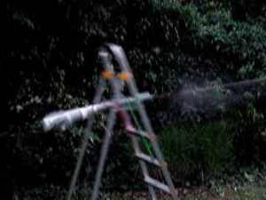
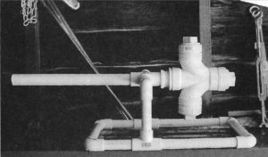
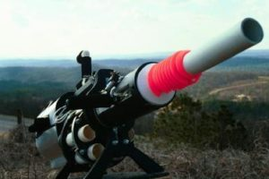
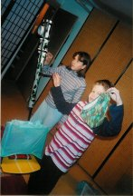
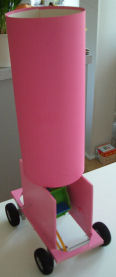

### The Potato Cannon Experiment (The kids’ account)

First of we looked up how to build a Potato–Cannon in the book [“Backyard Ballistics”](http://www.backyard-ballistics.com/) and got in the right frame of mind by cultivating a [Bonsai Potato.](https://web.archive.org/web/20190119215708/http://www.bonsaipotato.com:80/)

Then we did some calculations on how far the potato should fly:

We got the cameraman, Keith, over from England, to help us film it

<figure>

<figcaption>(Keith calibrating the Potato-Cannon)</figcaption>
</figure>

We checked if the Potato-Cannon was pointing at the target:

<figure>

<figcaption>(Note: AMMO = Potatoes, TARGET = Snoopy)</figcaption>
</figure>

After a tasty lunch and an afternoon sleep, we were ready to shoot a potato onto poor Snoopy.

## 1…2…3…BANG!!!

<figure>

<figcaption>Snoopy… you shall be missed</figcaption>
</figure>

It worked so well, that we now have bigger plans:

… and much, **MUCH** bigger plans!  

For your viewing pleasure, we bring you this epic production:

<video controls preload="metadata">
<source src="/assets/uploads/2019/01/potcann.mp4" type="video/mp4">
</source>
<source src="/assets/uploads/2019/01/potcann.webm" type="video/webm">
</source>
</video>

### Credits

-  Director ……………………… Michael Salmony

- Producer ……………….…… Michael Salmony

-  Camera ………………………..… Keith Plunkett

-  Father ………………..……… Michael Salmony

-  Son ………………………….…… Philip Salmony

- Grandson ………………..….. Chickly Salmony

- Post Production ………… Michael Grözinger

- Catering & Moral Suport .… Uschi Salmony

- Flyer Production ……… Florentine Salmony

- ### Reviews

> “This is the best short movie ever!”  
> – *The Daily Telegraph*

> “I am stunned to my pants!”  
> – *The Sunday Times*

- Cameras Used:
- – Sony Cybershot Dsc-P51
- – Philips USB Webcam

<!-- -->

- With many thanks to:
- – The Neighbours (who clapped when they heard the explosion)
- – The Superglue
- – The Squirel
- – The Tree
- – Bauhaus
- – The Bomb Shelter

<figure>

<figcaption>Now… to camouflage it.</figcaption>
</figure>

------------------------------------------------------------------------

If you liked this, Then you may also like to…

<figure>

<figcaption>Guess what this is…?</figcaption>
</figure>

Click [here](/personal/the-sand-crawler-competition/) to find out more.
