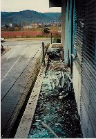
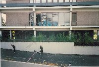
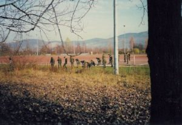

On 16th November 1986 we were sitting quietly at breakfast listening to the news on the radio. It happened to mention that my place of work had been blown up by a terrorist bomb.

Luckily the terrorists had only wanted to harm the facility and no people: they let the bomb explode at 3 a.m. on a Sunday and told a priest to tell the security guard to get out in time. Thus nobody was hurt.

The bomb was planted by the RAF (Rote Armee Fraktion) headed by the famous Baader-Meinhof gang. They left a very long and boring politically confused 8-page [letter](/assets/uploads/2019/01/raflet.jpg) nearby turgidly explaining their actions – quite fascinating in its misguidedness. Apparently they thought that the IBM Research Centre with its computer networking activities was supporting the “Rasterfahndung” (whereby a terrorists are identified by computers, databases, telecommunications networks etc.). This was not true.

(Above is the holes in our computer centre)

However in other respects they had done their homework: they knew where it hurts most. The sensitive parts of the building are the computer centre and the best thing to destroy is the data on disk drives – not the more easily replaceable processors. The bomb was hidden in a fire extinguisher which was placed outside this critical spot. They caused several million DMs of damage and caused severe disruption to our work for several weeks.

(Above, Squadrons of policemen flown in by helicopter to search the area.)
