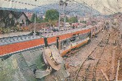
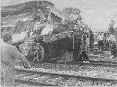
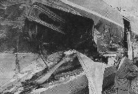
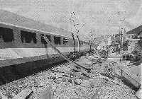
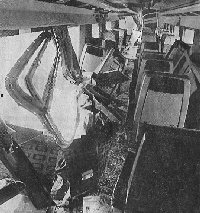

On 23rd September 1988 I was travelling from Grenoble to Lyon (because my boss did not want to go to that meeting)

I took the fabled french TGV which was relatively new at the time. Unfortunately the crossing and signals had not yet been adapted to the high speed of the train. A huge lorry with an industrial transformer on it (i.e. several tons of solid steel) got stuck between the barriers which closed only shortly before the TGV arrived.

There was a massive thump (which we all thought was annoying … stupid french train drivers, mumble mumble …) until the train started juddering (having left the rails), the luggage started to come down, dogs and bits of the walls came flying through the compartment, the windows shattered and we all cowered quitely (no screaming and panic – this was no horror movie; this was real) in the foetal position until the train stopped. Then those who could, got out (quite calmly, after picking up our belongings) and then started shaking violently.

 

 
