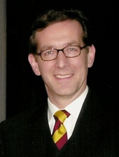
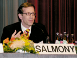
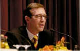
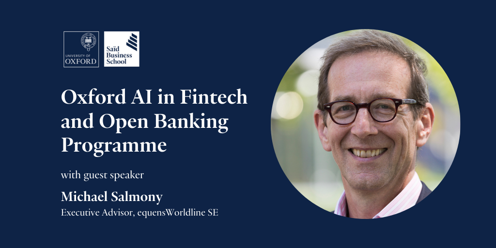
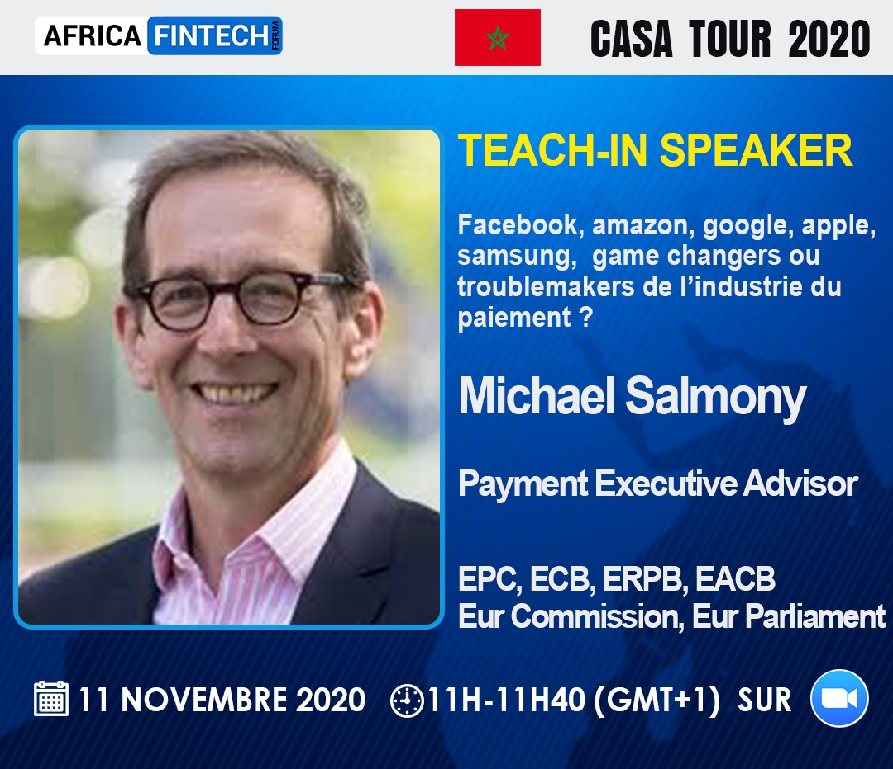
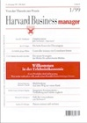
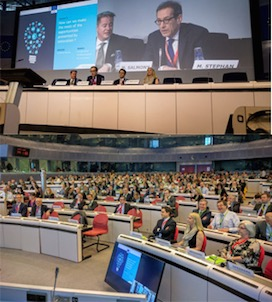
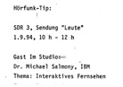

For the professional version of all this, with boards, lectures, publications, media and clients, see [Payments Innovation Consulting](https://payments-innovation.com/).

## Curriculum Vitae

**Prof. h.c. Dr. rer. nat. Michael G. Salmony, M.A. (Cantab.), VIP (Colbert), L.I.V.R., FRSA**

is an internationally recognised leader on strategy of business innovations in **digital and financial services** with a particular focus on Payments, FinTech, Tokenised Money/Stablecoins/CBDC and Open Finance. He is board-level advisor to major international banks (e.g. to the German Banking community “Deutsche Kreditwirtschaft” with 2.277 Banks of aggregated assets of 7.626 billion Euro), to industry associations (e.g. the EACB’s 2.914 banks with aggregated assets of 7 trillion Euro and their 209 million customers and 732.000 employees throughout the EU) and to European decision making bodies (e.g. the European Commission, the ECB, the EPC – the decision making body of the 8.000 banks in the 31 countries of Europe, the ERPB – the central multi-stakeholder strategy board chaired by the Executive Board of the ECB for the future of payments in Europe, the EU CEPS Think-Tank for guidance on future policy) and further national and international [boards](https://payments-innovation.com/boards/).

He is much in demand as a keynote [speaker](https://payments-innovation.com/lectures/) at international events not only across Europe but also in Japan, China, Russia and Australia. He regularly appears on TV/Radio/all electronic media on advances in finance and is quoted extensively (e.g. Financial Times, UK Telegraph, FAZ, SZ, Handelsblatt, Börsen-Zeitung, Harvard Business Manager, New Scientist (as “guru”), Economist and by business schools and governments from Ghana to Malaysia). He teaches at the Oxford Business School on “AI in Fintech and Open Banking” and at their Bank Governance Programme on “Tokenised Finance”. He also teaches at further universities such as in Japan, Australia, Turkey, Germany and top industry fora such as the EBA European Banking Academy. He has [published](https://payments-innovation.com/publications/) much own original work which has been translated into many languages including German, Italian, Dutch, Finnish, Polish, Danish, Russian, Turkish, Chinese and Japanese and is cited in hundreds of [academic](https://cambridge.academia.edu/MichaelSalmony) and commercial publications around the world. He is extensively **networked** into the new financial services space and has one of the top most viewed profiles on business social media platforms.

In operational roles  
– he managed in 2007, at the Board of Directors/Holding level, the **post-merger integration** between previously national organisations (achieving synergies and efficiency gains of more than 400FTE) to yield the first,  leading and now the biggest pan-European full-service payment service provider Equens SE which processes ca. 17 trillion Euro per year (1.7×10¹³€ which is roughly 1.3 times the gross domestic product of Europe) i.e. every year over 30.000€ pass through Equens for each man, woman and child in Europe (by far the world’s largest payment market). Equens has recently merged into **equensWorldline SE** the undisputed European leader in payments and one of the major global players. At the time it was part of Atos, a global leader in digital transformation, with over 100.000 employees in 73 countries and annual revenue of ca 12bn€.  
– from 2016 he was Programme Director of the top strategic PSD2 Programme for equensWorldline/Worldline/Atos covering over 27 departments across all European geographies with ambitious aims to deliver double-digit million€ revenues with full end-end solutions for all clients across the whole value chain covering FinTechs, Banks, Merchants and more. [Best Open Banking Provider Award 2019](https://equensworldline.com/en/home/news-and-pressreleases/pr-2019_07_23_01.html)

Previous positions include **Director Business Development** of leading national central bank (**Bank of the Year 2005**) and Assistant General Manager of its new payments subdivision (**Best Innovator 2004**).

Before entering the world of finance he helped transform many industries through diverse international managerial roles at **IBM** for many years. He was instrumental in setting up IBM’s European Network Centre (ENC) for the convergence of computers, telecommunications and media (later to be known as multimedia and eBusiness). After being elected as assistant to the IBM Board of Directors he was nominated IBM’s Director of Market Development Media and Communications Technologies where he managed major projects for the transformation of diverse industries (publishing, TV/radio, utilities, national rail, etc.) through eCommerce/Internet/multimedia technologies – including the transformation of IBM itself.

Born to a British officer of the Foreign Office (Intelligence Service) and a German mother, he was educated at a British preparatory school and won the Lord Plender Scholarship to **King’s School Canterbury** obtaining A-Level grade AAAA1 and studied at the University of **Cambridge** obtaining 1st class Honours in Engineering, and the George Carter Scholarship in Computer Science obtaining a Doctor in Philosophy (recognised by the German Cultural Ministry as Doktor der Naturwissenschaften Dr. rer. nat.) to begin a long international management career in the application of Innovation to Business Value. He was awarded an honorary Professorship of European Science from California. In 2022 he was elected Fellow of the Royal Society for Arts, Manufactures and Commerce FRSA.

He lives in Heidelberg (Germany) and London (UK), where he also has his offices. He is married, with two millennial children. He has also published a [cookbook](/cookbook/) and his restaurant reviews have been viewed by over **20.000.000 people**.

 

<figure>

<figcaption>Innovations</figcaption>
</figure>

<figure>

<figcaption>Lecturer at Saïd Business School, University of Oxford “AI in Fintech and Open Banking” Programme</figcaption>
</figure>

<figure>

</figure>

<figure>

</figure>

<figure>

<figcaption>Harvard Business Manager (English)</figcaption>
</figure>

<figure>

<figcaption>Inaugural Conference in Oceania</figcaption>
</figure>

<figure>

<figcaption>Regular speaker at ECB European Central Bank’s annual flagship event (here: Palazzo in Rome)</figcaption>
</figure>

<figure>

<figcaption>Keynote in Japan</figcaption>
</figure>

<figure>

<figcaption>Speaker in Moscow, Russia</figcaption>
</figure>

<figure>

<figcaption>Winning Oxford Union debate</figcaption>
</figure>

<figure>

<figcaption>Speaker in China</figcaption>
</figure>

<figure>

<figcaption>Speaking at Tokyo Elite Gakushuin University</figcaption>
</figure>

<figure>

<figcaption>Chair European Commission hearing on Innovations in Retail Financial Services with Lord Hill</figcaption>
</figure>

<figure>

<figcaption>Project 116 makes cover of BILD</figcaption>
</figure>

<figure>

<figcaption>Article in Russian</figcaption>
</figure>

<figure>

<figcaption>Radio interview of famous(?) people</figcaption>
</figure>

<figure>

<figcaption>Running event with everybody who’s anybody in European Open Banking (Eur Commission, ECB, EBA, Central Banks, FinTechs, Deutsche Bank, SAP, airline industry, …)</figcaption>
</figure>

<figure>

<figcaption>Speaking – in French – in Africa</figcaption>
</figure>

<figure>

<figcaption>speaker on “The End of Money” at New Scientist Live – The World’s Greatest Science Festival, audience of 40,000 people (!), with scientists, celebrities, astronauts, physicists, biologists, engineers, neuroscientists, mathematicians and more</figcaption>
</figure>

