

# Dr Michael Salmony FRSA

An internationally recognised leader on strategy of business innovations in digital and financial services with a particular focus on Payments, Open Banking/PSD2/Open Finance, FinTech, Digital Identity, e-Invoicing/SCF, AI for Financial Services and Electronic Money/CBDC.

<a class="button" href="/work/consulting/">Consulting</a> <a class="button quiet" href="https://www.linkedin.com/in/salmony">Connect on LinkedIn</a>

<figure></figure>

He is board-level advisor to major international banks, industry associations, regulators and finance bodies across the world and regularly helps shape future directions in all key decision making bodies (e.g. European Commission/ECB/European Parliament/CEPS Think-Tank in Europe, and central banks from Japan to Uruguay and Kazakhstan). For 10 years he served as Executive Adviser to the Board of Worldline Financial Services, helping to bring them from a local player to become the world’s 4th largest financial processor of transactional services, which handles over 17 trillion Euro per year.

He also works with multiple regions where financial innovations are currently emerging - for example with the World Bank in Central Asia, as Board Member of Fintech Africa, as Advisory Board Member to Mastercard in Latin America, as strategic partner to FinTech Istanbul.

His views are much in demand as keynote [speaker](/work/lectures/) at international events and he appears on TV/Radio/all electronic [media](/work/media/) on advances in finance and is quoted extensively (e.g. Financial Times, Harvard Business Manager, New Scientist, The Economist and governments from Ghana to Malaysia). He teaches in Australia, Turkey, Germany and at the Oxford Business School on “AI in Fintech and Open Banking”. He has [published](/work/publications/) much own original work which has been translated into many languages including German, Italian, Dutch, Finnish, Polish, Danish, Turkish, Russian, Chinese and Japanese and is cited in hundreds of publications around the world. He is extensively networked into the new financial services space and has one of the top most viewed profiles on business social media platforms.

He is a Freeman of the Worshipful Company of International Bankers, Freeman of the City of London and a Fellow of the Royal Society for Arts, Manufactures and Commerce FRSA.

Previous positions include Director Business Development of leading national central bank (Bank of the Year, Best Innovator Award).

Before entering the world of finance, he helped transform companies and business models in many industries as IBM’s Director of Market Development Media and Communications Technologies.

He studied at the University of Cambridge UK and is married, with two millennial children.

[Full curriculum vitae](/work/cv/) | [Boards and committees](/work/boards/) | [Clients and references](/work/clients/)

<figure>

<figcaption>Innovations</figcaption>
</figure>

<figure>

<figcaption>Lecturer at Saïd Business School, University of Oxford “AI in Fintech and Open Banking” Programme</figcaption>
</figure>

<figure>
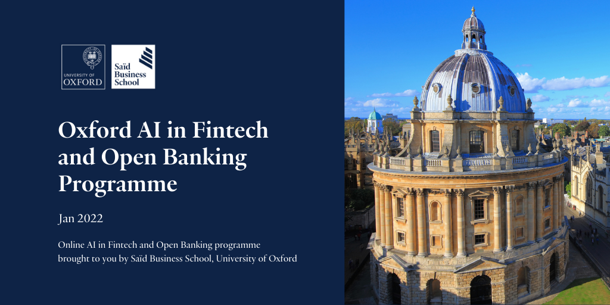
</figure>

<figure>

</figure>

<figure>

<figcaption>Harvard Business Manager (English)</figcaption>
</figure>

<figure>
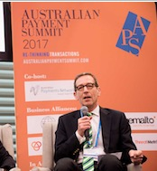
<figcaption>Inaugural Conference in Oceania</figcaption>
</figure>

<figure>
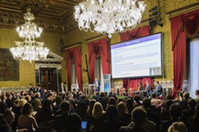
<figcaption>Regular speaker at ECB European Central Bank’s annual flagship event (here: Palazzo in Rome)</figcaption>
</figure>

<figure>
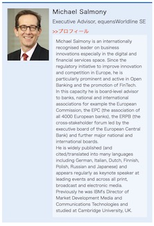
<figcaption>Keynote in Japan</figcaption>
</figure>

<figure>
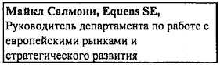
<figcaption>Speaker in Moscow, Russia</figcaption>
</figure>

<figure>
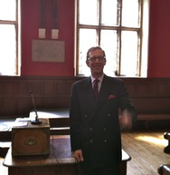
<figcaption>Winning Oxford Union debate</figcaption>
</figure>

<figure>
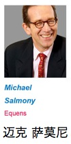
<figcaption>Speaker in China</figcaption>
</figure>

<figure>
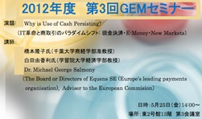
<figcaption>Speaking at Tokyo Elite Gakushuin University</figcaption>
</figure>

<figure>

<figcaption>Chair European Commission hearing on Innovations in Retail Financial Services with Lord Hill</figcaption>
</figure>

<figure>
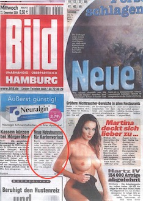
<figcaption>Project 116 makes cover of BILD</figcaption>
</figure>

<figure>
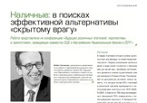
<figcaption>Article in Russian</figcaption>
</figure>

<figure>

<figcaption>Radio interview of famous(?) people</figcaption>
</figure>

<figure>
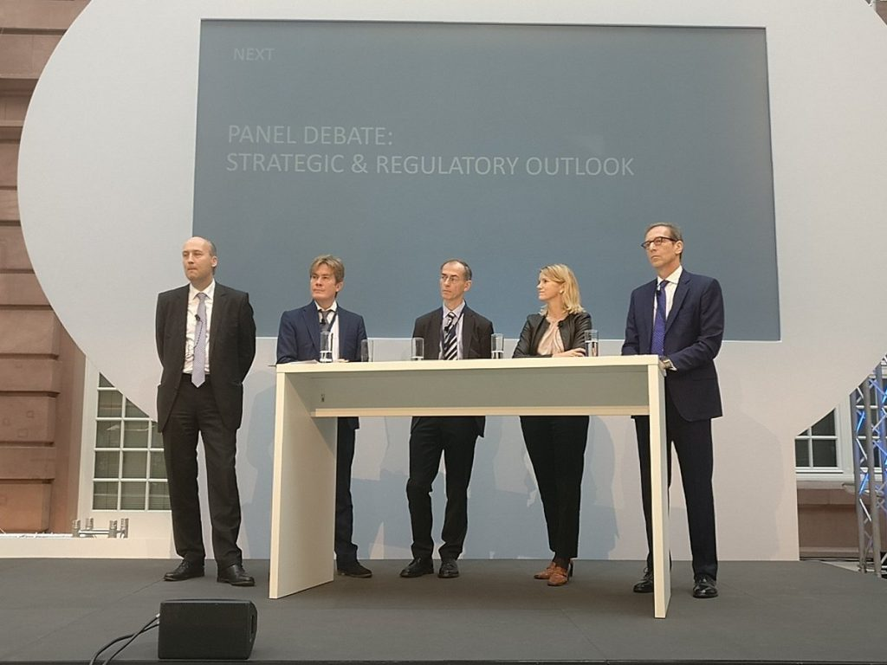
<figcaption>Running event with everybody who’s anybody in European Open Banking (Eur Commission, ECB, EBA, Central Banks, FinTechs, Deutsche Bank, SAP, airline industry, …)</figcaption>
</figure>

<figure>

<figcaption>Speaking – in French – in Africa</figcaption>
</figure>

<figure>
<a href="/assets/uploads/2019/06/NSL-tweet.png">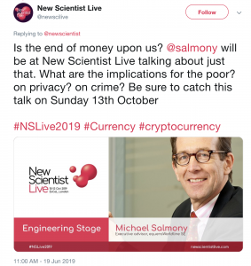</a>
<figcaption>speaker on “The End of Money” at New Scientist Live – The World’s Greatest Science Festival, audience of 40,000 people (!), with scientists, celebrities, astronauts, physicists, biologists, engineers, neuroscientists, mathematicians and more</figcaption>
</figure>

