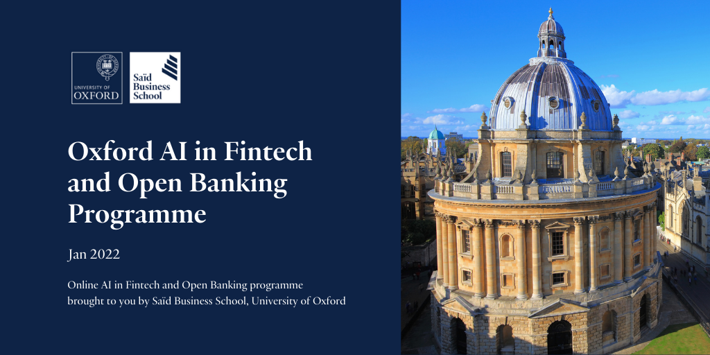
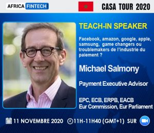
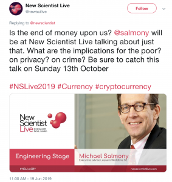

The following shows some of the invitations – only accepted a selection …  
Older lectures can found [here](/work/lectures/older-lectures/)

<nav aria-label="Jump to year" class="years">

[2027](#y2027) [2026](#y2026) [2025](#y2025) [2024](#y2024) [2023](#y2023) [2022](#y2022) [2021](#y2021) [2020](#y2020) [2019](#y2019) [2018](#y2018) [2017](#y2017) [2016](#y2016) [2015](#y2015) [2014](#y2014) [2013](#y2013) [2012](#y2012) [2011](#y2011) [2010](#y2010)

</nav>

## 2027

**15-16.6.27**  
Moderate panel discussion on tokenised money and promote the EBA Academy with 1400 senior professionals from 40 countries, [EBAday](https://www.ebaday.com/), Roma Convention Center La Nuvola, Rome

## 2026

**19.1.26**  
Opening Keynote “The Future of Banking and Payments” at [14th Banking, Payments & FinTech Forum](https://banking.imhbusiness.com/), Nikosia Cyprus

**19-23.1.26**  
Invited as speaker on “Distributed Finance” to 200 registrants at [Davos Innovation Week](https://www.davosinnovationweek.com/), Switzerland

**16-17.2.26**  
Invited as speaker at [Dubai FinTech Week](https://fintech.peoplevents.uk/), Dubai, UAE

**17.2.26**  
Instructor at Istanbul University on “Fintech and the API Economy”, Turkey

**27.2.26**  
Presentation on “new digital money; stablecoins, tokenized deposits and CBDCs” at EBA Digital Currencies and Smart Payments Working Group (DSWG)

**17.3.26**  
Lead trainer on Tokenised Money at [EBA Academy](https://www.abe-eba.eu/training-education/eba-academy-payments-training/), Frankfurt

**23-25.3.26 / 31.8.-2.9.26**  
Presentation of book at panel “Tokenisation of Money: From Fiat Currencies to Stablecoins” at [Currency Research Central Bank Payments Conference](https://currencyresearch.com/the-central-bank-payments-conference/), Istanbul  

**12-14.5.26  
** [CB&DC Conference](https://www.cbdc-conference.com/), Kuala Lumpur  

**21.4.26**  
Presentation on Tokenised Money at [Digital Currencies & Smart Payments Working Group of EBA](https://www.abe-eba.eu/thought-leadership-innovation/digital-currencies-smart-payments-working-group/)

**20.5.26**  
Lead trainer on [Tokenised Money](https://www.eventbrite.com/e/new-eba-academy-module-on-the-tokenisation-of-money-and-digital-assets-tickets-1986199669679) at [EBA Academy](https://www.abe-eba.eu/training-education/eba-academy-payments-training/), Frankfurt

**27.5.26**  
Webinar at [The Payers](https://thepaypers.com/crypto-web3-and-cbdc/interviews/stablecoins-cbdcs-and-tokenised-deposits-the-new-playbook-for-financial-institutions) on [“Stablecoins, CBDCs, and tokenised deposits”](https://youtu.be/RN1HiZnfbBc?si=WBqqbQjAzjM-5XQt) – “the new playbook for financial institutions” with Selim and Coskun (co-authors of the Tokenisation of Money Book)

**1.6.26**  
Interview with [The Psironi](https://www.thepsironi.com/) on his [Bankers’ Bookshelf](https://www.youtube.com/watch?v=HBscOoeDWq4&list=PL6GGVJxhttouSpy7SQJDhwXAauhdnH_RM) on the Tokenisation book

**3.6.26**  
Panel with Token.io, Business and Trade UK, Invela on “Regulation as the Edge in Open Finance”, [Money2020](https://europe.money2020.com/), Amsterdam  
  
[Panel](https://ascentialcdn.filespin.io/api/v1/video/f2ba4aa61fff42cba647dcef864fe726/1080p-wm-video.mp4) recording  
[Report](https://www.invela.com/resources/reports/regulation-as-the-edge)

**9-10.6.26**  
“How Tokenised Money is revolutionizing national and global payments”  at [Baku Fintech Forum](https://bakufintech.com/), Azerbaijan  

**16-17.6.26**  
Moderation of Panel “Translating AI adoption to real impact”, at [EBAday](https://www.ebaday.com/) “The new payments landscape: Navigating change in 2026 and beyond”, with 1,400 participants, Copenhagen, Denmark

**30.6.26**  
Debater on “Strategy in the Era of Digital Currency” at the [EBA Summer School](https://www.abe-eba.eu/training-education/eba-summer-winter-schools-and-other-educational-seminars/#summer-school) “The Edge of Tomorrow: Digital playments strategy in an Era of constant change”, Sophia Antipolis/Nice, France

**30.6.26**  
Moderator of Panel on “Stablecoins in cross-border payment flows” with The Paypers

**12-14.8.26**  
Geneva [Summit 2026, United Nations](https://indico.un.org/event/1024169/) Office, Geneva

**1.9.26**  
Presentation of book “Tokenisation of Money: From Fiat Currencies to Stablecoins” at [Central Bank Payments Conference](https://currencyresearch.com/the-central-bank-payments-conference/), Istanbul

**2.9.26**  
Open Banking and Blockchain at Mastercard with Saudi bank, London

**15.9..26**  
Lead trainer on [Tokenised Money](https://www.eventbrite.com/e/new-eba-academy-module-on-the-tokenisation-of-money-and-digital-assets-tickets-1986199669679) at [EBA Academy](https://www.abe-eba.eu/training-education/eba-academy-payments-training/), Paris

**15-16.9.26  
** Payment Leaders’ Summit, an invite-only, highly curated, senior-level summit bringing together Heads of Payments, Digital, Innovation, Product, and Compliance from leading banks, financial institutions, merchants, and FinTechs, Amsterdam

**17.9.26**  
Keynote “What they don’t tell you about Tokenised Money” at [Financial Innovation Forum Payments & RegTech](https://www.qubevents.com/financial-innovation-forum), London  

**27-29.9.26  
** Book peesentation at Academy and Moderation of plenary panel on Tokenisation with three central banks (DNB, BuBa, BdF), Qivalis, DZ BANK/CBMT at [CB&DC Conference](https://www.cbdc-conference.com/), Amsterdam  
**  
7-8.10.26  
** Speaker of “Blockchain, Tokenized Assets, Stablecoins & CBDCs: The Future of Digital Finance” Panel and moderator of Panel on [“The Digital Money Revolution: Digital Assets, Blockchain, Tokenization, Stablecoins, CBDCs & CBMTs](https://www.linkedin.com/posts/t-douminlian-2396a315a_fintechweek2026-digitalfinance-digitalassets-share-7501159325793705984-1moW/?utm_source=share&utm_medium=member_ios&rcm=ACoAAACtqB4BWhjRNUzjWjzD423gigMJLhHB5AU)” at totally chaotic [Frankfurt FinTech Week](https://eufintechweek.com/)  

**27-28.10.26**  
Moderator of panel at [MoneyLIVE Nordic Banking 2026](https://moneylive-insights.com/events/nordic-banking/), Copenhagen

**19.11.26**  
Keynote speaker for the fourth plenary meeting of the [central bank at the Foro di Pago Naciona](https://www.cbaruba.org/foro-di-pago-nacional/)l (FPN) on “How Artificial Intelligence (AI) is Transforming Digital (Payment) Experiences.”, Aruba

**7.12.26  
** Invited as keynote speaker at the Annual Conference of the Banking Supervision Department at the Bank of Israel bringing together senior representatives from across the financial ecosystem, including the Governor of the Bank of Israel, CEOs of banks and financial institutions, regulators, policymakers, and other key stakeholders. Invited due to my insights on innovation and extensive international experience in payments innovation, open banking, digital transformation, and the future of financial services to showcase potential implications for banking, payments, and financial services which could provide tremendous value to their audience. Tel Aviv.

## 2025

**24.1.25  
** “Industrial Policy & Leapfrog” at CEPS-ECRI Think Tank  
**  
17-21.2.25  
** Chair of [Digital Assets](https://www.linkedin.com/posts/activity-7293774106724888576-q9ay?utm_source=share&utm_medium=member_desktop&rcm=ACoAAACtqB4BWhjRNUzjWjzD423gigMJLhHB5AU) panel with hat Bank of Japan, Head D€ at Bundesbank, Director Global Digital Finance, IMF at Central Bank Payments Conference and Global Payments Summit, Currency Research, Paris  
  
[Interview](https://www.linkedin.com/posts/payments-innovation-technology-currency-research_pitexchange-paymentsinnovation-technology-activity-7293550494608691200-YECd/?utm_source=share&utm_medium=member_ios&rcm=ACoAAACtqB4BWhjRNUzjWjzD423gigMJLhHB5AU) podcast with CR

**26.2.25  
** Keynote: “Moving Beyond B2C Fintech To B2B Fintech – Is This A Bright New Future For The Fintech Industry & Will It Be Transformative For The Banking Industry?”, [Finovate Europe](https://informaconnect.com/finovateeurope/agenda/3/), London  
[Linkedin](https://www.linkedin.com/posts/activity-7271409445048352768-x5XR?utm_source=share&utm_medium=member_desktop)  
Featured as “Three Quick-Fire [Keynotes at FinovateEurope You Won’t Want to Miss](https://finovate.com/three-quick-fire-keynotes-at-finovateeurope-you-wont-want-to-miss/)”  
  
**11.3.25**  
Graduate Class Lecture on “Open Banking and API Economy” at Istanbul University

**19.3.25**  
Guest speaker on “CBDC, Leapfrog and Industrial Policy” at the payments committee of EuroCommerce, the principal European organisation representing the retail and wholesale sector with national associations in 28 countries  
**  
31.3.25**  
Talk on CBDC at the “[Digital Currencies & Smart Payments Working Group](https://www.abe-eba.eu/thought-leadership-innovation/digital-currencies-smart-payments-working-group/)” of the Euro Banking Association  
**  
27.3.25  
** Panellist on [Digital Euro Conference](https://digital-euro-conference.de/en/) Frankfurt at roundtable discussion “Rethinking CBDCs: Risks, Repercussions, and Alternatives”, a platform where CBDC skeptics can openly voice their perspectives, discuss potential pitfalls, and explore viable alternatives to central bank digital currencies  

**3.4.25**  
Pannelist with Worldline and The Paypers in CoP

**7.4.25  
** Pannelist at Blockchain event with Giesecke+Devrient, Frankfurt School and TUM, Munich

**8-9.4.25  
** Training with Jordanian Central Bank and Palestine Telecom, on Neo-Banks, Amman

**28.4.25  
** Chair of  [Instant Payments](https://kinfos.events/ips/) Event, Frankfurt  

**6.5.25**  
[“EU’s ‘local’ payment system EPI amid rising tensions with the US”](https://fintechistanbul.org/2025/05/06/son-durum-abd-ile-artan-gerilim-ortaminda-abnin-yerli-odeme-sistemi-epi/), by FinTech Istanbul citing Salmony interview with Martina Weimert, CEO EPI

**7-8.5.25**  
Open Banking Training for US Market, [Metamorph Global](https://metamorphglobal.io/)

**14.5.25**  
Keynote ” “Impact of AI on Payments/Financial Services”, [EACHA Payments Forum](https://www.eacha.org/activities.php), Warsaw

**20-23.5.25**  
Excellence in Digital Banking 4.0, Istanbul, Turkey

**12.6.25**  
Panel on Making European Payments Great Again at the [EuroCommerce Payments Day,](https://www.eurocommerce.eu/events/payments-day/) with Head of SIBS, Head of EPC, Head of EPI, Rulebook Head DigitalEuro, Brussels  
My very popular [LinkedIn post](https://www.linkedin.com/posts/activity-7339253666131918848-X4CW?utm_source=share&utm_medium=member_desktop&rcm=ACoAAACtqB4BWhjRNUzjWjzD423gigMJLhHB5AU) on the highlights  
**  
24.6.25**  
[Webinar](https://www.linkedin.com/posts/valerie-nowak-7270192_join-dr-michael-salmony-and-i-on-june-24th-activity-7341201005579051009-YqkU/?utm_source=share&utm_medium=member_ios&rcm=ACoAAACtqB4BWhjRNUzjWjzD423gigMJLhHB5AU) with Mastercard EVP EMEA&AP Head Open Finance on “Unlocking new opportunities with Open Finance in Europe”  
  
and [more](https://www.linkedin.com/posts/payments-cards-and-mobile_openbanking-activity-7386687866707419136-rV6A/?utm_source=share&utm_medium=member_ios&rcm=ACoAAACtqB4BWhjRNUzjWjzD423gigMJLhHB5AU) and more [LinkedIns](https://www.linkedin.com/posts/payments-cards-and-mobile_join-us-for-an-engaging-and-insightful-webinar-activity-7341030672473501696-7vHd/?utm_source=share&utm_medium=member_ios&rcm=ACoAAACtqB4BWhjRNUzjWjzD423gigMJLhHB5AU) from Mastercard  
Webinar recording [here](https://www.youtube.com/watch?v=yNhgpreQEEI)

supported by video clips with Valerie me  
– [Mastercard](https://www.linkedin.com/posts/mastercard-open-finance_openbanking-mastercard-mastercardopenfinance-activity-7380904690160443392-y6gg?utm_source=share&utm_medium=member_desktop&rcm=ACoAAACtqB4BWhjRNUzjWjzD423gigMJLhHB5AU) & [Payments Cards & Mobile](https://www.linkedin.com/posts/payments-cards-and-mobile_openbanking-openfinance-psd2-activity-7379092805614346240-GLAb?utm_source=share&utm_medium=member_desktop&rcm=ACoAAACtqB4BWhjRNUzjWjzD423gigMJLhHB5AU) & Mastercard’s [global Comms Director](https://www.linkedin.com/posts/runekallehauge_great-insights-from-valerie-nowak-and-dr-activity-7384872066652639232-w5Jt/?utm_source=share&utm_medium=member_ios&rcm=ACoAAACtqB4BWhjRNUzjWjzD423gigMJLhHB5AU) videos with [my comment](https://www.linkedin.com/posts/activity-7380990231560339456-tTQP?utm_source=share&utm_medium=member_desktop&rcm=ACoAAACtqB4BWhjRNUzjWjzD423gigMJLhHB5AU) on ecosystem, apps on banks  
– [Mastercard](https://www.linkedin.com/posts/mastercard-open-finance_openbanking-mastercard-mastercardopenfinance-activity-7383441424878571520-Heb1/?utm_source=share&utm_medium=member_ios&rcm=ACoAAACtqB4BWhjRNUzjWjzD423gigMJLhHB5AU) & [Payments Cards & Mobile](https://www.linkedin.com/posts/payments-cards-and-mobile_openbanking-activity-7381599243058380800-LGJr?utm_source=share&utm_medium=member_desktop&rcm=ACoAAACtqB4BWhjRNUzjWjzD423gigMJLhHB5AU) videos with [my comment](https://www.linkedin.com/posts/activity-7381978544702332928-E3tg?utm_source=share&utm_medium=member_desktop&rcm=ACoAAACtqB4BWhjRNUzjWjzD423gigMJLhHB5AU) on on OB/API-ification is like electricity, B2B is key  
– Mastercard & [Payments Cards & Mobile](https://www.linkedin.com/posts/payments-cards-and-mobile_openbanking-openfinance-psd2-activity-7384196386789007360-lHyd/?utm_source=share&utm_medium=member_ios&rcm=ACoAAACtqB4BWhjRNUzjWjzD423gigMJLhHB5AU) videos with [my comment](https://www.linkedin.com/feed/update/urn:li:ugcPost:7386661647475580929/) on FIDA and unlocking data

**26.6.25  
** Lunchtime talk on debunking Blockchain “”Digital Finance in the real world: exploring hopes and failures from Blockchain to CBDC” at Oxford Business School  

**1-3.7.25**  
Debate on “AI and Regulation: Help or Hindrance?” at EBA Summer School, Accenture Innovation Lab, Sophia Antipolis, Nice

**22-23.7.25**  
“Impact of the Global Open Banking Phenomenon on the Middle Eastern Region – How new regulation and competition are transforming financial services”  
Training for Middle Eastern Market, [Metamorph Global](https://metamorphglobal.io/)

**9-11.9.25**  
[CBDC Conference](https://www.cbdc-conference.com/), Nassau, Bahamas

**11.9.25**  
Moderator of [“The Global Arena: Meeting instant, real-time payment expectations with digital wallets”](https://thepaymentsassociation.org/) with FIS Global, Terrapay, UK Payments Association, Mastercard  
  
[LinkedIn](https://www.linkedin.com/posts/veena-sivathasan-425871125_webinar-invitation-the-global-arena-activity-7366767415172521984-MPdy/?utm_source=share&utm_medium=member_ios&rcm=ACoAAACtqB4BWhjRNUzjWjzD423gigMJLhHB5AU)

**15-16.11.25**  
Moderator of “Turning Open Banking into Real Business Value” at [Payments Leaders’ Summit](https://www.payments-leaderssummit.com/), Amsterdam

  
Blog about us [trailbazers](https://www.payments-leaderssummit.com/blog/beyond-transaction-inside-minds-europes-payment-trailblazers)  
[LinkedIn](https://www.linkedin.com/posts/payexpo_pls-paymentsleaderssummit-openbanking-activity-7364212181581602816-W27N/?utm_source=share&utm_medium=member_ios&rcm=ACoAAACtqB4BWhjRNUzjWjzD423gigMJLhHB5AU)  
my [LinkedIn](https://www.linkedin.com/feed/update/urn:li:share:7374070705019305985/)

**3-7.11.25**  
Keynote at company event, Istanbul, Turkey

**19.11.25**  
Chair of 8th Annual [PSD3 & Open Banking Forum](https://kinfos.events/psd3), Frankfurt  
on how banks are preparing for the upcoming regulations like PSD3, PSR, FIDA, DORA, and transition into Open Finance also the future of payments  
with speakers from leading Banks, Regulators, Industry Influencers including European Commission, ECB, EPC, EBA, BaFin, FCA UK, Pay.uk, Open Banking LTD, National banks of Germany, France, Netherlands, Slovakia and many major Retail Banks

**2-4.12.25**  
Opening Keynote “The Future of Banking and Payments” at [13th Banking, Payments & FinTech Forum](https://banking.imhbusiness.com/), Nikosia Cyprus

… and at the same time …

**2-4.12.25**  
Speaker at [Cyprus Fintech Summit](https://cyprusfintechsummit.com/), Grand Resort Limasol, Cyprus

## 2024

**2024**

**?.?.24**  
Panel or Keynote at Trust Live conference focused on financial services industry aspects of identity authentication and trust with SME speakers

**14-15.2.24**

Conference chair/moderator at [“Open Banking & CX Transformation Forum”](https://kinfos.events/obcx), Berlin

**28.2.24**

Keynote Address “Central Bank Digital Currencies – Miracle Money, New World Order or Global Flop?” at [Finovate Europe](https://informaconnect.com/finovateeurope/), “THE BEST FINTECH CONFERENCE FOR THE FUTURE OF FINANCIAL SERVICES”, with 1000+ senior attendees and 500+ banks & financial institutions, London

  
[LinkedIn](https://www.linkedin.com/posts/activity-7129074498640703488-uBhj?utm_source=share&utm_medium=member_desktop)  
[Fintech Istanbul](https://www.linkedin.com/posts/fintechistanbul_finovateeurope-etkinli%C4%9Fi-londrada-ba%C5%9Fl%C4%B1yor-activity-7167824512879726593-N4XE?utm_source=share&utm_medium=member_desktop) promotion

**28-29.2.24**

Nominated for FiNext Award, Dubai

**6-7.3.24**

MoneyLIVE Payments Europe2024, London

**7-8.3.24**

[17th NextGen Payments & RegTech Forum](https://www.qubevents.com/17th-npf-regtech-switzerland), an exclusive forum is a gathering that connects leading decision-makers from across the entire Payments and RegTech community, Zurich, Switzerland.

**8.3.24**

Closing Keynote on “AI for Financial Services/Payments” at [10th FPN Payments-Symposium](https://www.frankfurt-payments-network.de/veranstaltungen/), Frankfurt

**12-14.3.24**

Panel with Evelien Witlox (ECB Digital Euro), Dave Birch and Sveriges Riksbank on “The future of European payments and CBDC”  
and Panel with Token, Brite and Aiia/Mastercard on “The Use of Open Banking Today” at [MPE](https://merchantpaymentsecosystem.com/) Merchant Payments Ecosytem the \#1 European merchant payments conference with typ 1400 attendees, including 350 merchants attending, Berlin

[Citation](https://youshouldread.substack.com/p/once-businesses-get-big-they-want?utm_campaign=post&utm_medium=web&triedRedirect=true):

To paraphrase Dr Michael Salmony, who spoke at this year’s Merchant Payments Ecosystem (MPE):

> *“Nothing significant in payments happens in less than 10 years”.*

[LinkedIn](https://www.linkedin.com/posts/merchant-payments-ecosystem_mpe2024-merchantpaymentsecosystem-mpe2024-activity-7115643649706610688-9qkQ/?utm_source=share&utm_medium=member_ios)  
  
[Video](https://www.linkedin.com/posts/merchant-payments-ecosystem_mpe2024-mpe-mpecosystem-activity-7153718628322836480-Vrg4/?utm_source=share&utm_medium=member_ios) teaser  
[Predictions](https://www.linkedin.com/posts/merchant-payments-ecosystem_predictions-2024-activity-7157716217607151616-me0h/?utm_source=share&utm_medium=member_ios) on LinkedIn  
Promotion by [Fintech Istanbul](https://fintechistanbul.org/2024/02/13/dr-michael-salmony-merchant-payments-ecosystem-etkinliginde-konusacak/)  
[ECB](https://www.linkedin.com/posts/evelien-witlox-7b25543_digital-euro-project-head-evelien-witlox-activity-7173547062230265856-vVHm?utm_source=share&utm_medium=member_desktop) posts on LinkedIn  
Reported with my inputs on [Finextra](https://www.finextra.com/newsarticle/43840/mpe-2024-what-will-be-the-impact-of-a-digital-euro)

**15.3.24**

Interviewed by Worldline on Digital ID [“Are you ready for Digital Identity”](https://www.linkedin.com/posts/worldlineglobal_tune-in-here-activity-7174067266123112448-pdEP/?utm_source=share&utm_medium=member_ios) in their podcast series

**22.3.24**

Lectures on  
“Regulatory perspectives of Open Banking/Open Finance”  
and  
“AI on Innovation in Financial Services”  
by invitation from Pinar Ozcan, Professor of Entrepreneurship and Innovation at Saïd Business school, Oxford and Nir Vulkan, Associate Professor of Business Economics at Saïd Business school, Oxford. As part of the Fintech programme, an executive education course as an expert guest speaker adding to the programme’s teachings through unique perspectives which will be showcased alongside those of other distinguished experts and esteemed faculty members. “The expertise and experience will undoubtedly prove invaluable to participants who are dedicated to driving financial technology, innovation and entrepreneurship worldwide.”

**7.5.24**

Chair/moderator at [“Digital Transformation in Banking Summit”](https://www.kinfos.events/dxb/), London

**8.5.24**

Chair/moderator at [“Cyber-Security Transformation in Financial Services Summit”](https://www.kinfos.events/sxf/), London

**15-16.5.24**

Speaker at [Fintext Summit of the Finance and Technologies Expo](https://www.gbmevents.az/en/event/fintex-summit-2024-finance-and-technologies-expo), on new trends in banking and finance ecosystems, innovative solutions, fintech and security, ​Baku, Azerbaijan

**22.5.24**

Speech on “Impact of AI on Payments/Financial Services” at EACHA Forum, Sofia

**May 2024**

Interview with Wijnand Machielse on [Berlin Group](https://www.linkedin.com/posts/wijnandmachielse_standwithukraine-openbanking-openfinance-activity-7199304367668084736-daTC?utm_source=share&utm_medium=member_ios) standardisation  
published by [ETPPA](https://www.linkedin.com/feed/update/urn:li:activity:7200780295132921856/)

**10-11.6.24**

[“What is Open Banking ?”](https://www.linkedin.com/posts/global-leading-conferences_introduction-to-open-banking-apis-masterclass-activity-7181206310116368384-yMPt/?utm_source=share&utm_medium=member_ios) online Masterclass with GLC

**12-14.6.24**

Currency Research [Global Payment Summit](https://events.currencyresearch.com/event/fcc07391-d5d9-4f3b-8470-7f13b0cf6ba5/summary), Kuala Lumpur, Malaysia

**18-20.6.24**

“Fintech Frontiers: Sculpting the Future of Finance” at [iFX EXPO International](https://cyprus2024.ifxexpo.com/meet/speakers), City of Dreams Mediterranean Integrated Resort, Limassol, Cyprus

**19-20.6.24**

Speaker at [Unchain](https://unchainfestival.com/unchain-2024-partnerships/) Festival, Oradea, Rumania

**10-12.9.24**

Speaker at CBDC Conference, Istanbul  
Promotion [article](https://fintechistanbul.org/2024/04/22/fintech-istanbul-ekibinden-dr-michael-salmony-cbdc-conference-24-konusmacilari-arasinda/) on Salmony participation by FinTech Istanbul and [Linkedin](https://www.linkedin.com/posts/fintechistanbul_fintech-i%CC%87stanbul-ekibinden-dr-michael-salmony-activity-7188084132516642816-WVPn/?utm_source=share&utm_medium=member_ios)  
[Linkedin](https://www.linkedin.com/posts/cbdc-conference_istanbul-cbdc-fintech-activity-7186762175850418176-6clZ/?utm_source=share&utm_medium=member_ios)

**18-19.9.24**

“Latest Updates on Open Banking & APIS – including PSD3, PSR, FIDA – Changing data, finance & payments around the world”, GLC

**24-28.9.24**

Currency Research – Digital Currency and Central Bank AI conferences, London  
Moderator on “Privacy, Security, Interoperability, Offline: Have We Made Progress?”  
Moderator on “Digital Currency and Asset Regulation and Compliance”  
Pannelist on “AI Financial and Cyber Crime: Exploring the Risks and Mitigations”

**1.10.24**

Chair/moderator at “Digital Transformation in Banking Summit”, Amsterdam

**6.11.24**

Panel chair at [Instant Payments Summit](https://kinfos.events/ips/), Frankfurt

**21-22.11.24**

Keynote at Africa FinTech, Abidjan

**26-29.11.24**

Keynote at Excellence in Digital Banking 2.0, Amsterdam

**4.12.24**

Keynote “Implications to Banks through CBDC/D€” at the Euro Banking Association (EBA) “Forum on Digital Transformation” with UBS, J.P.Morgan, Deutsche Bank, Accenture, LBBW, Microsoft, EACT, Google, etc at  
[Euro Banking Association – Open Forum on Digital Transformation](https://www.abe-eba.eu/thought-leadership-innovation/eba-open-forum-on-digital-transformation/) “Everything, everywhere, all at once – Embracing Digital Transformation in Banking in 2025!”

## 2023

**16.1.23**

Presentation of Open Finance Manifesto to Swedish Finance Ministry

Trust Live conference in 2024 ?   We’re still in planning phase at the moment but are putting together a provisional list of SME speakers for the event, which is very much focused on financial services industry aspects of identity authentication and trust.  I don’t have any dates right now but would a panel slot or a keynote speaking

**10.2.23**

Ziraat Bank, Istanbul

**13.2.23**

Guest speaker on Digital Banking (as part of Warwick Finance Societies Fintech Week) at the University of [Warwick Finance Society](https://www.warwickfinancesocieties.org), UK

**15.2.23**

Tech Investment Banking Team at Moelis, UK

**21-22.2.23**

Closing speech on “Payment Innovations meet e-Invoicing” at [E-Invoicing Exchange Summit](http://www.exchange-summit.com), focussing on the latest trends in Middle East and Africa, Dubai  
  

[See the post on LinkedIn](https://www.linkedin.com/feed/update/urn:li:ugcPost:7021011144588820480/)

**22.2.23**

Talk on CBDC at World Banknote Summit, Amsterdam

**22-23.2.23**

Speaker on “The Future of Open Banking in Europe” at the exclusive invite-only [Banking Renaissance Retreat](https://bankingrenaissance.com/event/retreat2023/) of the [Amsterdam Banking Forum](https://amsterdambankingforum.com/) with Brett King, IBM, McKinsey, 50 banks from 50 countries, Amsterdam

**23-24.2.23**

Moderator at [Open Banking Forum](https://www.kinfos.events/obsca/) on Strong Customer Authentication, with 150+ senior level attendees from all over Europe from leading Banks, Regulators and selected FinTechs. A high level forum where executives share their vision of Open Banking, Open Finance, Transition to PSD3, API Economy, Strong Customer Authentication, Rise of Digital Transformation, Open Data, Customer Journey, Embedded Finance, Sustainable finance, Impact of Regulations, etc, Frankfurt

**28.2.-1.3.23**

[OpenX Middle East](https://www.openbanking-middleeast.com/), Riyadh  

**4.3.23**

Guest speaker in the “Frontiers in FinTech” unit within the Master of Financial Technologies at the Swinburne University of Technology, the Australian Graduate School of Entrepreneurship, Melbourne, Australia  
see [recording](https://www.youtube.com/watch?v=6VVLxwpRdJY&ab_channel=DimitriosSalampasis) and [LinkedIn](https://www.linkedin.com/posts/dimitriossalampasis_fintecheducation-fintechinnovation-payments-activity-7037743752102248448-R5-m/?utm_source=share&utm_medium=member_desktop)

**9-10.3.23**

AKBANK Academy, Istanbul

**15.3.23**

Presentation to Heads of Unit  Jan Ceyssens and Eric Ducoulombier of DG FISMA on the ETPPA Open Finance Manifesto  
[My](https://www.linkedin.com/posts/activity-7045418682658770944-ZIL1?utm_source=share&utm_medium=member_desktop), [Chairman’s](https://www.linkedin.com/posts/ralfohlhausen_etppa-open-finance-manifestopdf-activity-7044988383902724096-j8Xx?utm_source=share&utm_medium=member_desktop), [ETPPA’s](https://www.linkedin.com/posts/etppa_etppa-open-finance-manifestopdf-activity-7044973713854742529-XE8l?utm_source=share&utm_medium=member_desktop) LinkedIn posts

**16.3.23**

Chair of [MENA Open Finance Innovation Forum](https://informaconnect.com/mena-open-finance-innovation-forum/), Informa Connect, S. Arabia

**21.3.23**

Lecture on “The next stage: how to monetise Open Banking” at Ozyegin University, Graduate School of Business in the Graduate Financial Engineering Program, Istanbul

**28-29.3.23**

Panel on “Towards PSD3: Keeping pace with the regulatory evolution of commercial payments in Europe” and wider impacts of regulation at the [The Economist’s leading Commercial Payments International](https://www.commercialpaymentsinternational.com/europe-summit/) event, London  

**April 2023**

Finextra/P27 day, Sweden

**20.4.23**

Invited as speaker/pannelist/chair to [45th International Banking Conference](https://baceeconference.com/45th-bacee-banking-conference/), Budapest

**26.4.23**

Moderator of panel on “Future Proof Fraud Risk, Fin Crime, & CyberSecurity in Banking & Financial Services” in the [“Security Transformation in Financial Services Summit”](https://www.linkedin.com/events/sxfwebinarseries7052597452192792576/comments/)

**28.4.23**

Lecture in Financial Technologies course on “AI in Financial Services” at the Master in Finance Program at Sabanci Business School, Master in Finance (MIF) Programme, Turkey  
[LinkedIn](https://www.linkedin.com/feed/update/urn:li:activity:7060542644635992064/)

**8-9.5.23**

Speaker at 13th [NextGen Payments & Regtech Forum](https://www.qubevents.com/13th-npf-zurich) in Zurich, Switzerland

**May 2023**

Interviewed on Open Banking in Worldline Podcast series  
on [Spotify](https://open.spotify.com/episode/3OsXkMZpmkZ2xmhIj4x5o9?si=edb2d1d2f2b5439f) on [Apple](https://podcasts.apple.com/gb/podcast/whats-next-for-open-banking/id1605184060?i=1000612325932)  

[See the post on LinkedIn](https://www.linkedin.com/feed/update/urn:li:share:7062007992732262400/)

  
[LinkedIn](https://www.linkedin.com/posts/worldlineglobal_listen-our-podcast-here-activity-7082659634322235392-trdf/?utm_source=share&utm_medium=member_ios) promotion

**15-17.5.23**

Speaker at the [Open Finance World Congress](https://congress.openfuture.world/), Marbella

**23-24.5.23**

Chair of [Berlin Group annual conference on NetGenPSD2](https://www.bv-events.de/berlin-group-openfinance-conference), Frankfurt  
[LinkedIn](https://www.linkedin.com/posts/berlin-group-openfinance_standwithukraine-openbanking-openfinance-activity-7052285158179176449-fEUE/?utm_source=share&utm_medium=member_ios) promotion

**13-14.6.23**

[Digital Transformation for Financial Services](https://www.brighttalk.com/summit/5446-digital-transformation-for-financial-services/) at TechTarget, the global leader in B2B technology, bringing together IT and fintech leaders from across the globe, to explore the future of financial services and share a roadmap to optimise digital financial services.

**12-16.6.23**

Headline speaker on “The Payment Revolution – Is streamlining the answer?” on the Transformation Stage at [London Tech Week](https://londontechweek.com/), London

**26-28.6.23**

Panellist on “Open Banking – Did it deliver what was promised? ” at [Central Bank Payments Conference](https://events.currencyresearch.com/event/3e79b9b2-82b0-4ace-953f-56c51906ce9c/summary), Cape Town  
  
[LinkedIn](https://www.linkedin.com/events/centralbankpaymentsconference7070376137847152641/comments/)

**28-30.6.23**

Pannelist on “Why CBDCs if there are already stablecoins or private label digital currencies and fiat currency solutions?” at [Global Payments Summit](https://events.currencyresearch.com/event/bc5f9584-4c11-472c-baae-338638c6daef/summary), Cape Town

**29-30.6.23**

[Unchain Fintech Festival](https://unchainfestival.com/), B2B event with Central & Commercial Banks, Fintechs, VCs, startups, financial service providers, technology companies, as well as the entire fintech & blockchain ecosystem from Central and Eastern Europe. Oradea Fortress, Rumania

**4.7.23**

Panellist at UK Finance webinar with their Digital Transformation Director, Phil Mind, and Future Lab’s Director of strategy,  Louise French to discuss paper on the Authentiverse  and the implications it raises from a digital transformation perspective.

**12-14.9.23**

Panellist on “Macro-economic ecosystem for a CBDC” at [CBDC Conference](http://www.cbdc-conference.com), Istanbul  
  
[LinkedIn](https://www.linkedin.com/posts/cbdc-conference_cbdc-fintech-centralbank-activity-7054340374793789441-HGnf/?utm_source=share&utm_medium=member_ios) promotion as [world-class speaker](https://www.linkedin.com/posts/cbdc-conference_cbdc-fintech-centralbank-activity-7063910591643480064-EFI5/?utm_source=share&utm_medium=member_ios)  
also Moderator of panel on “Cross-border payments with CBDC”  
[Promotion by FinTech Istanbul](https://fintechistanbul.org/2023/09/18/istanbul-cbdc-alaninda-oncu-isimlere-ev-sahipligi-yapti/), “It should be noted that FinTech Istanbul Strategic Partner Dr. Michael Salmony presented the event. We were very pleased to see him in Istanbul.”  
My [Summary](https://fintechistanbul.org/en/2023/09/25/central-banks-rethinking-cbdc/) published in [Fintech Istanbul](https://www.linkedin.com/posts/fintechistanbul_central-banks-rethinking-cbdc-dr-michael-activity-7112337913182326784-FMNj?utm_source=share&utm_medium=member_desktop), promoted by them and myself on [Linkedin](https://www.linkedin.com/posts/activity-7112679427490082816-TJjq?utm_source=share&utm_medium=member_desktop)

**14.9.23**

Invited as Conference Leadership Board at 3rd annual [“Digital Transformation in Banking and Insurance Summit”](http://www.kinfos.events/dxb/), Amsterdam

**19-21.9.23**

Chair of Main Conference with presentations on “Increasing Collaboration with 3rd Party Providers in Your Banking Innovation & Digitalization Process”,  “Capitalizing on Open Banking & Open Finance” and “Technology-Driven Payment Innovations for Banks – Case Studies & Key Considerations” and Workshop on “Digital Wallet & Payments Innovation”, at [Banking Innovation Summit](https://www.equip-global.com/banking-innovation-cyber-insurance-2023?page_id=1), Singapore

**20-21.9.23**

Pro-Debater as “an internationally recognized rockstar when it comes to digital and financial services innovation” on the motion “Banks have missed the boat on Digital Identity” as participant “with stature, depth of knowledge and eloquence of content delivery” on Identity Wallets at [Mobey Members’ Forum](https://mobeyforum.org/copenhagen-member-meeting-2023/), National Museum of Copenhagen  

[See the post on LinkedIn](https://www.linkedin.com/feed/update/urn:li:share:7095314664166715392/)

**27-28.9.23**

Speaker and Pannellist at [15th NextGen Payments & RegTech](https://www.qubevents.com/15th-npf-usa) Forum, Austin, Texas, USA

**13.10.23**

Flown in for 6min [keynote](https://www.youtube.com/watch?v=6XFpVBKw7Mc&ab_channel=MichaelS) at [FinTech B2B Connect Summit](https://fintechistanbulb2bconnectsummit.com/en/), Istanbul  
“[Financial technology world is coming together](https://fintechistanbul.org/en/2023/10/02/financial-technology-world-is-coming-together-at-fintech-istanbul-b2b-connect-summit/) at FinTech Istanbul B2B Connect Summit” to “bring together the leading players and authorities of the financial technology ecosystem”  
“The keynote speaker will be Michael Salmony” [Oniki](https://www.linkedin.com/posts/ziyakiziltan_oniki-fintech-fintechistanbul-activity-7113614669302444032-G_n3?utm_source=share&utm_medium=member_ios),  
[LinkedIn](https://www.linkedin.com/posts/onikinet_oniki-fintech-fintechistanbul-activity-7113179259967279105-_yM-?utm_source=share&utm_medium=member_desktop)  
  
[Video](https://www.youtube.com/watch?v=GeVE9FTd-Ek&t=5925s&ab_channel=FinTechIstanbul) and [my bit](https://youtu.be/6XFpVBKw7Mc)

**Nov 2023**

Speaker at [Payments International](https://informaconnect.com/payments-international/), the one-stop event covering the whole payments ecosystem covering a wide variety of topics within the payments industry, including open banking/finance, financial crime, digital identity, as well as panels on the latest regulation (PSD2/3, MiCA, etc.). Connecting not only to key attendees at the conference, but also to thousands of industry professionals via the marketing campaigns in the lead up to the event.

**2-3.11.23**

Keynote at 16th [NextGen Payments & RegTech Forum](https://www.qubevents.com/16th-npf-cyprus), Four Seasons Hotel Limassol, Cyprus

**13-14.11.23**

“Open Banking: It is not just about banks” on the Embedded Finance and Super-Apps stage, at Fintech Talents Festival, London

**16-17.11.23**

API Workshop on “Fintech & Commece – How will Fintech shape commerce in Africa?” at [FinTech Africa](https://www.linkedin.com/posts/theafricafintechforum_nextfintechforum2023-abidjan-nextfintechforum2023-activity-7114404801550917632-ueTV/?utm_source=share&utm_medium=member_ios)

  
[LinkedIn](https://www.linkedin.com/posts/theafricafintechforum_speaker-next-fintech-forum-2023-activity-7128773907045584896-ZeZn?utm_source=share&utm_medium=member_desktop)

**16-17.11.23**

Workshop on Monetising Open Finance at [Next FinTech Forum, Abidjan](https://www.facebook.com/affintech/)

**20.11.23**

Co-creator of [Transaction Innovation Forum](https://www.transactioninnovationforum.com/), Tokyo  
Promoted by [me](https://www.linkedin.com/posts/activity-7120659145388646401-le1C?utm_source=share&utm_medium=member_desktop) on LinkedIn and by [FinTech Istanbul](https://fintechistanbul.org/2023/11/08/transaction-innovation-forum-20-kasimda-basliyor/) and their [summary](https://fintechistanbul.org/2023/11/20/fintech-istanbulun-medya-sponsoru-oldugu-tokyodaki-tif-2023te-one-cikanlar/)

**24.11.23**

Keynote on CBDC at Electi Consulting, Limmasol, Cyprus

**12.12.23**

[“Open banking for B2B: Maximising data for corporates”](https://youtu.be/WLu5VbCPvws) panel on [B2B Open Banking](https://www.finextra.com/event-info/487/webinar---open-banking-for-b2b-maximising-data-for-corporates), as Payments Innovation Pioneer, organised by Isabel/Ponto, with BNY Mellon and [Finextra](https://www.finextra.com/event-info/487/webinar---open-banking-for-b2b-maximising-data-for-corporates?utm_medium=finx-event-listing)  
[Linkedin](https://www.linkedin.com/posts/myponto_webinar-revolutionize-b2b-payments-with-activity-7132699354947055616-73YM/?utm_source=share&utm_medium=member_ios)  

**12-13.12.23**

[AI & Central Bank conference](https://ai-cb.org/), online

## 2022

**28.1.21**

Expert TED talk on “Open Banking, Open Finance, Open Everything” for Innovation and Experience Centre, La Défense, Paris, France  

[See the post on LinkedIn](https://www.linkedin.com/feed/update/urn:li:share:6892823225588334592/)

**28.1.22**

Jury on Open Banking at [e-Payment challenge](https://fairs.worldline.com/epayments-challenge/home.html), Worldline, Paris

**15.2.22**

Moderator of “Thought Leadership” webinars under BrightTalk “Transforming Payments for the Digital Age” in [Worldline FUTURING Payments](https://www.brighttalk.com/channel/18085/)  
[“Is Europe the new payment powerhouse ?”](https://www.brighttalk.com/webcast/18085/504590) – innovation through regulation with Head of Payments La Banque Postale, CEO TrustEUAffairs and head of Strategy Worldline  
[promoted in Turkish](https://fintechistanbul.org/2022/01/18/webinar-dijital-cagda-odemelerin-donusumu-ingilizce-25-ocakta-katiliminizi-bekliyor/) and [English](https://fintechistanbul.org/en/2022/01/18/webinar-is-europe-the-new-payment-powerhouse/) by Fintech Istanbul

**9-10.3.22**

Invited to give keynote at [10th NextGen Payments & RegTech Forum](https://www.qubevents.com/npf-ireland), QUBE, Dublin

**15.3.22**

Lecture on “Open Banks … Open Everything” at Ozyegin University, Graduate School of Business in the Graduate Financial Engineering Program, Istanbul

**16.3.22**

Keynote on “Experiences and Surprises in Global Open Finance” at [“MENA Open Finance Innovation Forum”](https://aqmen365.com/mena-open-finance-innovation-forum/), which gathers the finest open finance leaders, CIOs & CISOs and key influencers, Middle East

[See the post on LinkedIn](https://www.linkedin.com/feed/update/urn:li:ugcPost:6909727237063757824/)

  
  
[Interview and clip](https://aqmen365.com/mena-open-finance-innovation-forum/open-finance-a-game-changer-for-the-financial-services-industry/)

**17.3.22**

Keynote on “Opening up: Open Banks … Open Everything … (a model pioneered by IBM)”  
at IBM iExecutives Annual General Meeting, Berlin

**15.3.21**

Keynote on “Open Banking, Identity, CBDC” at Worldline Expert Convention, Paris

**13.4.22** (then actually 27th May)

Open Banking – State of the Art across the world – how to increase financial inclusion at Africa Fintech  

[Video](https://www.linkedin.com/posts/estellebrack_lopen-banking-peut-il-contribuer-%C3%A0-accro%C3%AEtre-activity-6938924907175010305-57cV/?utm_source=linkedin_share&utm_medium=ios_app) on LinkedIn

**10-11.5.22**

Chair of CxO Panel on “Embedded Finance & Agile Transformation in Banking” and Keynote speaker on “Global Open Banking Trends: What We’ve Learned and What to Expect” at [Finnovex Europe Summit](https://eu.finnovex.com), the leading summit on financial services innnovation and excellence  
[LinkedIn](https://www.linkedin.com/posts/finnovex_meetourtrailblazer-speakingatfinnovex-trailblazers-activity-6925686738950488064-OaVy/?utm_source=linkedin_share&utm_medium=ios_app)  

**11.5.22**

Keynote “Challenges for Challengers” at [EACHA 9th Annual Payment Forum](https://www.eacha.org/activities.php) with European Commission, Iberpay, Mastercard, ECB etc, Madrid

**16.5.22**

Lecturer on “Open Finance, Open Everything – A Global Perspective” at [Saïd Business School, University of Oxford AI in Fintech and Open Banking Programme](https://bit.ly/OXFAIF22), Oxford

[LinkedIn](https://www.linkedin.com/posts/oxfordfls_join-our-cloud-hd-video-meeting-activity-6931892078821941249-76f2/?utm_source=linkedin_share&utm_medium=ios_app) promotion by Oxford Fintech & Legaltech Society

**2.6.22**

Speaker on CBDC at launch event of EWPN with Bird&Bird, Brussels

**13-14.6.22**

Keynote on “Best of FinTech” and introducing Masterclass at [11th Payments & Regtech event](https://www.qubevents.com/npf-athens), QUBE, Athens, Greece

**16.6.22**

Chair of executive banking panel on [“Technology – a threat and an opportunity?”](https://www.europeanpaymentscouncil.eu/news-insights/videos/epcs-20-years-anniversary-conference-i-technology-threat-and-opportunity) with Google, Nexi’s Chief Strategy and Transformation Officer,  Banco Santander’s Managing Director for  Digital Assets at their Corporate & Investment Bank, BEUC’s Director General at [EPC 20th Anniversary event](https://www.europeanpaymentscouncil.eu/), Royal Museums of Fine Arts of Belgium, Brussels

**22.6.22**

Speaker at [World API Summit](https://www.tresconglobal.com) for C level executives from across ASEAN region

**28.6.22**

Chair of Event with EBF, Republic of Latvia, American Express, The Payments Association, Trust EU Affairs, FinTechs etc and closing speaker on “CBDC and Digital Currencies” at [Payments Nordics](https://informaconnect.com/payments-nordics/#:~:text=2022%20Highlights&text=Payments%20Nordics%20brings%20together%20specialists,place%20for%20Nordic%20payments%20specialists.)  

**29.6.22**

Led seminar on “Digital Finance” with directors of PayCell/TurkCell – the largest provider in the region, Turkey

**1.7.22** (at 4 a.m.)

Talk on “Lessons learned from implementation of Open Banking and Open Data in Europe” in Workshop on “Leveraging Open Banking, Open Finance and Open Data for Malaysia” with Central Bank Negara Malaysa and World Bank

**19-21.7.22**

Open Banking course with Equip Global

**21.7.22**

Panel on “The Role of Paytech in Embedded Finance” and Workshop leader on CBDC at [Fintech Futures – PayTech](https://informaconnect.com/fintech-futures-edge-paytech/), FinnovateEdge  

**1-2.8.22**

[Innovation Masterclass and Panel](https://www.qubevents.com/nextgen-santo-domingo) with many Crypto-fans, QUBE, Santo Domingo  
  
[LinkedIn](https://www.linkedin.com/posts/nextgen-payments-forum-2016_payments-regtech-forum-activity-6948554056692867072--Ekd/?utm_source=linkedin_share&utm_medium=ios_app)  

[See the post on LinkedIn](https://www.linkedin.com/feed/update/urn:li:share:6959873821390581762/)

  
also leading “The Next Generation of Banking” panel with “Key Market Development in Digital Financial Services” on  at the [Global Forum on “The Future of Money” with the Minister of Finance of the Dominican Republic, the former president of the Dominican Republic, the Executive Director of the Global Foundation for Democracy and Development](https://www.globalfoundationdd.org/), in a forum to bring together the main authorities of the public and private, academic, diplomatic and social sectors  
[Letter from President](/assets/uploads/2022/08/Letter-from-President.pdf) Leonel Fernández, President of Santo Domingo ​“….excellent …very well received by the audience.  
A number of the attendees commented on how your presentation was **exceptionally interesting and offered compelling information and arguments, based on your vast knowledge and experience**”

**2.8.22**

Speech on [“Open Finance, Open Banking, Open Everything – experiences on the best of breed around the world”](https://informaconnect.com/finovate-middle-east/speakers/michael-salmony-1/) with Saudi British Bank etc at [FinovateEdge Middle East](https://informaconnect.com/finovate-middle-east/)  
[LinkedIn](https://www.linkedin.com/posts/jazwasson_book-now-finovate-edge-middle-east-activity-6957294840472551424-eab2/?utm_source=linkedin_share&utm_medium=ios_app)

**29-31.8.22**

“CBDC: What are we trying to achieve?”/”Wird die Eierlegendewollmilchsau fliegen?”/”Do we need another Dollar, another Pound, another Euro … ?” at [CBDC Conference](https://cbdc-conference.com/), Frankfurt  
  
[LinkedIn](https://www.linkedin.com/feed/update/urn:li:activity:6927889729208127488/), [LinkedIn](https://www.linkedin.com/posts/beat-attinger-b7a1906_cbdc-defi-digitalcurrency-activity-6956152275404779520-kLd_/?utm_source=linkedin_share&utm_medium=ios_app)

**6-7.9.22**

Speaker on “Implementing & Monetizing Digital Wallets – Developing Strategies & Overcoming Common Challenges” and Panellist on “How will the Digital Wallet Ecosystem Evolve and How Stakeholders can prepare” at 7th Digital Wallets Summit, Singapore

**first days of Sept 2022**

(hat-trick at) R+V 100 year celebration – End of Money/7 Myths in Financial Services – The Risk of Believing what everyone says/New Digital Money/High-Tech Japan

**15.9.22**

Founder and Chair [Transaction Innovation Forum](https://www.transactioninnovationforum.com/), Tokyo

**22-23.9.22**

Invited as Keynote speaker to [5th World Digital Banking Summit](https://www.luxatiainternational.com/product/5th-annual-world-digital-banking-summit) with Chief Innovation Officer, Société Générale; CEO & Co-founder, RailsBank; Group Chief Customer Experience Officer, Virgin Money; Retail Head of Engineering, Lloyds Banking Group; Head of Strategic Partnerships, Solarisbank, etc, Berlin

**29.9.22**

Opening speech at “[EBA Open Forum on Digital Transformation](https://www.abe-eba.eu/thought-leadership-innovation/eba-open-forum-on-digital-transformation/) – What can we expect from Payments and Banking in the future? Connecting the dots!” on “Let’s challenge the challengers! Neo-banks vs incumbents – what is the “real” story?”

**10.10.22**

Fireside chat at Africa New Finance Forum on how banks and fintechs work together  

**3.11.22**

Invited to give speech on “CBDC – The Future of Money  
Why do we need another Euro, another Dollar, another Lira, … ?” under Web3 at [Istanbul Tech Week](https://istanbultechweek.com/program/), promoted on [Instagram](https://www.instagram.com/p/CjaeFJfo19w/?igshid=YmMyMTA2M2Y=)**,** [Lin](https://www.linkedin.com/posts/istanbultechweek_itw2022-activity-6984138315063025664-Iocy?utm_source=share&utm_medium=member_ios)[kedIn](https://www.linkedin.com/posts/istanbultechweek_itw2022-activity-6984138315063025664-Iocy?utm_source=share&utm_medium=member_ios), [LinkedIn](https://www.linkedin.com/posts/ebruayan_webinar-teknoloji-tech-activity-6983398996543180802-1iFZ?utm_source=share&utm_medium=member_ios)  
  
view my [teaser on Instagram](https://www.instagram.com/stories/istanbultechweek/2946712706668853534/) and on [LinkedIn](https://www.linkedin.com/posts/istanbultechweek_itw2022-activity-6986268708738379776-Bv-P/?utm_source=share&utm_medium=member_ios)  
result snapshot on [LinkedIn](https://www.linkedin.com/posts/fintechistanbul_cbdc-stablecoin-activity-6993926854923431936-fOb3/?utm_source=share&utm_medium=member_ios)

**2-3.11.22**

Invited to give opening keynote at [12th NextGen Payments & RegTech Forum](http://www.qubevents.com/12th-npf-cyprus), QUBE, Limmasol, Cyprus

**3.11.22**

Invited as Chair of [MENA Paytech Summit](https://informaconnect.com/mena-paytech-summit/agenda/1/)

**7-8.11.22**

Opening day keynote TED talk on “From Finance-TPPs (Fintechs) to Everything-TPPs” at [OpenX](https://www.openxcongress.com/), London  
  

[See the post on LinkedIn](https://www.linkedin.com/feed/update/urn:li:share:6995425562273996800/)

  
See [recording](https://openfuture.world/view/from-finance-tpps-to-everything-tpps/) of talk here  
See [interview on EU Data Market](https://www.youtube.com/watch?v=fii940tS7RI&ab_channel=OpenFutureWorld) here as [promoted](https://openfuture.world/view/the-european-data-market-regulation-and-incentives/) by OpenX

**18.11.22**

Invited as speaker and moderator at [Amsterdam Banking Forum](https://amsterdambankingforum.com/)

**22-23.11.22**

Speaking on “Monetising APIs – the commercial opportunities of Open Banking, Open Finance, Embedded Finance, Platforms, BaaS, etc” and Panel on “Banking ass a Service” at [Africa’s Next FinTech Forum](https://nextfintechforum.com/), Abidjan  
  
[LinkedIn](https://www.linkedin.com/posts/theafricafintechforum_data-management-finance-activity-6990634912563216384-netR/?utm_source=share&utm_medium=member_ios)

**23-24.11.22**

Moderator of Berlin Group event on Open Banking, Open Finance and Open Data with 500-600 attendees bringing together high-profile speakers from the European Commission, European Central Bank, European Banking Authority, FinTechss, corporates, banks, national supervisors and consumer/merchant organisations, Deutsche Bank, Berlin

**29.11.22**

Keynote speech on “Let’s Challenge the Challengers!  Neo Banks vs Incumbents – what is the “real” story?” at the [EBA Open Forum](https://www.abe-eba.eu/thought-leadership-innovation/eba-open-forum-on-digital-transformation/) for Digital Transformation “Different Aspects of Payments and Banking, Connecting the Dots!”

**29-30.11.22**

Speech on “Digital Identity as the basis for safer payments, safer banking, safer online” at [Payments International](https://informaconnect.com/payments-international/), London  

**5.-9.12.22**

Speaking – with Hilary Clinton – at [FinTech Fuse](https://informaconnect.com/fintech-fuse/), London  

**8.12.22**

Talk with ECB on the options for the design of a central bank digital currency for digital euro payments CBDC

## 2021

**Jan/Feb/Mar**

Moderator of “Thought Leadership” webinars with Worldline Head of Strategy, M&A, Public Affairs under BrightTalk

live [recordings](https://www.youtube.com/embed/1-zU_qCTQSE?rel=0&autoplay=1&&utm_source=newsletter&utm_campaign=feb_2021&utm_content=webinar-michael_salmony) as follows:  
26.1.21 – [Staying Competitive With A Pan-European Banking System](https://www.brighttalk.com/webcast/18085/459671) – see [recording](https://www.youtube.com/embed/1-zU_qCTQSE?rel=0&autoplay=1&&utm_source=newsletter&utm_campaign=feb_2021&utm_content=webinar-michael_salmony)

> Learn more about infrastructure, [\#payment](https://twitter.com/hashtag/payment?src=hash&ref_src=twsrc%5Etfw), and [\#ConsumerTrends](https://twitter.com/hashtag/ConsumerTrends?src=hash&ref_src=twsrc%5Etfw) influencing [\#banks](https://twitter.com/hashtag/banks?src=hash&ref_src=twsrc%5Etfw) today by joining our expert Michael [@Salmony](https://twitter.com/salmony?ref_src=twsrc%5Etfw) in the first [\#webinar](https://twitter.com/hashtag/webinar?src=hash&ref_src=twsrc%5Etfw) episode of “Preparing European Banks for a Connected [\#DigitalFuture](https://twitter.com/hashtag/DigitalFuture?src=hash&ref_src=twsrc%5Etfw)”. Register now! <https://t.co/19jiIqx55f> [pic.twitter.com/levbyGvpWq](https://t.co/levbyGvpWq)
>
> — Worldline Global (@WorldlineGlobal) [January 20, 2021](https://twitter.com/WorldlineGlobal/status/1351805423918133248?ref_src=twsrc%5Etfw)

23.2.21 – [The Rise and Role of Crytography & Digital Currency in European Banking’s Future](https://www.brighttalk.com/webcast/18085/459674?utm_source=Worldline&utm_medium=brighttalk&utm_campaign=459674) – with over 1150 views and 5 star rating – see [recording](https://www.youtube.com/watch?v=idzJccItwwc&feature=youtu.be&ab_channel=equensWorldline)  
23.3.21 – [How A Digital Customer Experience Can Help Banks Thrive in Today’s Digital World](https://www.brighttalk.com/webcast/18085/459675) – see recording  

[See the post on LinkedIn](https://www.linkedin.com/feed/update/urn:li:share:6787645652303257600/)

All in all “one of Worldline’s best performing campaigns, from the figures below showing very high overall engagement and number of viewers”:  

**26.1.21**

Moderator of [Executive Round Table](https://asiapaymentsconnect.com/data-governance-the-key-to-compete-in-a-digitized-financial-services-roundtable/) on “Data Governance: The Key to Compete in a Digitised Financial Services Market”

**2.2.21**

Interview on [Open Banking moving Financial Services like Telecommunications from Nokia to Smartphone](https://esme-learning.wistia.com/medias/kth2sy697e) with Prof. Ozcan, Professor of Entrepreneurship & Innovation  
Director, Oxford Future of Finance and Technology Initiative at Saïd Business School, University of Oxford for the “AI Finance & Open Banking Programme”

**3.3.21**

Moderator of APC Panel [“Open Banking – has the Pandemic accelarated Adoption?”](https://asiapaymentsconnect.com/open-banking-will-the-pandemic-accelerate-adoption/)

****

**18.2.21**

Invited by World Bank as Discussant with Central Bank of Uruguay on Open Banking with Asian Aggregators and Indian DEPA (Data Empowerment & Protection Architecture)

**5.3.21**

Kick-off keynote talk on “eIdentity – Digitisation starts at the very beginning – making Digital Identity work with Banks” at Trilateral Round Table Commerzbank, UniCredit/HVB, equensWorldline

**10.3.21**

Moderator of  [“The New ASEAN Digital Data Governance”](https://asiapaymentsconnect.com/the-new-asean-digital-data-governance/) Executive Round Table with Ambassador Michael W. Michalak and participants from Singapore, Malaysia, Philippines, Vietnam etc

**17.3.21**

Keynote “Open Banking where is it ? where will it go?”, Worldline

**15-16.3.21**

“The – sometimes surprising – benefits of Open Banking, Open Finance and beyond” and panel on “FinTech and API” at [APIdays Helsinki](https://www.apidays.global/helsinki_and_north/#schedule), with 1000+ attendees, 650+ companies on “APIs, Platforms, And Ecosystems – Transforming Industries And Experiences” on all social media platforms incl [YouTube](https://www.youtube.com/watch?v=G3rrNbn8gQc&ab_channel=apidays) clip, [tweet](https://twitter.com/APIdaysGlobal/status/1369938646778802178?s=20), [tweet](https://twitter.com/MNiinioja/status/1371436006554099713?s=20), [tweet](https://twitter.com/MNiinioja/status/1371452869178630153?s=20)

> Join us in this session with [@salmony](https://twitter.com/salmony?ref_src=twsrc%5Etfw) Michael Salmony, Executive Adviser at equensWorldline SE ​to hear what the (sometimes surprising) new scenarios for Open Banking will be.[\#apidays](https://twitter.com/hashtag/apidays?src=hash&ref_src=twsrc%5Etfw) LIVE Helsinki & North \| March 15, 2021 \| 02:00 PM (EET)
>
> Register at <https://t.co/CTE8Pr4SMI> [pic.twitter.com/cmBZTvKZPe](https://t.co/cmBZTvKZPe)
>
> — apidays Global (@APIdaysGlobal) [March 11, 2021](https://twitter.com/APIdaysGlobal/status/1369938646778802178?ref_src=twsrc%5Etfw)

**29.3.21**

[Interview](https://pseconsulting.com/worldline_psd3/) with PSE Consulting CEO in the “Innovation Videos Series with key executives” on PSD3, GDPR2,  … [LinkedIn](https://www.linkedin.com/posts/chrisjonespse_innovation-payments-regulation-activity-6782242387021336576-k0rw) promotion of the “wonderful Michael Salmony”

**20.4.21**

NextGen Payments and RegTech event on the latest trends, operations, technologies, and compliance by Qube

**20.4.21**

Invited by Mobey Forum to chair panel on [“What Central Bank Digital Currencies mean for the retail banks”](https://myonvent.com/event/central-bank-digital-currencies/lobby) with European Central Bank, Giesecke & Devrient and Head of Emerging Technologie Nordea, and run breakout session “What’s left after the Hype?”. [Tweet](https://twitter.com/MobeyForum/status/1372822788709478401?s=20)

**21-22.4.21**

“The – sometimes surprising – benefits of Open Banking, Open Finance and beyond” at [APIdays global](https://www.apidays.global/singapore/), Singapore  
[YouTube](https://youtu.be/08kk-SEgZbU), [Twitter](https://twitter.com/APIdaysGlobal/status/1382083218506194957), [Facebook](https://www.facebook.com/APIdays/posts/4201257836585007), [LinkedIn](https://www.linkedin.com/feed/update/urn:li:activity:6787850844709773313),  [Instagram](https://www.instagram.com/p/CNn2o9Dht5T/?utm_source=ig_web_copy_link)

**11.5.21**

The Future of Banking at The Banking Scene event with Worldline, BeneLux

**20.5.21**

Sparring workshop on policy with DNB on CBDC, EPI, Open Banking, Data, eID, KYC portability, lessons learned from China/India/Australia/Singapore, on ruminations for their Vision on Payments 2022

**26.5.21**

[“EPI – Towards a Pan-European Payments Solution”](https://youtu.be/exWHDKO3uyI) at NACHA Global Payments Alliance panel on EPI with CEO M. Weimert and others for the members of the Northern American Clearing House Association

**26-28.5.21**

Chair of  Open Banking at AFRICA FINTECH FORUM with Nvalaye Kourouma, Youssef Koun, Nadine Ebelle Koto

**28.5.21**

“CBDC – will the “mouton à cinq pattes” fly ?” at BizzPay 9.0 Payments Forum, The Hague, [video](https://youtu.be/iVl8K5Wfz-A)

**8.6.21**

[Payments Nordics](https://informaconnect.com/payments-nordics/agenda/1/) which brings together financial services, policymakers, FinTechs and thought leaders on the changing payments ecosystem.- speech on “**CBDC and Digital currencies**” with EBF, American Express, Republic of Latvia, EU Trust Affairs, The Payments Association, etc  
[LinkedIn](https://www.linkedin.com/posts/icbi_payments-digital-banks-activity-6945763371614937088-5i9A/?utm_source=linkedin_share&utm_medium=ios_app)

**22.6.21**

“[CBDC – Why Do We Need Another Euro, Another Dollar?](https://asiapaymentsconnect.com/cbdc-why-do-we-need-another-euro-another-dollar/)” Expert round table with Prof. Bolt, Professor of Payment Systems and Senior Economist at Dutch Central Bank, Hiromi Yamaoka Head Future Institute of Research and ex Director-General Payment and Settlement Systems Bank of Japan and Daniel McLean Principal Market Infrastructure Expert for Payments Policy at ECB, see [recording](https://us06web.zoom.us/rec/play/l5bxnHse-ceie3kUb-3t18DoIRrdM9Zth-J3mHIqD3N9KqPQiSPWhZnXoVJLumTCEiDr-mij236wtJoA.4l-_1T-ESWBgxJDV?continueMode=true&_x_zm_rtaid=kbYMhOB9SD-1IssKwyMBjA.1625643419305.e9b673d28a746458497051212e82b24d&_x_zm_rhtaid=222)

**mid July**

“Blockchain and cryptocurrencies in Africa : Central Banks digital currencies and payment innovation” as part of Breaking Banks Africa

**20.8.21**

[“The Future of Open Banking”](https://fintechistanbul.org/2021/08/16/webinar-daveti-the-future-of-open-banking-with-michael-salmony/) with FinTech Istanbul, also [recorded](https://www.youtube.com/watch?v=p6DRCUjGmcU&ab_channel=FinTechIstanbul) Announced on [Twitter](https://twitter.com/SelimYazici/status/1428674300014387206?s=20)

**31.8.21**

Video on European Open Banking within the Oxford AI in Fintech and Open Banking Programme to compare open banking across different jurisdictions (Mainland Europe, Australia, Canada, …).  Why and how mainland Europe implemented open banking, what is unique about the implementation there in comparison to other jurisdictions and Europe is looking at the future of Open Banking

**30.9.21**

[“Reviewing the Policy aims of PSD2/SCA”](https://stream.mux.com/5uZBAi01ACRozeFxurKAKDh3UfIHTBFS97GzIT88LI4A/high.mp4) at annual [PSD2 & Customer Authentication Summit](https://psd2casummit.com/) with banks, regulators, standard bodies, selected FinTechs who are looking to stay ahead of the curve

**Oct/Nov/Dec**

Moderator of “Thought Leadership” webinars under BrightTalk “Transforming Payments for the Digital Age” in [Worldline FUTURING Payments](https://www.brighttalk.com/channel/18085/)  
**27.10.21** [“Open Banking: beyond payments into the data economy”](https://www.brighttalk.com/webcast/18085/504593?utm_campaign=user_webcast_register&utm_medium=email&utm_source=brighttalk-transact&utm_content=title)  
[video](https://www.youtube.com/embed/XK2fpulEyjQ?ab_channel=WorldlineFinancialServices) with CEO Ecolytiq, Prof. from Oxford Business School, Worldline Open Banking team leader  
[promoted](https://www.linkedin.com/posts/paul-jennekens-32bb1111_open-banking-beyond-payments-into-the-data-activity-6859010320208302080-nTGH/) by Wordline  
**7.12.21** “Identity as a service: foundation of the digital economy” – EU eID

**7.10.21**

“Global Payment Trends” panel with Elisabeth McQuerry (Glenbrook) at [NACHA Alliance](https://www.nacha.org/content/alliance-2021-fall-meeting) meeting

**15.10.21**

Chair of [“Optimising X-Border Business Potential in APAC”](https://asiapaymentsconnect.com/optimizing-x-border-business-potential-in-apac-15-oct-2021/) with Manager Economic Crime Australian Payments Network, CEO OVO (Indonesia’s largest digital payments, rewards, and financial services platform), GM APAC of EKATA (bought for 1bn\$ by Mastercard)

**3-5.11.21**

Speech of Alessandro Baroni, CMO Worldline at the main fair for Payments in Italy called “Salone dei Pagamenti” – for top managers from Intesa San Paolo, Mastercard, Visa, Accenture, CBI, Bancomat, etc  
Promoted on [LinkedIn](https://www.linkedin.com/posts/laura-boffi-31329a17_worldline-salonepagamenti-payvolution-activity-6859409958618877952-7pZx/)

**4.11.21**

Istanbul Tech Week Fireside chat with CIO/COO AKBANK and ex BKM Executive on [“The Fintech Agenda of the World”](https://istanbultechweek.com/schedule/program/)**[,](/assets/uploads/2021/10/Istanbul-Tech-Week-Sal-Visuals.jpg)** [LinkedIn](https://www.linkedin.com/posts/istanbultechweek_teknoloji-fintech-phd-activity-6861959345123454976-N8vs) ****[video](https://www.youtube.com/watch?v=PkenYEBeP00&ab_channel=IstanbulTechWeek)

**4-5.11.21**

Invited to give keynote at [World Digital Banking Summit](https://www.luxatiainternational.com/product/4th-world-digital-banking-summit), Berlin

**16-17.11.21**

Panellist on [“Global Trends in New Payment Methods”](https://informaconnect.com/payments-international/agenda/1/) with Barclays, IATA, Deutsche Bank at Payments International, London

**23-24.11.21**

Keynote Speaker on Open Banking at [Africa FinTech Forum ](https://africafintechforum.org/), and participant in panel on “State of the art across the world, opportunities and risks to anticipate how open banking can help to increase the financial inclusion”, Abidjan, Côte d’Ivoire

**24.11.21**

Invited by Professor of FinTech Innovation and Entrepreneurship of Swinburne University Australia to panel on “Roadmapping towards a customer-centric transformation and actionable digital initiatives – Critical Issues and Breakthrough Solutions” at the [19th Bank Management Conference on Transforming Banking and the Customer Experience](https://www.bankmanagement.gr/), Greece, [LinkedIn](https://www.linkedin.com/posts/dimitriossalampasis_financialservices-fintech-banktech-activity-6853985189933154305-DLP7/)

**24-25.11.21**

Keynote Speaker on “Identity is Bigger than Payments” at the [QUBE 9th NextGen Payments & RegTech Forum](//www.qubevents.com/npf-cyprus) at the Amathus Beach Hotel, Limassol, Cyprus

[See the post on LinkedIn](https://www.linkedin.com/feed/update/urn:li:share:6858696341997023232/)

  
attendee posted [rave](https://www.linkedin.com/posts/weshassan_eu-digital-identity-proposal-objectives-activity-6871364662739419136-Z8X8/) on “excellent talk” which inspired

**29.11.21**

Fireside chat on Open Banking at Mastercard LAC Innovation Forum, the region’s premier customer event/one of the most important industry events attracting the most influential group of payment industry leaders with 3200 international clients, with Executive Vice President Market Development “where you can share your vast knowledge of the global landscape”; other speakers include AS Roma Coach, CEO PepsiCo, psychologist and author Dan Ariely, primatologist Jane Goodall, Miami

> En todo el mundo, el cambio a la banca abierta es provocado por la regulación gubernamental o las fuerzas del mercado, pero ¿ha traído una mejor experiencia al consumidor? [@salmony](https://twitter.com/salmony?ref_src=twsrc%5Etfw) nos comparte sus ideas.  
> [\#MastercardIF21](https://twitter.com/hashtag/MastercardIF21?src=hash&ref_src=twsrc%5Etfw) [\#Rise](https://twitter.com/hashtag/Rise?src=hash&ref_src=twsrc%5Etfw) [\#mediosdepago](https://twitter.com/hashtag/mediosdepago?src=hash&ref_src=twsrc%5Etfw) [pic.twitter.com/pW0URxsMc8](https://t.co/pW0URxsMc8)
>
> — Noticias Mastercard (@MastercardLAC) [December 7, 2021](https://twitter.com/MastercardLAC/status/1468332064399413249?ref_src=twsrc%5Etfw)
>
> 

**1.12.21**

Interview on Open Banking by President Latin America and Caribbean at Mastercard LAC Board Meeting, Miami

## 2020

**18-19.2.20**

Chairing of “Digital Customer Experience Forum: BFSI Market”, Berlin

**20.2.20**

“The future: PSD3 and pan-European schemes?” after European Commission at eCommerceEurope event on “Reflection on the future of payments regulation” and “Digital Transactions and Innovation Working Committee”, Brussels

**27-28.2.20**

TrendLab to “open the minds of the participants” on the business models from the intersection of Instant Payment, Request-to-Pay and PSD2, DZ Bank, Frankfurt

**10.3.20**

“PSD3 and future European Schemes” invitation to NETCOMM DIGITAL E-PAYMENT WORKING COMMITTEE with Bank of Italy and all the major Italian Banks, including Nexi, Unicredit, IntesaSanpaolo e Banca Sella and many merchants, Milan

**11-12.3.20**

Closing speech on “End of Money”, FPN [Frankfurt Payment Network](https://www.frankfurt-payments-network.de/veranstaltungen/), Frankfurt

**19.3.2020**

[fin:CODE](http://www.fincode-eu.com) is Europe’s unique event mainly focused on addressing the challenges that banks, asset management firms and insurance companies are experiencing when adopting and scaling DevOps at an enterprise level, Frankfurt

**25.3.20**

Seven Myths in Payments, Kartenforum, Frankfurt

**26.3.20**

Blick auf die Payment-Entwicklung in Europa und auf die Chancen und Risiken der Banken, [Cibi](http://www.cibi.de), München

**6/7.5.20**

Was kommt nach PSD2 ?  
by personal invitation of Professor for International Management und Innovations at ISM to [Euroforum](http://www.euroforum.de/veranstaltungen/open_banking) event on Open Banking, Frankfurt

**21-22.5.20**

“7 Myths in Payments” (via head of communications) at [NACHA](https://www.nacha.org/content/alliance-2020-spring-meeting) Alliance 2020 Spring Meeting, The Hague, Netherlands

**21.5.20**

[Transaction Innovation Forum](https://www.transactioninnovationforum.com/), Tokyo (moved due to Covid to Nov 2021)

**30-31.5.20**

5th International Conference on E-money, Cards and Payments, co-hosted by the Institute of Banking Education NBS and the Banking Association for Central and Eastern Europe (BACEE),  Bratislava

**23.6.20**

“Payment-Entwicklung/PSD2-Umsetzung in Europa – Chancen und Risiken für Banken” at ibi-Payment Day, Frankfurt

**5.8.20**

Hard Talk on [“Open Banking: Regulator or Market Driven?”](https://asiapaymentsconnect.com/interviews-blogs/) as member of Asia Payments Connect (APC) Global Expert Council

**14.8.20**

Hard Talk on [“Digital Identity – Interconnecting Many Solutions or Start Anew?”](https://asiapaymentsconnect.com/interviews-blogs/) as member of Asia Payments Connect (APC) Global Expert Council

**10.9.20**

Moderator of Asia Payments Connect (APC) [webinar on Digital Identity](https://asiapaymentsconnect.com/2020/06/18/digitalidentity/) with CEO Jumio, Chief Strategy Officer of AusPayNet, CEO Moneyforward and Head of Fintech Institute Japan

**16-18.9.20**

“The future: PSD3 and pan-European payment/data scheme” at Worldline e-Payments Challenge, Brussels

**Sept-Oct-Nov 20**

[HardTalk](https://asiapaymentsconnect.com/hardtalk-with-kalliopi-spyridaki-data-governance/) with SAS on “Data governance – the magic wand for data wizards?”

[HardTalk](https://asiapaymentsconnect.com/hardtalk-with-bo-harald-what-could-be-the-role-of-banks/) with Bo Harald on “What could be the role of banks in the digital economy?”

[HardTalk](https://asiapaymentsconnect.com/hardtalk-digital-identity-interconnecting-many-solutions-or-start-anew/) with CEO Jumio on “Digital Identity – Interconnecting Many Solutions or Start Anew?”

Chaired panel on “[Digital Identity](https://asiapaymentsconnect.com/digitalidentity/) – the basis for all modern services” with Chief Strategy Officer AusPayNet Sydney, CEO of Fintech Institute & Money Forward, Inc. Tokyo, CEO Jumio

Chaired panel on “The [New Transactional Ecosystem](https://asiapaymentsconnect.com/the-new-transactional-ecosystem/) – redesigning and building a new common financial services infrastructure” with ex Bank of Japan Board member now Member of the Board Future Corporation and Head of Future Institute of Research Tokyo,  Managing Director Payments & Trade Asia Pacific SWIFT Singapore, Director Payment Products & Global Head of Low Value Domestic Payments Global Liquidity and Cash Management HSBC, London

Chaired panel on “[Data Governance](https://asiapaymentsconnect.com/data-governance-the-key-to-compete-in-a-digitized-financial-services/) – the key to competing in a Digitized Financial Services Market” with Deputy Commissioner at Personal Data Protection Commission Singapore, Chief Privacy Strategist SAS Brussels, Director Data Intesa Sanpaolo Italy, Adviser Data and AI UnionBank Philippines

**22.10.20**

[GSMA event on Identity](https://www.gsma.com/identity/financial-services-community)

**28.10.20**

[Interview](https://www.youtube.com/watch?v=UoqLhkUyruY&feature=youtu.be&ab_channel=AvantVideo) with Chris Jones, managing director PSE Consulting on “PSD3 and a European Data Scheme – what is coming next”

**29.10.20**

“PSD3 ? Der nächste Schritt zum Europäischen Data Scheme ?”  
and “Power Talk: Die Zukunft im Payment 2030”  
at [cibi](http://www.cibi.de), “Finance 4.0: Neue Finanzdienstleistungen rund um Menschen, Unternehmen, Maschinen”, online/Munich

**11.11.20**

“Facebook, amazon, google, apple, samsung, game changers ou troublemakers de l’industrie du paiement ?” at Africa Fintech given in French [see](https://fb.watch/1JbuHnuu48/) 2:00 to 2:30

**18-19.11.20**

“PSD3 and a European Data Scheme – what is coming next” at [Payments International](https://informaconnect.com/payments-international/agenda/1/), London

**7-8.12.20**

FDATA Edinburgh

**8-9.12.20**

“PSD3 and the new EU Data initiative” at PSE Conference, London

## 2019

**21-23.1.19**

Making the Open Economy Work  
at [Omnisecure](https://www.omnisecure.berlin/de/omnisecure/programm/kongress-2019) with Bundesgesundheitsminister Spahn, Berlin

**6.2.19**

PSD2 – Finding the right balance between convenience and security  
Keynote at VISA event at Digital Hub, Berlin

**22.2.19**

Better eIdentity for better Security – with Banks  
at EBA Board strategy offsite on Digitsation, Schloss Reinhardshausen, Frankfurt

**27.2.19**

“7 Myths in Payment”  
closing speech at FPN Flagship event, Frankfurt

**11.3.19** (via CEO)

Zahlungsverkehr – die Basis für die Wirtschaft  
at Unternehmerbeirat of Frankfurter Volksbank (with mayor of Frankfurt etc), Frankfurt

**26.3.19**

Digital Identity  
Payments Nordics 2019 Forum, Stockholm

**3.4.19**

[Executive cross-industry event](https://www.nordicfinanceinnovation.com/news-and-events/united-europe-enabled-by-technologies) on “United Europe enabled by technologies” at Nordic Innovation Forum, Madrid

**8.4.19**

Banks taking back control  
strategy workshop with EACB, Brussels

**9-10.5.19**

Innovation in a disruptive digital economy at the [7th Nextgen Payments Leaders Forum](https://www.qubevents.com/npf-malta), Valletta, Malta

**14.5.19**

Banking for Humanity  
[The Banking Scene](https://www.thebankingscene.com/), Brussels

**15.5.19**

EBA Open Forums Programs on Open Banking and Digital Transformation

**20-21.5.19**

[E-Commerce Summit](https://e-commercesummit.com/) on Fashion & Lifestyle, Home & Living and Food & Care – the top trending topics on E-commerce, Barcelona

**5.6.19**

“A world of digital identity – exploring the most powerful asset of the modern world”  
Chair of panel with CEOs of Setu, Dwolla, Jumio, Monzo at [Money2020](https://europe.money2020.com/agenda#/agenda/event/a-world-of-digital-identity-57khjqgch6dij3jkom6hds), the \#1 FinTech event in Europe, Amsterdam  
many [tweets](https://twitter.com/Business_Progr/status/1113792389641048064?s=17) more [tweets](https://twitter.com/WorldlineGlobal/status/1131454826498412544?s=17) and [promotions](https://www.linkedin.com/feed/update/activity:6519176730601680898/) before and lots of [tweets](https://twitter.com/WorldlineGlobal/status/1136171079813259266?s=17) and journalist reports (e.g. [FinTech Times](https://thefintechtimes.com/importance-of-being-verified/) “the importance of being verified” after  

Worldline calls Salmony its [most influential speaker](https://twitter.com/MichelMissud/status/1149586911150784513)

**6-7.6.19**

Making Digital Identity work – with Banks (“Identity is bigger than payments”)  
NACHA Payments Innovation Alliance with senior executives from US and internationally, Madrid

**28.6.19**

The Potential of Open Banking  
as keynote speaker by invitation of board of Banco de Portugal for strategic debate at Portuguese Interbank Payment Commission (CISP) chaired by Banco de Portugal with with high-level representatives of key banks, the Portuguese State Treasury, SIBS Forward Payments solution (ACH) at Executive Board level, Portugese Central Bank, Lisbon

**3.7.19**

Daten sind das Asset und Gold der Branche – wie Daten für zukünftiges Mehrgeschäft genutzt werden können  
by personal invitation of Professor for International Management und Innovations at ISM to [Euroforum](http://www.euroforum.de/veranstaltungen/open_banking) event on Open Banking, Frankfurt  
[tweeted](https://www.linkedin.com/feed/update/urn:li:activity:6538786443987296256/) about “Mehr Chancen als Hype”

**11.7.19**

Workshop with BVN/Currence on “The Future of iDeal” and how NL banks can take back control, Amsterdam

**26.7.16**

EFiS, Dreieich

**13-14.9.19**

“The Open Economy is the future – from banking to identity”  
keynote at [Payment Drift Forum](https://pdf.wz.uw.edu.pl/edition2019/) as “unquestionable and widely recognised expert” with best-in-field European experts, researchers, regulators, FinTech and input to PSMEG meetings at DG FISMA, University Warsaw

**16.9.19**

Banks Take Back Control round table, iDeal Users’ Club, Amsterdam

**17-19.9.19**

eIdentity – keynote introductory speech and expert workshop  
at Worldline [e-Payments Challenge](https://worldline.com/en/home/epayments-challenge.html) Hackaton, Frankfurt  
[tweeted](https://twitter.com/WorldlineGlobal/status/1173946288464965633?s=20) about by Worldline

**20.9.19**

“7 Myths in Payments”, Keynote at PPI Offsite, Bramsche

**20-22.9.19**

“Disruptive Innovation, Powerful Fortune, Leaping Development”,  
[6th Annual Global Congress of Knowledge Economy](http://www.bitcongress.com/gcke2019/), with more than 3,000 world renowned speakers and participants from more than 40 countries and areas around the world as a leading international event for the economy community, Shanghai Cooperation Organization International Conference Center, Qingdao, China

**26.9.19** [Kartensicherheit.de](https://www.kartensicherheit.de/oeffentlich/aktuelles/15-konferenz-kartensicherheit-de.html)

Professor, der einen Blick in die Zukunft wirft (Trendforscher?) und dabei auch das Bezahlen

**10-13.10.19**

The End of Money  
at New Scientist Live – [The World’s Greatest Science Festival](https://live.newscientist.com/), audience of 40,000 people (!), with scientists, celebrities, astronauts, physicists, biologists, engineers, neuroscientists, mathematicians and more, [Technology Stage](https://live.newscientist.com/talks), London  
much [tweeted](https://twitter.com/newscilive/status/1141269486936514560/photo/1) about (since wrongly tagged with \#crypto) and much [LinkedIn](https://www.linkedin.com/feed/update/urn:li:activity:6548851381497839616), [tweeted](https://twitter.com/eW_eu/status/1150738675627679746?s=20) with video, etc  

<iframe allowfullscreen loading="lazy" src="https://www.youtube-nocookie.com/embed/kdsgxCZefnU" title="NSL End of Money w titles"></iframe>

<iframe allowfullscreen loading="lazy" src="https://www.youtube-nocookie.com/embed/ZznZE2yaqDg" title="NSL Knife technology"></iframe>

<iframe allowfullscreen loading="lazy" src="https://www.youtube-nocookie.com/embed/_-38Q_FAN0Q" title="Michael Salmony at NSL 2019 - The End of Money"></iframe>

**29.10.19**

PSD3 – a first view of the next round, what is to be expected ? at VISA Open Banking Forum, Frankfurt

**24-25.10.19**

on Digital Identity at [Payment Market Conference](https://vedicard.eu/conference/) with Worldline Baltics, Riga, Latvia

**7-8.11.19**

It’s time for banks to take back control  
at equensWorldline Client User Group meeting, Barcelona

**13.11.19**

The evolution of real time payments, the emergence of EPL etc.  
at [PSE Merchant Acquiring](https://pseconsulting.com/conferences/merchantacquiring2019/) conference to highlight the major trends affecting European acquiring and provide unique insights into developments in the current market with senior payments people from merchants, acquirers, gateways, processors, issuers, card schemes, ISOs, ISVs, legal firms, and private equity firms, London

**26-27.11.19**

“Identity is bigger than Payments” on innovation stage at [TrusTech](https://www.trustech-event.com/), The Leading Event  for Digital Trust Technologies, with 8.000 participants fro 143 countries, Cannes

**27-28.11.19**

“Where Next for the API Ecosystem Model? – Digital Identity, Premium APIs and Beyond” with Open Banking Implementation Entity and Head of Digital Banking Nordea at [Payments International,](https://finance.knect365.com/payments-international/agenda/1) London  
[tweeted](https://www.linkedin.com/feed/update/urn:li:activity:6592311300271980544/) about

**4-5.12.19**

Chair of “The Journey to Open Finance: The International Picture” at Financial Data and Technology  
Association [FDATA](https://fdata.global/) Global Open Data Finance Summit which brings together regulators, policymakers,  
[thought leaders](https://fdata.global/summit/summit-2019/speakers/) from CMA, OBIE, ODI, Pay.UK, Plaid, FCA etc and firms from around the world to discuss the delivery of Open Finance, international collaboration on standards and the setting of the agenda for best practices across the ecosystem with the Central Banks of Japan, Russia and Brazil, Australian and Canadian regulators, European Commission, several key US agencies and more, Edinburgh

**10.12.19**

“Why it’s worth all the effort – The Future of Open Banking” at [EPSM](https://www.epsm.eu/) European Association of Payment Service Providers for Merchants, Vienna

## 2018

**22.1.18**

The arguments against cash  
at CSFI (Centre for the Study of Financial Innovation), a forum for debate and research about the future of the international finance services sector, on the role of cash and ATMs in the future economy with Sir Mark Boleat. Participants from Morgan Stanley, Lloyds, Bank of England, Swiss Re, SWIFT, Financial Times, all major consultancies, Japan Post Bank, Visa, Italian Chamber of Commerce, Santander, German Embassy, Bloomberg etc, London

**7.2.18**

Moderator of “Omnichannel” Panel  
and Panelist at House of Finance discussion on “Chinese banking/payments” with Bundesbank  
[Kartenforum](https://www.kartenforum.de/de/homepage.php), Frankfurt

> Michael Salmony [@eW_eu](https://twitter.com/eW_eu?ref_src=twsrc%5Etfw): [@Alipay](https://twitter.com/Alipay?ref_src=twsrc%5Etfw) und [@WeChatApp](https://twitter.com/WeChatApp?ref_src=twsrc%5Etfw) sind so erfolgreich, weil sie Ökosysteme für das ganze Leben bereitstellen und nicht nur einen „[\#Payment](https://twitter.com/hashtag/Payment?src=hash&ref_src=twsrc%5Etfw) Button“ [\#Kafo18](https://twitter.com/hashtag/Kafo18?src=hash&ref_src=twsrc%5Etfw) [pic.twitter.com/XeAdAEKniq](https://t.co/XeAdAEKniq)
>
> — Katharina Schneider (@KatharinasNews) [February 7, 2018](https://twitter.com/KatharinasNews/status/961174232515399681?ref_src=twsrc%5Etfw)

(Above) tweeted about China by Handelsblatt.

> What an interesting Morning at [\#kafo18](https://twitter.com/hashtag/kafo18?src=hash&ref_src=twsrc%5Etfw) in Frankfurt. Dr. Michael Salmony just started the next discussion about [\#omnichannel](https://twitter.com/hashtag/omnichannel?src=hash&ref_src=twsrc%5Etfw). ^MW [pic.twitter.com/fUkAecOv0a](https://t.co/fUkAecOv0a)  
> — equensWorldline (@eW_eu) [February 7, 2018](https://twitter.com/eW_eu/status/961215656988434433?ref_src=twsrc%5Etfw)

(Above) tweeted about Omnichannel by Worldline

**8.2.18**

Fintech Dialog rund um ZV und Blockhain hype  
at [TechQuartier](https://www.techquartier.com/), a focal access point to the startup and FinTech community in the largest financial center in continental Europe, Frankfurt

**21.2.18**

“Identity – die Lösung für alles ?”  
at FPN Frankfurt Payments Network Symposium, Frankfurt  
[cited](https://www.linkedin.com/feed/update/activity:6372107420348616705/?midToken=AQEWzvHWl_3EBg&trk=eml-email_mentions_individual_single_01-hero-21-check_update_cta&trkEmail=eml-email_mentions_individual_single_01-hero-21-check_update_cta-null-6rxge%7Eje048t3r%7E7s-null-neptune%2Ffeed%2Eupdate&lipi=urn%3Ali%3Apage%3Aemail_email_mentions_individual_single_01%3BUomSEZoySpy17eFOg2fZkQ%3D%3D) on LinedIn

**23-24.2.18**

Regulation of Non-Banks  
discussant on “Banking in the digital age – who is afraid of payment disintermediation” at the EBI (European Banking Institute – the point of reference for banking regulation research in Europe and instrument to facilitate the interactions between academia, supervisors, regulators and industry) [Global Annual Conference on Banking Regulation](https://ebi-europa.eu/event/ebi-global-annual-conference-on-banking-regulation/), with EC, ECB, EBA, EP/ECON, Worldbank, ESMA, EIOPA and many universities, Frankfurt

**27.2.18**

“The possibilities brought by PSD2” panel within the Mobile Connect seminar “[How are identity regulations shaping the digital world?](https://www.gsma.com/identity/event/mwc18-seminar-data-legislation-shaping-digital-world-depth-overview-psd2-eidas-uncitral) In-depth overview of PSD2, eIDAS and new upcoming identity initiatives”, as part of “future of innovation” with European Commission, NIST, UN University, Mobile World Congress, Barcelona  
Panel around the possibilities that PSD2 is bringing to the digital world, moderated by GSMA and attended by a global operator (Telefonica), MobeyForum, eCommerce Europe with ca 250 attendees.

**27.2.18**

NPF series (Nextgen Payments Forum), an exclusive two-day gathering bringing together senior executives in an intimate and productive environment, for focused conversations around the future of payments QUBE Events, Malta

**28.2.18**

Invitation-only workshop for ca. 25 mobile telecommunications operators on mobile SCA  
by invitation of GSMA at Mobile World Congress, Barcelona

**6-7.3.18**

“Open Banking from a European perspective and how this is relevant for the Nordics”  
[Betalingsformidling](http://www.betalingsformidling.no/), Trondheim, Norway

**28.2.-1.3.18**

Keynote at [Digital Finance World](https://www.kuppingercole.com/events/dfw2018)  
RegTech and Digital Finance Conference, Frankfurt

**14-15.3.18**

Keynote plenary panel on Identity on “Securing Transactions” at [European Payments Summit](http://europeanpaymentsummit.com/?mc_cid=dc6726d552&mc_eid=844a0e9040), The Hague  
[promoted](https://mailchi.mp/transactives/identity-needs-a-radical-rethink-pre-summit-security-masterclass-open-for-registration?e=844a0e9040) by Transactivies

**21-22.3.18**

“How PSD2 and eIdentity can help eachother”  
Opening Keynote at [Payments SUMMIT 2018](http://events.almatalent.fi/payment-summit/ohjelma/), with ECB, Monzo, etc, Helsinki

**28-29.3.18**

“Identity is bigger than Payments”  
opening keynote speech at [IDnext](http://www.idnext.eu/en/events/annual-idnext-2018/program/), Europe’s leading independent, interdisciplinary European conference on Digital Identity and chair of panels (with Eur Commission DG Connect, ABN, Ministry of Interior NL) on rethinking digital services/disruptive innovations, smart cities/smart and connected citizens, privacy in a digital world/guiding the future, Utrecht

LinkedIn [promotion](https://www.linkedin.com/feed/update/activity:6356964577032445952/?midToken=AQEWzvHWl_3EBg&trk=eml-email_mentions_individual_single_01-hero-21-check_update_cta&trkEmail=eml-email_mentions_individual_single_01-hero-21-check_update_cta-null-6rxge%7Ejc9k4qf6%7E25-null-neptune%2Ffeed%2Eupdate&lipi=urn%3Ali%3Apage%3Aemail_email_mentions_individual_single_01%3BmIEIrJRTQDe9he8DTeSSfw%3D%3D) and [again](https://www.linkedin.com/feed/update/activity:6376159955417919488/?midToken=AQEWzvHWl_3EBg&trk=eml-email_mentions_individual_single_01-hero-21-check_update_cta&trkEmail=eml-email_mentions_individual_single_01-hero-21-check_update_cta-null-6rxge%7Ejed8w3w8%7Ei0-null-neptune%2Ffeed%2Eupdate&lipi=urn%3Ali%3Apage%3Aemail_email_mentions_individual_single_01%3BczOthPbETFyyU6UEQjBxXw%3D%3D), equensWordline [promotion](https://equensworldline.com/en/home/events.html), Worldline [promotion](https://worldline.com/en/home/newsroom/events/idnext-2018.html)

**5-6.4.18**

Atos Analysts’ Day, Boston

**18.4.18**

“Open Banking / API as an innovation opportunity”  
at WSBI Innovation Workshop, Hong Kong

**24-25.4.18**

Identity (how PSD2 can help)  
at [Tomorrow’s Transactions Forum](http://www.chyp.com/thought-leaders/tomorrows-transactions-forum/), Consult Hyperion, London

**17.5.18**

“Unlocking the business potential of PSD2 – despite diverging standards”  
at [EACHA](http://eacha.org/activities.php) Annual Payment Forum, with all European ACHs, EPC chairman etc, Ljubljana, Slovenia

**17-18.5.18**

Evolution of Digital Payments – striving for excellence in modern banking  
Euroevents, Berlin

**21.5.18**

“PSD2 and Open Banking: Unleashing opportunities for innovation and digital transformation”  
opening keynote and panel (with CEO Russian electronic money association, Founder FinTech Ireland, European Commission, EPC) at Nextgen Payments Forum Cyprus, an exclusive two-day gathering bringing together senior executives for focused conversations around the future of payments [QUBE Events](http://qubevents.com/content/npf2018), Nicosia, Cyprus

> [\#PSD2](https://twitter.com/hashtag/PSD2?src=hash&ref_src=twsrc%5Etfw) and [\#OpenBanking](https://twitter.com/hashtag/OpenBanking?src=hash&ref_src=twsrc%5Etfw) is the equivalent of moving from Nokia phones to iPhones [@salmony](https://twitter.com/salmony?ref_src=twsrc%5Etfw) at [\#NPF2018](https://twitter.com/hashtag/NPF2018?src=hash&ref_src=twsrc%5Etfw)
>
> — Aleksi Grym (@aleksigrym) [May 21, 2018](https://twitter.com/aleksigrym/status/998458672006205440?ref_src=twsrc%5Etfw)

(Above) Tweet by Finland Central Bank on my talk

Russian [Facebook post](https://www.facebook.com/dostov.victor/posts/10209357034961389) on my talk:

**21-24.5.18**

“Changing Banking and Payments Models”  
[xCEED](https://www.xceedconference.com/) top FinTech Conference for CEE with over 200 delegates from 14 eastern-European countries, Belgrade, Serbia  
then invited to reception at the Elsie Inglis House the Residence of the British Ambassador in Belgrade hosted by Ms Tracy Gallagher, the British Chargé d’Affaires

promoted on LinkedIn as Fintech’s Finest.

**29.5.18**

“Chancen von PSD2 für Banken”  
at GS1 Germany: The Global Language of Business conference for banks and merchants, Cologne

**4-6.6.18**

“The business potential of open banking – how PSD2 can help solve the mess around Identity”  
[Money 20/20](https://europe.money2020.com/amsterdam), Amsterdam

**5-6.6.18**

The impact of PSD2 on international business  
[Avapay](https://advapay.eu/events/en_05_06_2017.html) conference, Moscow, Russia

**12.6.18**

[Nordic Finance Innovation](http://www.nordicfinanceinnovation.com/), Oslo

**17-19.6.18**

Invitation by the Head of the Department of the Finance Management Faculty of Economic Sciences and Management of Nicolaus Copernicus University to the international forum with academics representing higher education institutions on the role of sustainable development in the discipline of finance and its impact on economic development, with Nobel laureate in economics, Torun, Poland

**21.6.18**

Bank Solutions for Banks  
Amsterdam FinTech Forum

**6.7.18**

The Impact of Regulation on Innovation  
Annual International Credit and Risk Management Summit, CRIF, London

**8.8. & 16.8.19**

Wie sieht Ihre Zukunft im Transaction Banking aus?  
TxB Kongress der DZ Bank mit Vorständen, Frankfurt & Hannover

**12-14.9.18**

“The Business Potential of PSD2 … and what to do about it”  
and Moderation of event at equensWorldline Client User Group, Behoust, France

**19-20.9.18**

“We’ve got Identity all wrong – and how to fix it … with banks”  
and Panel “Identity management as potential business opportunity / business enabler for Banks” at Mobey, Paris

> “Identity is broken” [@salmony](https://twitter.com/salmony?ref_src=twsrc%5Etfw) from [@eW_eu](https://twitter.com/eW_eu?ref_src=twsrc%5Etfw) outlines great opportunities for banks in Digital ID in a Q&A with Mobey ahead of [\#MobeyForum](https://twitter.com/hashtag/MobeyForum?src=hash&ref_src=twsrc%5Etfw) [\#Paris](https://twitter.com/hashtag/Paris?src=hash&ref_src=twsrc%5Etfw) Member Meeting: <https://t.co/2XUMeVtUPk> [\#digitalidentity](https://twitter.com/hashtag/digitalidentity?src=hash&ref_src=twsrc%5Etfw) [\#security](https://twitter.com/hashtag/security?src=hash&ref_src=twsrc%5Etfw) Hosted by [@Gemalto](https://twitter.com/Gemalto?ref_src=twsrc%5Etfw) [pic.twitter.com/jO61D1qCjC](https://t.co/jO61D1qCjC)
>
> — Mobey Forum (@MobeyForum) [July 26, 2018](https://twitter.com/MobeyForum/status/1022437017601421318?ref_src=twsrc%5Etfw)

(Above) Promoted by Mobey

**26-28.9.18**

Inovation through Regulation – not a contradiction!?  
Keynote, Mentor and Jury at [equensWorldline Hackathon](https://worldline.com/en/home/blog/2018/june/the-future-of-payments-now-the-Worldline-epayments-challenge-hackathon.html) “The Future of Payments”, Paris – see [video](https://www.youtube.com/watch?v=NvqfigoiyFk&feature=youtu.be)

**26.9.18**

Open API and Platform Banking  
panel with Bird&Bird/Ibanity/EBA/Danske Bank/Santander at “Digital Finance Europe” (together with the European Banking Federation) with European Commission, European Banks and experts from across the world

**16.10.18**

Zukunft des Handels: Instant und PSD2  
Panel bei Mobile in Retail Conference 2018, Berlin

**17-19.10.18**

Open Banking  
Central Bank Forum [Finopolis](http://finopolis.ru/en/), FORUM OF INNOVATIVE FINANCIAL TECHNOLOGIES, Sochi, Russia

**25-26.10.18**

“The Convergence of Open Banking Initiatives and PSD2”  
Keynote and panel moderator in [“Data Protection and Open Banking: Experiences and Expectations”](https://www.dataexpectations.com/) with representatives from the European Commission, businesses, banks, SMEs, vendors and consumer associations as part of the 40th International Conference of Data Protection and Privacy Commissioners ([ICDPPC](https://icdppc.org/)), Brussels.  
[blogged](https://www.pelicancrossing.net/netwars/2018/12/opening_the_source.html) (wrongly) about my comments on Open Access

**14.11.18**

“Wie Wandeln sich Geschäftsmodelle unter Einfluss von PSD2, Instant Payments und Realtime Banking?” (for CEO)  
panel with board members Landesbank Hessen, Bundesbank, Ministry of Finance, Bearing Point, Otto at [Eurofinance](https://www.dfv-eurofinance.com/konferenzen/euro-finance-week-2018/wochenubersicht-2018/mittwoch-14-november-2018-digitalisation/payments-konferenz) Week, under chair of German Minister of Finance, Frankfurt

**14/15.11 & 7.12.18**

“super expert level” moderator of [Berlin Group NextGenPSD2](https://xs2a-inpractice.eu/) conferences  
with EBA European Banking Authority, ECB European Central Bank (Marc Bayle, Director General DG Market Infrastructure & Payments), and top officials from EC European Commission. Broad European and international audience of market supply-side (banks, banking/payment associations, payment schemes and interbank processors) and demand-side (i.a. FinTechs, TPPs, consumer organisations, IT solution providers), run by Berlin Group – by far the largest standardisations initiative on PSD2, Deutsche Bank Berlin & Sociéte Generale Paris

**27.11.18**

“The Digital Identity Agenda – Regulatory Initiatives and Practical Uses”  
at [Payments International](https://finance.knect365.com/payments-international/agenda/1), London

**11-12.12.18**

Central European Digital Payment Conference  
Warsaw

**11.12.18**

“We’ve got Identity all wrong – and how to fix it … with banks”  
Bundesbank, Frankfurt

**12.12.18**

EPC General Assembly  
Speech and Panel on “Biometrics – tokenisation – eID: new ways to identify/protect customers and the key to future payments? what role for PSPs?” with European Commission, Auchan, KBC and Mastercard, Brussels

## 2017

**16.-18.1.17**

“Debunking Blockchain”  
chair of panel with Carl-Ludwig Thiele Member of the Board Deutsche Bundesbank, Klaus Löber Senior Adviser Market Infrastructure and Payments ECB, Daniel Szmukler Director Euro Banking Association (EBA) at [Omnisecure](https://www.omnisecure.berlin/de/omnisecure), the ultimative conference of the Smart ID Solutions Community under the patronage of the Ministry of the Interior (BMI), Berlin

**26.1.17**

“Making Tea on the Blockchain”  
at FS Club, London

> Excellent talk on the reality of [\#Blockchain](https://twitter.com/hashtag/Blockchain?src=hash&ref_src=twsrc%5Etfw) [@salmony](https://twitter.com/salmony?ref_src=twsrc%5Etfw) at [@FSClub](https://twitter.com/FSClub?ref_src=twsrc%5Etfw). Sobering thought decentralisation leaves us exposed to [\#Hackers](https://twitter.com/hashtag/Hackers?src=hash&ref_src=twsrc%5Etfw) [\#Criminals](https://twitter.com/hashtag/Criminals?src=hash&ref_src=twsrc%5Etfw)
>
> — Sally Jasmin茉莉 Sarma (@JasminandRoses) [January 26, 2017](https://twitter.com/JasminandRoses/status/824737847781576704?ref_src=twsrc%5Etfw)

(Above, Much tweeted about as excellent talk) and [cited](https://www.cloudcomputing-news.net/news/2017/mar/08/how-data-acceleration-will-make-blockchain-even-more-secure/) and again [cited](https://www.linkedin.com/pulse/blockchain-single-version-truth-agreement-%E8%8C%89%E8%8E%89-m%C3%B2l%C3%AC-sarma) in articles about my talk and publication

**2017**

**15.2.17** “Blockchain Brexit”  
at FPN Zahlungsverkehrs-Symposium, Frankfurt

**27.2.-2.3.17** PSD2 for Mobile  
at GSMA Event within Mobile World Congress, Barcelona

**8-9.3.17**

The Changing European Payment Landscape  
keynote and plenary opening panel with SWIFT and KBC Bank at EPS [European Payment Summit](http://europeanpaymentsummit.com/the-program/), The Hague  
published about in [Finextra](https://www.finextra.com/newsarticle/30248/psd2-dominates-discussion-on-day-one-of-european-payments-summit) “PSD2 dominates discussion in European Payments Summit”

> “Cybercrime is the most innovative sector in the payment industry.” Micheal Salmony ([@salmony](https://twitter.com/salmony?ref_src=twsrc%5Etfw)) [@eW_eu](https://twitter.com/eW_eu?ref_src=twsrc%5Etfw) [\#eps2k17](https://twitter.com/hashtag/eps2k17?src=hash&ref_src=twsrc%5Etfw)
>
> — Martin de Vries (@vriesjm) [March 8, 2017](https://twitter.com/vriesjm/status/839414450599886849?ref_src=twsrc%5Etfw)

(Above) Tweeted about

> [\#eps2k17](https://twitter.com/hashtag/eps2k17?src=hash&ref_src=twsrc%5Etfw) [@salmony](https://twitter.com/salmony?ref_src=twsrc%5Etfw) cybercrime is Organised business with ceo’s targets etc – we must get more organized in fighting it
>
> — Conny Dorrestijn (@RubiconFinance) [March 8, 2017](https://twitter.com/RubiconFinance/status/839414418639314944?ref_src=twsrc%5Etfw)

and again (Above)

**6 & 21.3.17**

“How to make PSD2 the driver of your business success”  
webinar to hundreds of Worldline/Atos employees

**21.3.17**

“The future of cashless payment instruments”  
by invitation of the President as “eminent and well known subject matter expert” to panel at FROB (the Retailers’ Association in Poland) at international congress on Cashless Payments, Warsaw

**29-30.3.17**

Digitalisierungswille: Wo sind die Stellschrauben für den Zahlungsverkehr – Europäische ZV-Marktentwicklung – Vision 2020  
KURS Zahlungsverkehr 2017, IIR, Wien

**18.-19.5.17**

“Payment Innovation: what’s hot and what’s not?”  
[“BIT – Retail Banking, Private Banking, Zahlungsverkehr”](http://businesscircle.at/banken-versicherungen/konferenz/bit), seit 15 Jahren Fixpunkt der Bankenkonferenzen in Österreich mit über 130 Entscheidungsträger aus Banken, Stegersbach, Österreich

**7-8.6.17**

Harnessing FinTech Innovation in Retail Banking  
[Arena International](http://www.arena-international.com/fintech/), London

**6.-8.6.17**

“PSD2 in Practice – Past reflections on PSD2 regulatory process and future business opportunities”  
at [Mobey Forum](http://www.mobeyforum.org/events/edinburgh-member-meeting/) annual plenary event on “Democratization of Finance”, Edinburgh [promoted](https://www.linkedin.com/feed/update/activity:6275363948397162496/?midToken=AQEWzvHWl_3EBg&trk=eml-email_mentions_individual_single_01-hero-11-check_update_cta&trkEmail=eml-email_mentions_individual_single_01-hero-11-check_update_cta-null-6rxge%7Ej3bt1qup%7E61-null-neptune%2Ffeed%2Eupdate&lipi=urn%3Ali%3Apage%3Aemail_email_mentions_individual_single_01%3Bs9bG5wFCROGxYXxkyR%2F55Q%3D%3D) and [promoted](https://www.linkedin.com/feed/update/activity:6278852627451117568/?midToken=AQEWzvHWl_3EBg&trk=eml-email_mentions_individual_single_01-hero-11-check_update_cta&trkEmail=eml-email_mentions_individual_single_01-hero-11-check_update_cta-null-6rxge%7Ej3pka40u%7Eo1-null-neptune%2Ffeed%2Eupdate&lipi=urn%3Ali%3Apage%3Aemail_email_mentions_individual_single_01%3Bl4uHxYNYSQWX3a711chtdg%3D%3D) on LinkedIn

**15.6.17**

“The business potential of PSD2 … and what to do about it”  
plenary speech under “Bank Revolution” at annual [“Toekomst van het Betalingsverkeer”](http://www.toekomstbetalingsverkeer.nl/) (Future of Payments) positioned before Amazon speaker for 300 industry representatives in the Netherlands, Amsterdam  
[promoted](https://www.linkedin.com/feed/update/urn:li:activity:6278859950806560768/) on LinkedIn, official [video interview](https://www.youtube.com/watch?v=VVgnG0Uw-uI&feature=youtu.be), and [scripted video interview](http://www.toekomstbetalingsverkeer.nl/blog/betalingsverkeer/payment-sector-needs-security-provide-stable-future/?utm_source=email&utm_medium=email&utm_campaign=70368_c_nb_fin_eur_primair_wk42), and [another](https://www.youtube.com/watch?v=lWi_7ZVDbd8) unofficial one “PSD2 will change the world and unleash third party creativity in banking – interview Michael Salmony” also with [blog](http://zelfsturing.it/psd2-will-change-the-world-and-unleash-third-party-creativity-banking-and-payments/) about the talk

**11.7.17**

“Knowledge Share: PSD2 – Regulator forces Banks to Open Accounts to Third Parties”  
Webinar to Atos consultants

**31.8.17** ”

The Risks of the Blockchain Hype”  
only speaker to have been re-invited in the event’s 15 year history at R+V flagship Re-Risc-conference “To be, or not to be … in the cloud” with attendees from 38 countries, Kempinski Hotel Frankfurt-Gravenbruch

**12-15.9.17**

“This House Believes Blockchain Is A Truly Transformative Technology”  
“con” debater at top event [Payments International](https://finance.knect365.com/payments-international/purchase/select-package), Europe’s longest running Payments event, with 400 attendees from 45 countries, now in its 25th year, London  
promoted with my old LinkedIn [article](https://knect365.com/fintech/article/1aac6efc-3a74-4c47-bdb3-ec05f755cab7/blockchain-not-for-payments?utm_medium=email&utm_campaign=Finance%2FNewsletters%2FFKN2528%2FPay_Int%2FContentAug2&utm_source=Payments%20International&user_id=900031825615&tracker_id=022JYQB8F)

**29.9.17**

“Cybercrime – the most innovative area in payments”  
with record number of attendees at Learning Day for Worldline Group, Frankfurt (and worldwide)

**4.10.17**

Open Banking Workshop  
Discussion with FSA (financial regulator Japan) on connection between industry and finance for growth  
4h workshop with NEC Head of FinTech and team in Executive Lounge of headquarters, Tokyo

**5.10.17**

Opening keynote at Panel at [Cyber3](http://www.npr-event.jp/cyber3/en/program.html) Conference, with Cabinet Office Government of Japan, Minister for Internal Affairs and Communications, Minister of Economy Trade and Industry, Dean Keio University, U.S. Ambassador to Japan, British Ambassador to Japan, Executive Chairman Hitachi, Head Technology Industries World Economic Forum, Executive Director INTERPOL, Editor Nikkei, Vice President IBM Global, Cabinet Secretariat Government of Japan, General Manager Panasonic, Professor Dept. of Information Systems and Multi Media at School of Science and Technology for Future Life Tokyo Denki University, President of the National Institute of Information and Communications Technology (NICT) and many more prestigious [attendees](http://www.npr-event.jp/cyber3/en/lecture.html), Keio University, Tokyo

**25.10.17**

Moderator of all Panels at Berlin Group’s [NextGenPSD2 conference](https://www.berlin-group.org/nextgenpsd2-conference-2017) with Deputy Director General ECB, Head of Financial Services and Payments European Commission, etc at Deutsche Bank, Berlin  
Berlin Group encompasses 24 major players in the payments industry from all major European Countries  
Promoted on [LinkedIn](https://www.linkedin.com/feed/update/activity:6328866986327711744/?midToken=AQEWzvHWl_3EBg&trk=eml-email_mentions_individual_single_01-hero-11-check_update_cta&trkEmail=eml-email_mentions_individual_single_01-hero-11-check_update_cta-null-6rxge%7Ej96rqhm1%7Epw-null-neptune%2Ffeed%2Eupdate&lipi=urn%3Ali%3Apage%3Aemail_email_mentions_individual_single_01%3BkJz7%2B0WpTvaAevIL%2FNAwEA%3D%3D)

**26-28.10.17**

“The Future Banking After PSD2”  
in HUAWEI European flagship event [CONNECT EUROPE 2017](http://www.huaweiconnecteurope.com/) one of the ICT industry’s leading global events with 2000 delegates, including European Commissioner, Secretary of State, etc – as leading representative at Financial forum, Berlin  
leading to Journalist article in The [Telegraph](/assets/uploads/2019/01/Huawei.pdf) UK

**6-7.11.17**

PSD2 als Innovative Bezahlmethode  
[Swiss Payment Forum](http://www.swisspaymentforum.ch/), Zurich

**15-16.11.17**

The Business Opportunities of PSD2 (via Worldline CEO)  
at “Re-Inventing Payments in the Digital Age” with Lloyds, Deutsche Bank, Swedbank, ECB, EBA etc, Frankfurt

**16-17.11.17**

equensWorldline Client User Group meeting 2017  
moderation and presentation “The Business Potential of PSD2 … and what to do about it”, Barcelona

**23-24.11.17**

International Payment Forum on Payment Innovations and the New EU Regulations and its impact on the Payment Industry, Vienna

**28-29.11.17**

“PSD2 and Identity – How to solve the chaos we are in now”  
at [Consumer Identity World](https://www.kuppingercole.com/events/ciw2017), Paris

**30.11-1.12**

“The interplay between the regulatory framework and payment innovations”  
by personal invitation of the Executive Board of ECB and the Governor of the Bank of Italy to be Discussant at the academic session at the European Central Bank’s conference [“The Digital Transformation of the Retail Payments Ecosystem”](https://www.ecb.europa.eu/pub/conferences/html/20171130_ECB-BdI_digital_transformation_of_the_retail_payments_ecosystem.en.html), with 300 people from more than 50 countries, mainly high-level policymakers, regulators, researchers and market participants e.g. Governors of Banks of Thailand/Brasil/France/South Africa/India/Japan/Spain/Bundesbank, Mastercard, Swift, European Commission, MIT etc, Rome  
[ECB](https://www.ecb.europa.eu/paym/intro/news/articles_2018/html/1801_insights_digtra_retpaymeco.en.html) report, LinkedIn [feature](https://www.linkedin.com/feed/update/activity:6356988047531212800/?midToken=AQEWzvHWl_3EBg&trk=eml-email_mentions_individual_single_01-mentions_individual-25-update&trkEmail=eml-email_mentions_individual_single_01-mentions_individual-25-update-null-6rxge%7Ejc9ngxgl%7E92-null-neptune%2Ffeed%2Eupdate&lipi=urn%3Ali%3Apage%3Aemail_email_mentions_individual_single_01%3BdTNJ%2FNvKSo%2BsAJQauYyGeg%3D%3D) by ECB, [tweeted](https://twitter.com/target_ecb/status/951102528938299392?refsrc=email&s=11&ref_src=twcamp%5Eshare%7Ctwsrc%5Eios%7Ctwgr%5Eemail) by ECB  
[video](https://www.youtube.com/watch?v=isrEeSLdUcI&list=PLyhLMpVKJsPuDP4d0-JvoHuUp04sbJ9DR&index=13) of session (see from 39:00)

**5.12.17**

Mobile/Fintech invitation-only breakfast on “the role of Mobile in the FinTech revolution”  
by invitation of GSMA at their Brussels office near the European Parliament, with Member of Cabinet for Financial Stability, Financial Services and Capital Markets Union, European Commission, Head of Unit on Startups and Innovation DG CONNECT, DG FISMA, Member of Council of European Union and further business stakeholders and key regulatory stakeholders from the European institutions moderated by a Member of the European Parliament, Brussels  
with video interview in European Internet Forum published by [GSMA](https://www.youtube.com/watch?v=DHBvTCjdpuI)

**5.12.17**

Update CAPS & PSD2 Marketplace Initiative  
at [Open Forum on Open Banking of Euro Banking Association](https://www.abe-eba.eu/thought-leadership/open-forum-on-open-banking/) with ECB, EU-Commission, Berlin Group, FinTechs, FIDO Alliance, etc, Brussels

**5.12.17**

Open Banking Summit, of FDATA Financial Data and Technology Association, with industry and regulatory speakers from Continental Europe, UK Open Banking, Russia, USA, India and Australia, London

**7-8.12.17**

“PSD2 and Identity”  
at [RegTech World 2017](https://www.kuppingercole.com/events/regtech2017) with focus is on digital identity as the enabler of new compliance and business requirements (KYC/Onboarding, ID-Platform, Analytics, Access management, legacy integration, incident response management, governance issues, sales-compliance dynamics…) to the Financial sector (banks, Financial services, insurance) and other industries (travel, pharma), Frankfurt

**13.12.17**

Flown in at organisers’ expense for two panels “Open Banking: The New Frontiers” and “Australia in the context of Global Developments” at “Towards a new world of payments” inaugural [Australian Payments Summit](http://www.australianpaymentsummit.com/?mc_cid=dc6726d552&mc_eid=844a0e9040)for Oceania, with Governor of the Reserve Bank of Australia, General Manager National Australia Bank etc, Sydney  
citing Salmony in [Asia Retail](http://retailasiaonline.com/wp-content/uploads/2017/11/RA_Oct-Nov2017.pdf) (p.69), highlights [article](http://paymentsconsulting.com/news/inaugural-australian-payments-summit-2017-recap), [featured](https://www.linkedin.com/feed/update/urn:li:activity:6344642322734678016) in LinkedIn and after interview in [Payments Consulting Network](http://paymentsconsulting.com/news/feature-on-australian-payments-summit), [panel](https://www.linkedin.com/feed/update/activity:6346620864208957440/?midToken=AQEWzvHWl_3EBg&trk=eml-email_mentions_individual_single_01-mentions_individual-25-update&trkEmail=eml-email_mentions_individual_single_01-mentions_individual-25-update-null-6rxge%7Ejb4rv0zx%7Emc-null-neptune%2Ffeed%2Eupdate&lipi=urn%3Ali%3Apage%3Aemail_email_mentions_individual_single_01%3BKYmIFWbnQ%2FytRjLjzXEzrA%3D%3D) impression,[Australia can learn from Europe](https://www.linkedin.com/feed/update/activity:6346578998398713858/?midToken=AQEWzvHWl_3EBg&trk=eml-email_mentions_individual_single_01-mentions_individual-23-update&trkEmail=eml-email_mentions_individual_single_01-mentions_individual-23-update-null-6rxge%7Ejb4lwrat%7Eo3-null-neptune%2Ffeed%2Eupdate&lipi=urn%3Ali%3Apage%3Aemail_email_mentions_individual_single_01%3BJP%2B1hhMXRhWB4B2BkgTizQ%3D%3D), [fantastic](https://www.linkedin.com/feed/update/activity:6346519694987628544/?midToken=AQEWzvHWl_3EBg&trk=eml-email_mentions_individual_single_01-mentions_individual-25-update&trkEmail=eml-email_mentions_individual_single_01-mentions_individual-25-update-null-6rxge%7Ejb4diy1i%7Eql-null-neptune%2Ffeed%2Eupdate&lipi=urn%3Ali%3Apage%3Aemail_email_mentions_individual_single_01%3BIfMhOY2FT3CpIIz%2Fi9kg3A%3D%3D) panel, [Australia compared to Europe/UK, India, Korea](https://twitter.com/advisoryst/status/940811354130313218?s=17), and [again](https://mobile.twitter.com/TaleenShamlian/status/940812047150977024), [not standards but business rules](https://mobile.twitter.com/naddison/status/940816548599607296), [EU fed up with banks](https://mobile.twitter.com/victoriajane/status/940735169761132544), [banks not ambitious enough](https://mobile.twitter.com/victoriajane/status/940736150355853312) in Open Banking, [policy should be principle based](https://mobile.twitter.com/victoriajane/status/940740623228739584), etc

## 2016

**2.3.16**

Moderator of Public [Hearing](http://ec.europa.eu/finance/events/2016/0302-retail-financial-services/docs/programme_en.pdf) on “How can we make the most of the opportunities presented by innovation?” for the European Commission’s Green Paper on Retail Financial Services

**  
17.2.16**

“mP2P – wirklich kein Bedarf und kein Business case?”  
Zahlungsverkehrs-Symposium des FPN Frankfurt Payments Network, Frankfurt

with Lord Hill and Olivier Guersent European Commission Director-General for Financial Stability, Financial Services and Capital Markets Union Retail Financial Services and Payments, European Parliament, FCA etc by personal invitation from European Commission having “extensive experience in the area of innovative financial services and understanding of the EU policy making process”, Brussels  
[tweet](https://twitter.com/equens/status/704957812875653120?refsrc=email&s=11) and [tweet](https://twitter.com/salmony/status/704937232768040960?refsrc=email&s=11) and [tweet](https://twitter.com/adrien_rorive/status/705039037296467971) and [tweet](https://twitter.com/FilippovEU/status/705035716586291200) and [tweet](https://twitter.com/FilippovEU/status/705035716586291200) and [tweet](https://twitter.com/Fin_Reg/status/705033483660468225) and [tweet](https://twitter.com/EU_Finance/status/705026788913762304) and [tweet](https://twitter.com/EU_Finance/status/705024972452990977) and many others under \#MyMoneyEU

**11.3.16**

Interview with The Centre for European Policy Studies (CEPS)  
on role of digitalisation strategy and innovation in creating a true single market for retail financial services for the European Commission (DG FISMA) to contribute to future policy initiatives in retail financial services as part of the roadmap following the Green Paper on this topic

**15.3.16**

“Blockchain – without the hot air”  
Deutsche Bundesbank, Hauptgruppe Strategie und Politik Massenzahlungsverkehr, Retail Payment Policy, Frankfurt

**6.4.16**

“Geplante Strategische Schwerpunkte des ERPB für 2016” [Bankenkongress](http://www.iir.at/veranstaltungen/hub/bankenkongress-kurs/), Wien

**13.4.16**

“The most business oriented and innovative sector in Payments”  
Digital Payments Intensive, Addleshaw Goddard and e-finance & payments law & policy, London

**20/21.4.16**

“Blockchain – Modern Alchemy?”  
Tomorrow’s Transactions Forum, Consult Hyperion, London  
[blogged](http://pelicancrossing.net/netwars/) about “compellingly argues that blockchains aren’t the computer science breakthrough many people think” and loads of friendly [tweets](https://twitter.com/search?q=%23ttforum16%20salmony&src=typd&lang=en-gb)“@salmony \#fantastic truly”, “really excellent talk”, “my hero”, “my goodness this gentleman @salmony is a smart and funny chap”, “best opening line” etc

**27./28.4.16**

“EU: Pushing forward major regulations on card payments, payments services, e-Money”  
in The Regulatory Session “How regulation is driving, enabling or limiting market developments”, InPayCo, Toronto

**10./11.5.16**

“What’s the use of Instant Payments ? International considerations for global players”  
by invitation of CEO to “Disruptive Financial Services: Blessing or Threat?” Annual Conference or Eurogiro (whose members from over 50 countries from Albania to Vietnam have a combined reach of more than 500,000 branches and 4 billion people), Prague  
[published](http://www.eurogiro.com/news/newsletter/2016_Sep/HTML/files/assets/basic-html/index.html#4)

**18.5.16**

“What’s the use of Instant Payments ? Are we investing billions in a real-time payment infrastructure in Europe just to do P2P?”  
Closing speech at EACHA Annual Payment Forum, with EPC, ECB etc, Stockholm

**30.5.16**

Keynote at Global eCommerce Summit  
by E-Commerce Europe, the association representing 25,000+ companies selling goods and services online in Europe. It is the voice of the e-commerce sector in Europe, Barcelona

**21.7.16**

The Future of Retail  
Equeris event with experts from Marketing and Digital space on retail innovations and industry trends, KPM Königliche Porzellan-Manufaktur, Berlin

**1.9.16**

“No more money – the underestimated danger of Cybercrime”  
at “Megarisks: are Insurers prepared?” at international event for insurance companies, with CEO European Space Agency, TED speakers (what when antibiotics don’t work any more and Robot-assisted search and rescue), Lufthansa Flight Safety Officer, Mainz

**7.9.16**

“What is CAPS?”  
to Open Transaction Alliance OTA, Frankfurt

**8.9.16**

“What is CAPS?”  
at EBA e-APWG/OBWG meeting on open APIs and open banking, Brussels

**13.9.16**

“Debunking Blockchain”  
at Equens Management Committee, Utrecht

**26.9.16**

“XS2A – How to innovate and lead in the future”  
[SIBOS](https://www.sibos.com/conference/conference-programme/equens-xs2a-how-innovate-and-lead-future) Open Theatre (via Equens Head PM)

**27.9.16**

Cooperation possibilities for Bank and Mobile Industries for Identity services  
GSMA Seminar, London

**5.10.16**

“How is Mobile Banking changing the Banking industry”  
Keynote at Executive Dinner Netcentric and Adobe, Zurich/Frankfurt

**6.10.16**

“Proposals for making PSD2 work in practice and at scale”

at ECB Stakeholder meeting on payment initiation services with bank associations, EBA authority London, European Commission, various national central banks, EBA Association, OTA, Berlin Group, Sofort, iDeal, Trustly, PayU, Isabel, DigiCash, etc, Frankfurt

**12.-13.10.16**

“Debunking Blockchain”  
at [Global Payments Summit](http://www.transactives.com/onpayments/GlobalPaymentSummit/Event.aspx), Singapore

**20.10.16**

“Blockchain without the hot air”  
webinar to Equens card teams, Italy

**26.10.16**

High-Level Roundtable  
with European Commission (Head of Unit DG Fisma, Dg Comp, DG Justm DG Grow), Amazon, eCommerce Europe

**7.-8.11.16**

PSD2 für Innovative Bezahlmethoden  
at [Swiss Payment Forum](http://www.swisspaymentforum.ch/teilnehmer), Zurich

**10./11.11.16**

Impulsvortrag zu “Erfahrungsaustausch zwischen Bankenbranche und ÖPNV Branche” durch stellvertretende Vorstandsvorsitzende des ÖPNV Netzwerkes kontiki eV, Leipzig

**10.-12.11.16**

“Innovation and Sharing”  
“admired due to your high reputation” towards [3rd Annual Global Congress of Knowledge Economy](http://www.bitcongress.com/GCKE2016/), bringing together international organizations, governments, research institutes, NGOs, businesses and other groups that are interested in using indicators to support the development of economy, Qingdao, China

**15.11.16**

The Industry Response To The EBA Technical Standards For PSD2. What Should We All Be Doing Now? Which Areas Are Still To Be Detailed?  
Strategy Roundtable with Payments UK, EBA Authority and ePIF at Payments International conference, London

**21.-24.11.16**

“The future of digital currencies” panel at 6th Central Banking Workshop “Blockchain Technology – Opportunities and Challenges” with member of executive board of Deutsche Bundesbank and President of the Frankfurt School of Finance and Management, invited as “one of the most renowned practitioners on this new field” for high-ranking executives of central banks and international organizations, as well as researchers and representatives of the financial markets industry from all over the world, Bundesbank Conference Centre, Frankfurt/Eltville

**30.11.16**

Business opportunities of PSD2 – and what to do about it” at KIR annual conference with European Banking Authority, Polish Banking Society etc, Copernicus Centre, Warsaw

**1.12.16**

“Making Tea on the Blockchain” keynote at FS Club, after welcome speech from Mieczysław Groszek, PhD, Vice President of The Polish Bank Association and Piotr Włodarek, Chief Technology Officer, Kontomierz Poland, The Bankers Club, Warsaw

**13.12.16**

“Brexit – Outlook for the City and London Fintech”  
panel with Liz Oakes, Director, Management Consulting, KPMG UK; Simon Bailey. Director, Payments and Transaction Banking, CGI; and Lawrence Wintermeyer, CEO, Innovate Finance, London

**19.12.16**

“Business implications of PSD2 and CAPS Open Framework”  
at FBF French Banking Federation, Paris

## 2015

**13.1.15**

Cross-Industry Dialogue between telecoms and banking industries on regulation, London

**20-22.1.15**

eIdentity through PSD2 [Omnicard](http://www.omnicard.berlin/) Conference on smart ID solutions, Berlin

**27.1.15**

AAB Workshop on PSD2 and Innovations, Amsterdam

**3.2.15**

B2B or not to B2B  
BoD and Management Meeting, Utrecht

**10.2.15**

SEPA 1.0 & 2.0 (via CEO) and Access to Account – new possibilities for payment service providers at Zahlungsverkehrs-Symposium, Frankfurt Payment Network, with Bundesbank, Commerzbank, AT Kearney, Frankfurt

**3-4.3.15**

Regulation for non-centralised Banks  
UNICO Learning Journey Seminar, Frankfurt

**9.3.15**

Unexpected new developments in Cybercrime  
14th EPCA Payment Summit with ECB etc, Brussels

**10.3.15**

Status, plans and critical issues on ERPB working group on mobile P2P payments  
at EACB Workshop on Instant Payments, Brussels

**17.3.15**

How PSDII could transform the payments industry  
Panel with IKEA, Mastercard, PayPal and Deutsche Bank at Payments International/IPS Payments Regulation Boot Camp, London

**18.3.15**

“The most professional and business-oriented sector in payments” (it’s Cybercrime)  
at [Tomorrow’s Transactions Forum](http://www.chyp.com/tomorrows-transactions/forum-2014), London

**23.3.16**

“Open APIs and Open Banking”  
invited by EBA Director to e-APWG, Paris

**16.4.15**

PSD2 – advantages for banks to open up  
Opening keynote at [Digital Payments Intensive](http://www.cecileparkconferences.com/digital-payments-intensive-2015) by e-Finance & Payments Law & Policy in partnership with corporate law firm Addleshaw Goddard. Key figures, from business and legal backgrounds discuss the most pressing issues at present in the payments sector. With Managing Director of the UK Payment Systems Regulator, along with senior representatives from the ECB.

**22.4.15**

The Future of Payments  
at SWIFT Business Forum during AGM 2015, with Bundesbank, Deutsche Bank, Commerzbank, DSGV and Metro, Frankfurt

**29.4.15**

Open Innovation: How to survive in the modern world  
Opening Keynote speech at EPF – EACHA Payment Forum, Hotel Quirinale, Rome

**4.5.15**

European Mobile P2P Payment  
BVR ad-hoc EPC e/m-Payments, Frankfurt

**4.5.15**

Moderation of Future of Payments Workshop  
with 20 top German corporate treasurers (BASF, Deutsche Post, E-Plus, Merck, PwC etc), banks and consultants, Wiesbaden

**11.5.15**

Moderation of Future of Payments Workshop  
with Statoil and consultants, Oslo

**18-19.5.15**

Cyber Security Threats to Financial Services / Cyber Crime: Economic Impact and Trends  
invitation by World Bank to Financial Sector Advisory Center (FinSAC) seminar on cyber preparedness in the Europe and Central Asia Region, Vienna

**1.6.15**

“The most business oriented and the most innovative sector in payments”  
to German, Italian, Dutch and European Works Council, Utrecht

**2.6.15**

Innovation in FinTech  
panel at NACHA’s (North American ACH Electronic Payments Association) Payment Innovation Alliance PIA, with Finextra’s Multimedia and Special Projects Editor, Currency Cloud’s Chief Commercial Officer, Holvi, Barcelona

**4-5.6.15**

Policy session “How best to reconcile the regulatory agenda and innovation?” chaired by Pierre Petit (Deputy DG)  
personal invitation by European Central Bank Head Market Integration Division, DG Payments and Market Infrastructure to joint ECB and Suomen Pankki (Bank of Finland) conference in session with Head of Oversight Division ECB, Chair of EPC, European Commission DG Competition, Central Bank of Italy in “Getting the balance right: innovation, trust and regulation in retail payments”, Helsinki

**30.6.15**

Anwendung von Instant Payments – was hat der Nutzer davon ?  
ibi Seminar [“Instant Payments: eine Revolution im Zahlungsverkehr”](http://www.ibi.de/1408-ibi-seminar-instant-payments-eine-neue-revolution-im-zah-lungsverkehr.html), Frankfurt

**1.9.15**

“Security of Retail Payments: How to be and stay one step ahead of criminals”  
by invitation of the Committee on Payments and Market Infrastructures and the World Bank to the 5th CPMI-World Bank Retail Payments Forum, Istanbul.

**1.9.15**

Moderation of Future of Payments workshop with Citi bank and KPMG, Frankfurt

**8.10.15**

“European Trends in eInvoicing”  
at DZ BANK Seminar, Frankfurt

**8.10.15**

Conference on Payment Services  
by recommendation/invitation of EPC Director General to be held in Ljubljana, Slovenia

**14-15.10.15**

“Mobile P2P payments in Europe and beyond – is harmonization just a dream?”  
Fourth Annual Mobey Day, with 250+ delegates from the digital finance industry, hosted by CaixaBank, Barcelona  
[tweeted](https://twitter.com/MobeyForum/status/646631486523895808?t=1&cn=bWVudGlvbg%3D%3D&sig=ae068bdd79305448c098936e7b8d4c6d68c7f52b&al=1&refsrc=email&iid=8e76da685ecb45ab8c1c0e9b4b3e16d6&autoactions=1443003935&uid=28813348&nid=4+1264) about, and [again](https://mobile.twitter.com/senordlund/status/654239719430189056?p=v), and [again](https://mobile.twitter.com/SurfiSteve/status/654247551785402369), and [again](https://mobile.twitter.com/kuyara/status/654245144246493184), and [again](https://mobile.twitter.com/harishankar86/status/654243903701446656), and [again](https://mobile.twitter.com/dgwbirch/status/654243495272665088), and[again](https://mobile.twitter.com/hachilipu/status/654243208084496384), and [again](https://mobile.twitter.com/mateeizenberger/status/654243050638733312), and [again](https://mobile.twitter.com/MobeyForum/status/654243006183276544), and [again](https://mobile.twitter.com/dgwbirch/status/654242840978038784), and [again](https://mobile.twitter.com/hachilipu/status/654242774624169985), and [again](https://mobile.twitter.com/ville_s/status/654241872320311296), and [again](https://mobile.twitter.com/dgwbirch/status/654241345515745284), and[again](https://mobile.twitter.com/hachilipu/status/654240935719649280), and [again](https://mobile.twitter.com/dgwbirch/status/654240795554414592), and [again](https://mobile.twitter.com/ThePaypers/status/654238528423989248), and [again](https://mobile.twitter.com/harishankar86/status/654238521268510720), and [again](https://mobile.twitter.com/hachilipu/status/654238515828518912)…

**4-5.11.15**

@The European Regulatory Ecosystem”  
Keynote in “The policy and regulatory context for digital/mobile payments in advanced economies” and panel of [International Payment Conference](http://inpayco.com/) In PayCo, Paris [tweeted](https://twitter.com/alexlongoni/status/661857505073569792?refsrc=email&s=11) about, and [again](https://twitter.com/alexlongoni/status/661863558028881920?refsrc=email&s=11)

**5.11.15**

Unusual Results of Future of Paying Workshops  
Equens Client User Group Conference, Lisbon

**11.11.15**

Instant Payments  
Podiumsdiskussion The Future of Cash Management, Verband Deutscher Treasurer, Frankfurt

**27.11.15**

“Use cases for PSD2 – the good, the bad and the downright ugly”  
[PSE Merchant Acquiring Conference](http://www.pseconsulting.com/08_a.htm), London

**1.12.15**

PSD2 – Pending Challenges and Hidden Opportunities  
at [European Payments Regulations](http://www.icbi-events.com/event/single-euro-payments-area-event) conference with DG FISMA, PSR, ECB, EBA EPCBank of England etc, London

**10-11.12.15**

[Cards & Payments Innovation Summit](http://www.luxatiainternational.com/Events/payments-innovation-summit/), Berlin

**16.12.15**

[“Blockchain technology for payments: a real game changer or a short-lived illusion?”](http://www.europeanpaymentscouncil.eu/index.cfm/newsletter/article/?articles_uuid=F9B5D02B-5056-B741-DB2A2784926CB3F8&utm_source=em_epc_newsletter&utm_medium=email&utm_campaign=issue29)  
by personal invitation of EPC General Director, EPC General Assembly (i.e. all European banks) Business Session, with BCG, Central Bank Banco de España, Mark Buitenhek Global Head Transaction Services of ING etc, Brussels

> Blockchain debate at the EPC with [@Equens](https://twitter.com/Equens?ref_src=twsrc%5Etfw) ‘s Michael [@salmony](https://twitter.com/salmony?ref_src=twsrc%5Etfw) on the panel – read the report <https://t.co/Xky35jfMoK>
>
> — equensWorldline (@eW_eu) [March 10, 2016](https://twitter.com/eW_eu/status/707938643596472320?ref_src=twsrc%5Etfw)

## 2014

**15.1.14**

Round Table on PSD2  
For leading European payment processors and several of McKinsey’s most senior payment partners, initiated by Equens and McKinsey, Frankfurt

**6.2.14**

Strategy Session with senior business executives of ABN Amro Bank  
Utrecht, NL

**17-18.2.14**

EISB Equens Innovation Sounding Board  
Host, moderator and talk on “Real Mobile Value-Adding Payment beyond NFC”, Berlin

**19.2.14**

Mehrwertdienste durch Mobile  
Vortrag vor BVR EPC E-M-Payments ad hoc team, Berlin

**12.3.14**

PSDII & Access to the Account Expert Session  
with European Commission (DG Comp, DG Markt), ECB etc at [EPCA Payment Summit](http://www.transactives.com/onpayments/epcasummit/Program.aspx), Brussels, Belgium  
Quoted twice in [video](https://www.youtube.com/watch?v=fBYWw8vnHnY&feature=youtu.be) interviews

**13.-14.3.14**

7th international Equens Cards and Payments Conference  
Moderator of Innovation Day and talk on Access to Accounts, Stockholm, Sweden

**19.3.14**

“Paradigm Change in Payments – Open Payments to Third Parties”  
at [“Tomorrow’s Transactions” Forum](http://www.chyp.com/tomorrows-transactions/agenda-2014), London

**20.3.14**

“Auswirkungen auf die Geschäftsstrategie durch die PSD2” in “Strategische Auswirkungen auf den Zahlungsverkehr” im Track “Finanzinnovationen” und Abschluss-Plenums-Podiumsdiskussion  
at Premium Conference on Innovations in the Banking Industry (CIBI) on [“Eine neue Welle von Innovationen bei Finanzdienstleistern”](http://www.ibi.de/images/Aktuelles/Informationsbrosch%C3%BCre_CIBI_2014.pdf), Munich

**1.-4.4.14**

[IPS London](http://www.icbi-ips.com/) “The Future is coming … get busy”  
3.4.: Facilitator of Unconference  
4.4.: Member of final panel: Crowdsourcing IPS 2015 – With The IPS Advisory Board

**6.5.14**

Thomas Ullrich (DZ Board Member) cites Salmony Analysis in “Internetkonzerne als Banken von morgen?” Konferenz zum Thema “Finanzdienstleister der nächsten Generation – Die neue digitale Macht der Kunden”, Frankfurt School

**7.5.14**

“PSD2 and Access to Accounts”  
EBA Electronic Alternative Payments Working Group, Paris

**21.5.14**

Implication of Access to Account Regulation for ACHs  
[EACHA Annual Payment Forum](http://eacha.org/downloads/EPF%202014%20%20Programme%20Final.pdf), with ECB, chair of EPC, CEOs of major European Processors, Vienna

**27.5.14**

“Coalitions of the Willing on XS2A”  
at Equens BoD and Top Management meeting, Utrecht, NL

**5.-6.6.14**

Keynote “PSD2: Liberalisation of Payments through Regulation”  
and Moderation of Workshop on “Die Zukunft der Karte – Das richtige Zahlungssystem für ‘digital natives’”  
at [PayComm Meets Europe](http://www.paycomm.de/en/pub/public_area/paycomm_conference.php) Conference, Stromberg. Much [tweeted](https://twitter.com/dgwbirch/status/474815310307266560?refsrc=email) about and extensively [blogged](http://tomorrowstransactions.com/2014/07/api-blast-part-2-ecb-eba-and-dag/) about – “the best talk of the event”, “the best slide ever”

**6.14**

Diverse meetings at ING (PSD2 Week Kick-Off), ABN AMRO (Supervisory Board), OP Bank (Future Strategy) etc

**17.6.14**

Presentations on “The Future of Mobile” and “Conditions for Success of Opening Payments Accounts to Third Parties” with DG Markt, Brussels

**18.6.14**

Breakfast with Finance Attachés (advisers to European Council of Finance Ministers) on PSD2

**9-11.14**

Moderation of Workshops on “Future of Payments” with Business Centre, Equens

**10.9.14**

“Was kommt nach SEPA?”  
Vortrag & Diskussion mit Firmenkundenvertrieb DZ Bank, Frankfurt

**27.9.14**

Latest Developments on Payments Innovation: Fraud and Cybercrime  
IPFA General Meeting with international central banks, Federal Reserve Bank, Boston, USA

**29.9.-2.10.14**

[SIBOS](http://www.sibos.com/about-sibos/sibos-2014-boston) Boston, USA

**16.10.14**

“Letting the hordes in: third parties to have access to your bank account thanks to PSD2” at the Worshipful Company of Pewterers, Pewterers’ Hall, by [Financial Services Club,](http://www.fsclub.co.uk/events-focus.cfm?id=421) London

**28.10.14** “On the most business oriented, most innovative sector in Banking” at Equens BoD Meeting, Utrecht

**10.11.14**

“Paradigmenwechsel durch Digitalisierung – Lessons learned auch aus der Finanzwirtschaft” als einziger Sprecher bei “Digitalisierung” Event der Deutschen Bahn neben Konzern-CIO, auch Podiumsdiskussion, Berlin

**1.-2.12.14**

“Why standards are overrated in business / Perché gli standard sono sopravvalutati per le imprese” in “International Trends and Standards / Trend e Standard Internazionali” Keynote and Panellist  
[CBI](http://www.abieventi.it/eventi/2098/cbi-2014/#evento-tabs) Conference on “Integrated multichannel services for digital public administrations, corporates and citizens”. The main Italian event for the international community of payment and financial services, playing a key role for structural, technological, strategic and business issues, with banks, corporates, and public administrations, Rome

**9.-10.12.14**

Mobile Technology in Japan, Mobey Forum, Vienna

## 2013

**21.1.13**

“Payment Innovations”  
at Equens Academy College, Utrech

**13.2.13**

CEO Talk “Innovationen, Trends, Herausforderungen, Nutzen” (via CEO)  
at BVR Fachrat Zahlungsverkehr

**27.2.-1.3.13**

“Comparing Innovations in the Automobile and Banking/Payment Industries” and leading of innovation day, including moderation of multi-table innovation in banking discussion, 6th International Equens Cards and Payments Conference, Geneva

**22.3.13**

“Neuentwicklungen im Zahlungsverkehr – welche Innovationen bringen Mehrwert?”  
[Euroforum](http://www.iir.de/produkt.aspx?pnr=P2500366) Seminar “Zahlungsverkehr: Produkte Infrastrukturen Prozesse SEPA”, Frankfurt a. M.

**20-22.3.13**

“Transactions: where should we go from here. Open your Mind, Open Payments” Keynote Closing Plenary Speech at [EPCA](http://www.transactives.com/onpayments/epcasummit/Event.aspx) Payment Summit bringing together top professionals and thought leaders from all over the world, Egmont Palace, Brussels. See [video interview](http://vimeo.com/62737180)

**8.4.13**

“What Does The Past Tell Us About The Future of Money?” Balloon Debate at “Tomorrow’s Transactions Forum”

**10.4.13**

Leader of roundtable on “The Future of Payments”  
in [IPS](http://www.icbi-ips.com/) 2013, Europe’s most prestigious payments forum, London. [Blogged about](http://www.chyp.com/media/blog-entry/what-will-life-be-like-in-2013) with photo as the “voice of reason”

**14.5.13**

EISB – Equens Innovation Sounding Board  
Initiation, moderation and talk with industry thought leaders, Utrecht

**6-7.6.13**

“Why Regulations is a good thing”  
closing speech at [PayComm](http://www.paycomm.de/en/pub/public_area/paycomm_conference.php) meets Europe, Wiesbaden

**6.6.13**

For EPC Chairman: “The SEPA Project Europe”

**7.6.13**

Moderator of Workshop “Leapfrogging Opportunities – taking advantage of having no payment legacy” and Keynote [“Europe’s Leapfrog – Jumping Ahead with “Access to the Account””](http://www.transactives.com/onpayments/GlobalPaymentSummit/News/tabid/1173/YearMonth/201304/ItemID/253/Title/EuropesLeapfrogOpeninguppayment/Default.aspx)  
at [Global Payment Summit](http://www.transactives.com/onpayments/GlobalPaymentSummit/Event.aspx) Bridging Global Strategic Developments in Payments, Singapore with Worldbank, Gartner, Microsoft, McKinsey, Citi Bank etc, Singapore. See pre-summit [video interview](http://vimeo.com/63513812) and post-summit opening statements at [“Strategic Trends identified at Global Payment Summit”](http://blog.payvision.com/strategic-trends-identified-global-payment-summit/) video and report

**18.6.13**

“Toekomst van het Betalingsverkeer” (via BCC exec Evelien Witlox)  
at NL Payments Summit

**20.6.13**

CEO talk “Die Zukunft des Zahlungsverkehrs” (via CEO)  
bei der 69. Bankwirtschaftliche Tagung des BVR, Berlin

**20.6.13**

“Innovations in Payments”  
Equens Academy College, Utrecht

**19.7.13**

“Open Payments – what to expect from new regulation”  
Capgemini Payments Community of consultants, Worldwide Live Meeting

**29.8.13**

“Cross-Industry View on Open (Payment) Systems”  
as “Industry Strategist” at [“Access to Account”](http://www.innopay.com/xs2a-day) day, Innopay, Brussels  
[cited](http://innopay.com/content/PSD2-Imperatives-to-realize-Access-to-payment-account-XS2A) in Innopay blog

**17.9.13**

“Co-Regulation: The way forward for Market Infrastructures in Regulation” (via CEO)  
Panel at World’s largest payment conference SIBOS, Dubai  
quoted extensively in SWIFT media [etc](http://www.efinancialnews.com/story/2013-10-18/sibos-2013-market-infrastructure-coregulation?ea9c8a2de0ee111045601ab04d673622)

**26.9.13**

“Neuentwicklungen im Zahlungsverkehr – welche Innovationen bringen Mehrwert?”  
[Euroforum](http://www.iir.de/produkt.aspx?pnr=P2500394) Seminar “Zahlungsverkehr: Produkte Infrastrukturen Prozesse SEPA”, Frankfurt a. M.

**30.10.13**

“Wem gehört zukünftig das Online Banking bzw das Konto?”  
Impulsvortrag, ERFA Kreis der Top VR Banken und Execs der DZ Bank, Frankfurt

**14.11.13**

“The need for Innovations – in Payments, Banking and for Everybody”  
Keynote opening speech at Enigma Customer Event ‘Finance meets Marketing – Discover your opportunities through innovations in payments and SEPA’ with Top Management from major non-bank industries, Bomencentrum, Baarn, NL

**18.11.13**

“Innovations in Payments – Introduction and Overview of latest Trends”  
& “Innovations in Payments – Masterclass” at Equens Italian Management Board and Academy College, Milan

**19.11.13** ”

Controlled Access to Bank Accounts – The Future is Open” at EPC Co-ordination Committee offsite with European Bank and EPC executives, European Commission DG Markt and European Central Bank speakers, Château du Lac, Genval, Belgium

## 2012

**26.1.12**

Zukunft von Mobile Payments Commerzbank Mittelstandsbank und weitere Führungskräfte, Frankfurt

**12.3.12**

International Payments Summit [IPS](http://www.informaglobalevents.com/event/International-Payments-Summit), London  
• The Future of Money “Is it now time to get rid of cash?” with President Russian e-Money association  
• Keynote opening speech (for CEO) “Reconsidering the traditional way of working in the payments market”  
**  
18.4.12** “Infrastructure Convergence and Innovation” Expert Session “Are we becoming Over-Infrastructured?” at [11th International EPCA Summit](http://transactives.com/onpayments/epcasummit/Event.aspx)“Rethinking Transactions: Fostering Europe’s Digital Agenda” with EU Commissioner Neelie Kroes, Rita Wezenbeek (Head of DG Competition Unit, Payment Systems) etc, Rome

**26.-27.4.12**

5th International Equens Cards & Payments Conference, Oxford  
• “Third parties alone can deliver payment innovations Europe needs” con-Debater at Oxford Union (winner)  
• “Japan – Surprises about mobile payment and technology in Asia” talk

**27.4.12**

“Innovationen und Neuentwicklungen im Zahlungsverkehr: Welche Innovationen bringen Mehrwerte ?” at Seminar Zahlungsverkehr Produkte – Infrastrukturen – Prozesse of IFF International Faculty of Finance, [IIR ZV Seminar](http://www.iir.de/produkt.aspx?pnr=P2500349), Frankfurt

**8.5.12**

“Banking and Payments in Europe”  
invited [lecture](http://research.nii.ac.jp/~iechizen/official/news-e.html) at [National Institute of Informatics](http://www.nii.ac.jp/en/), National Center for Science, with Government advisor Dr Ryoichi Sasaki, Tokyo

**25.5.12**

“Why is the use of Cash persisting ?” invited [lecture](/assets/uploads/2026/09/sal-at-Gakushuin.pdf) at [Gakushuin](http://www.gakushuin.ac.jp/univ/english/econ-top/)University Research Institute of Economics and Management with delegation from Treasury Division, Japan Monetary Authority, National Finance Bureau, Managing Director of the Japan Mint, the National Printing Bureau and the Ministry of Finance, Tokyo

**31.5.12**

“The Future of Payment” PayComm meets Europe conference, Frankfurt

**21.6.12** “Mobile Payments – bezahlen wir alle in Zukunft mit dem Handy ? Chancen und Risiken” Universität Freiburg, Institut für Informatik und Gesellschaft, Freiburg

**26.6.12**

“Mobile Banking”  
Vereinigung der Repräsentanten ausländischer Banken in Deutschland e.V. (VRAB, [www.vrab.de](http://www.vrab.de/)), Deutsche Bundesbank, Frankfurt a M

**5.9.12**

“Innovationen und Neuentwicklungen im Zahlungsverkehr: Welche Innovationen bringen Mehrwerte ?” at Seminar Zahlungsverkehr Produkte – Infrastrukturen – Prozesse of IFF International Faculty of Finance, [IIR ZV Seminar](http://www.iir.de/produkt.aspx?pnr=P2500350), Frankfurt

**6.9.12**

Wat is de rol van regelgeving?” (What is the Role of Regulation ?)  
closing speech at Event for Financial Service Agents, Utrecht

**20.9.12**

Weltweite Trends in Mobile Payments – was ist das Richtige für Europa ?”  
[Online- und Electronic Banking Forum](http://www.siz.de/topnavigation/unternehmen/veranstaltungen.html) der Sparkassen-Finanzgruppe, Petersberg, Bonn

**26.9.12**

CEO Talk “Innovationen, Trends, Herausforderungen, Nutzen” (via CEO)  
at major strategic Allfinanzbeirat of DZ BANK, Wiesbaden

**29.10.-2.11.12**

“EISB – Equens Innovation Sounding Board” (via Sales directors)  
at world’s largest banking event SIBOS, Osaka, Japan

**30.10.12** & **8.11.12**

“Innovationen im Zahlungsverkehr”  
at Equens Academy, Frankfurt & Stuttgart

**6.11.12**

“Paradigm Shift through Innovations in Payments”  
to consultants at Roland Berger, Frankfurt

**12.11.12**

“The talent challenge in the payments industry” Interview as one of selected industry executives with principal of Heidrick & Struggles (Worldwide executive search firm, specializing in chief executive, board of directors and senior level management assignments) and partner of Value Partners Management Consutling for research report, London

**12.11.12**

“e-Invoicing considered from a (typical?) SME”  
at UKeAG, at BIS, London

**22.11.12**

“Reconsidering the traditional way of working in the payments market” (Via Francesco Nespola)  
on Equens Innovation Sounding Board and Equens Innovation Framework at CBI Conference, Rome

**26.11.12**

Interview on Future of Payments  
by A.T. Kearney Partner as Market Expert for their Management Study

**28.11.12**

“Analysing the Relationship between Payment Systems and Cash Collateral in Light of the Intra-day Liquidity Risk Regulations”  
Panel at [Intra-day Liquidity Risk conference](http://www.infoline.org.uk/event/Intraday-Liquidity-Risk) with Bank of England, J P Morgan, British Bankers Association, Deutsche Bank etc., London

**4.12.12**

“Die Zukunft des Zahlungsverkehrs”  
Podium at [“The Future of Cash Management”](http://www.slg.co.at/FutureofCashManagement), Frankfurt

**x.x.12**

“Technology in Japan – mobile and beyond – is everything better in Asia ?” at [Mobey Forum](http://www.mobeyforum.org/), the leading global organisation between banks, telecommunications companies, payment processors and vendors, Brussel

## 2011

**1.3.11**

eSEPA Update to EACB PSWG, Brussels

**2.3.11**

“Is Asia the Future?” in “Leading Edge” at [Digital Money Forum](http://www.digitalmoneyforum.com/), London – [tweeted](https://twitter.com/tomiahonen/statuses/42949846436560896) and [blogged](http://digitaldebateblogs.typepad.com/digital_money/2011/03/not-as-big-in-japan.html) about

**21.3.11**

Participant in Digital Money Debate “Is it now time to get rid of cash” at “Cash is Dead – Long Live Digital Money” summit within the International Payments Summit [IPS](http://www.icbi-events.com/ips/), London

**14.-15.4.11**

Moderator of Panel on “Strategic Choices in Payment Processing” with Citi, RBS, BCG at 4th international Equens Cards & Payments Conference, Barcelona

**9.5.11**

“The True Threat of Mobile – as seen from the Grand Unified Theory of Everything (for retail payments in developed countries)” at BVR (German cooperative banking association) workshop on mobile payment strategy, Düsseldorf Quoted by BVR in presentation on 5.9.11

**29.6.11**

Keynote, Moderation and Management Equens Innovations Sounding Board, Stuttgart

**10.8.11**

“Die Zukunft von Mobile Payment” Operations & Services Bereichsleiter DZ BANK, Frankfurt

**30.8.11**

eSEPA Innovations Update to EACB PSWG, Brussels

**9.9.11**

Keynote, Moderation and Management Equens Innovations Sounding Board, Palazzo Altieri, Rome

**28.9.11**

”Mobile Payment in Europe – Five Controversial Hypotheses” Dinner speech at Executive Event “Perspectives on Mobile Payment”, PA Consulting Group and Frankfurt Payment Network, Villa Kennedy, Frankfurt – [tweeted](https://twitter.com/#%21/Equens) about

**6.10.11**

“Theorie und Praxis: Zum Marktführer der Industrialisierung eines Geschäftsfeldes in Europa” und Talk Runde mit Prof. Penzel, Fraunhofer Gesellschaft und Banken im 3. Capgemini-Kundenforum für Banken “Industrialisierung: Auswirkungen auf Geschäftsprozesse und IT”, Eltville

**13.-14.10.11**

“Mobile Payments” at Equens Client User Group, Budapest

**17.-18.10.11**

“Cash is King – how (not) to get rid of paper” Opening Keynote at 3rd international forum [“Cash Circulation & Self-Service Banking and Retail CIS 2011”](http://plus-forum.com/forum_2011/oct/en/), Moscow, Russia – published on [YouTube](https://www.youtube.com/watch?v=gxKPwg4uqIo)

**19.10.11**

“Japan – Some Surprises about Mobile Payment and Technology in Asia” Business & Operational Excellence in Payments conference, London

**8.11.11**

“Innovationen und Neuentwicklungen im Zahlungsverkehr: Welche Innovationen bringen Mehrwerte ?” at Seminar Zahlungsverkehr Produkte – Infrastrukturen – Prozesse of IFF International Faculty of Finance, [IIR ZV Seminar](http://www.iir.de/produkt.aspx?pnr=P2500263&lang=DE&fid=2&tid=5), Frankfurt

**11.11.11**

“Update EPC eCommerce and ePayment” at Deutsche Kreditwirtschaft SpAG “e- & m-Payments im EPC”, BVR, Berlin

**16.11.11**

“Geschäftsbanken und Innovationen im Zahlungsverkehr” Podiumsdiskussion mit Vorständen von DSGV, BVR, Atos bei Payments Konferenz “Wie zahlt der Kunde der Zukunft?” im Rahmen der [14. Euro Finance Week](http://www.malekigroup.com/en/event/14eurofinanceweek-Info.html?), dem größten Branchentreffen der Finanz- und Versicherungsindustrie in Europa, Schirmherrschaft Bundesfinanzminister Dr. Wolfgang Schäuble, Frankfurt

**2.12.11**

“EISB – Gestione industrial delle innovazioni” (“Equens Innovation Sounding Board – Industrial Management of Innovations” Keynote speech at opening session of [CBI Corporate Banking Forum](http://www.abieventi.it/eventi/1331/cbi-2011/), the main Italian event for the whole international community of financial services, ABI convention centre, Milan

**12-13.12.11**

“Business Intelligence – Exploring Payment Data for New Services” to subgroup of EISB, London Keynote, Moderation and Management Equens Innovations Sounding Board, London

## 2010

**2**1.1.10

“eSEPA – der Turbo für den Zahlungsverkehr mit Internet und Mobile” Leitung Fachforum am Eröffnungstag der [Omnicard 2010](http://www.omnicard.de/index.php?m=284), by a long way the most significant conference of its kind in Europe, Berlin

**3.3.10**

“Cash is King – or isn’t it ?” Opening speech at [PayComm](http://www.paycomm.de/en/pub/public_area/home.cfm), Utrecht

**8.3.10**

Innovations in Payment Services and Payment Delivery Channels Round Table at [IPS](http://www.icbi-events.com/ips/), the most significant payments conference in Europe, London

**10.3.10**

“You’re All Crazy, Cash is King” [Digital Money Forum](http://www.digitalmoneyforum.com/), with MIT, Google, The Bill & Melinda Gates Foundation, Citi, Barclaycard, the Future Foundation, American Express, SWIFT, the British Retail Consortium, Vodafone, Orange etc., London. Quoted in whittering American [blog](http://www.newswireless.net/index.cfm/article/8273)

**11.3.10**

“Innovations in Bank Retailing” at [Financial Services Club](http://www.fsclub.co.uk/public-club-events.cfm) with IBM Global Business Services, Credit Suisse Entrepreneur of the Year and an MNO CEO (founder of M-PESA), London

**20.4.10**

Keynote+Panel: “The next wave of payment innovation” [MEFTEC](http://www.meftec.com/), The world’s premier Financial Technology event for Emerging Markets, under Central Bank of Bahrein, 500 attendees from 30 countries, Bahrain

**11.6.10**

“Why Regulation, European Bureaucracy, Death & Taxes are brilliant” 3rd International Equens Cards and Payments Conference, Brussels

**22-24.9.10**

“Parallels between Energy & Banking Industries” at [Metering, Billing/CRM Europe](http://www.metering-europe.com/) conference, Europe’s top event with 3000 professionals, Vienna

**13.10.10**

“e-SEPA – State of Payment Innovations in Europe” at EACB Payment Systems Workshop, Brussels

**27.10.10**

“Retaining Control while Outsourcing Corporate Payments” Open Theatre Presentation at the world’s premier financial services event [SIBOS](http://www.swift.com/sibos2010), Amsterdam

**3.11.10**

“Kritische Alternativen im Mobilen Bezahlen” Workshop des BVR (Bundesverband der Volks- & Raiffeisenbanken), Berlin

**10.11.10**

“Current and Future Trends” SEB Strategic Management Meeting, Stockholm

**17.11.10**

“Payments – A View from Continental Europe” [Payments Executive Day](http://www.s1.com/News/events.aspx), with PayPal, Barclaycard, Edgar Dunn etc., London

**23.3.10, 21.9.10 and 8.12.10**

“Innovationen und Neuentwicklungen im Zahlungsverkehr” at Seminar Zahlungsverkehr A-Z und ZV update of IFF International Faculty of Finance, [IIR ZV Seminar](http://www.iir.de/produkt.aspx?pnr=P2500263&lang=DE&fid=2&tid=5) with Deutsche Bank and Commerzbank, Wiesbaden
